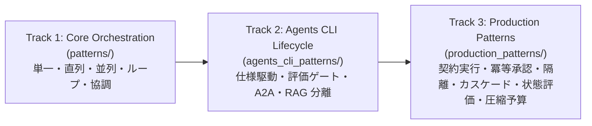

# AI Agent Design Patterns

Google Cloud のアーキテクチャガイドおよび Agent Development Kit (ADK) 2.x に基づく、AI エージェントデザインパターンのハンズオン実装カタログです。

基礎的なオーケストレーションから、`agents-cli` を用いたエージェント開発ライフサイクル、さらにミッションクリティカルな本番システムで求められる信頼性・安全性・評価・コスト制御までを **3 つのトラック（全 23 パターン）** として体系化しています。

---

## 🚀 クイックスタート

### 前提条件

- Python 3.12+
- Google Cloud プロジェクト（Gemini Enterprise Agent Platform / Vertex AI API 有効）
- `gcloud auth application-default login` 済み
- （Track 2 の CLI 操作を行う場合）`uv tool install google-agents-cli`

### セットアップ

```bash
# リポジトリをクローン
git clone <repo-url>
cd agent-design-patterns

# 環境変数を設定（Gemini 3.8 Flash は global エンドポイントを利用）
cp .env.example .env
# .env を編集して GOOGLE_CLOUD_PROJECT を設定

# 仮想環境の作成 & 依存関係インストール
python3 -m venv .venv
source .venv/bin/activate
pip install -e ".[dev]"
```

### 実行方法

```bash
# 1. Lv.1 ユニットテスト（外部 API 通信なし・全 3 トラック 120 テストを約 6 秒で検証）
.venv/bin/pytest tests/unit/ -v

# 2. 各パターンのデモ実行（GOOGLE_CLOUD_PROJECT 設定時）
PYTHONPATH=. .venv/bin/python patterns/p01_single_agent/demo.py
PYTHONPATH=. .venv/bin/python production_patterns/prod01_contract_based_execution/demo.py

# 3. ADK Web UI で対話的にテスト
docker compose up
# → ブラウザで http://localhost:8080 を開く

# 4. Lv.2 実モデル統合テスト（Google Cloud ADC 認証済みの端末で実行）
.venv/bin/pytest tests/integration/ -v
```

---

## 📚 3 トラック構成とデザインパターン一覧



---

### Track 1: Core Orchestration Patterns（[`patterns/`](patterns/)）

エージェントの制御フローと協調構造を段階的に学ぶ基礎〜応用オーケストレーショントラックです。

#### 決定論的ワークフロー（Deterministic Workflows）

| Level | パターン | ディレクトリ | ユースケース | 主要な ADK 2.x 構成要素 |
|-------|---------|------------|------------|-----------|
| Lv.1 | **Single Agent** | [`patterns/p01_single_agent/`](patterns/p01_single_agent/) | GCP ドキュメント Q&A | `LlmAgent` |
| Lv.2 | **ReAct Pattern** | [`patterns/p02_react_pattern/`](patterns/p02_react_pattern/) | 技術調査（思考・行動・観察の可視化） | `LlmAgent` + ツール群 |
| Lv.3 | **Sequential** | [`patterns/p03_sequential/`](patterns/p03_sequential/) | ETL データパイプライン | `Workflow` チェーンタプル |
| Lv.4 | **Parallel** | [`patterns/p04_parallel/`](patterns/p04_parallel/) | マルチソース AI ニュース集約 | `Workflow` ネストタプル + `JoinNode` |

#### 反復ワークフロー（Iterative Workflows）

| Level | パターン | ディレクトリ | ユースケース | 主要な ADK 2.x 構成要素 |
|-------|---------|------------|------------|-----------|
| Lv.5 | **Loop** | [`patterns/p05_loop/`](patterns/p05_loop/) | コード生成 & テストループ | `Workflow` 条件付きサイクル + `@node` ルーター |
| Lv.6 | **Review & Critique** | [`patterns/p06_review_critique/`](patterns/p06_review_critique/) | ブログ記事の生成と批評改善 | `Workflow` 条件付きサイクル + `@node` ルーター |
| Lv.7 | **Iterative Refinement** | [`patterns/p07_iterative_refinement/`](patterns/p07_iterative_refinement/) | 技術ドキュメント自己改善 | `Workflow` 条件付きサイクル + スコア閾値ルーター |

#### 動的オーケストレーション・複合パターン（Dynamic & Composite）

| Level | パターン | ディレクトリ | ユースケース | 主要な ADK 2.x 構成要素 |
|-------|---------|------------|------------|-----------|
| Lv.8 | **Coordinator** | [`patterns/p08_coordinator/`](patterns/p08_coordinator/) | カスタマーサポート振り分け | `LlmAgent` (`sub_agents`) |
| Lv.9 | **Hierarchical** | [`patterns/p09_hierarchical/`](patterns/p09_hierarchical/) | 競合分析（多層タスク分解） | 多層 `LlmAgent` + callable `instruction` |
| Lv.10 | **Swarm** | [`patterns/p10_swarm/`](patterns/p10_swarm/) | 製品設計コンセンサス形成 | `Workflow` 多エージェント合議 + `@node` ルーター |
| Lv.11 | **Human-in-the-Loop** | [`patterns/p11_human_in_the_loop/`](patterns/p11_human_in_the_loop/) | コンテンツコンプライアンス承認 | `Workflow` + `RequestInput` / `ResumabilityConfig` |
| 🏆 | **Capstone** | [`patterns/capstone/`](patterns/capstone/) | 全構文統合 企業分析レポート | `Workflow` 全構文統合（`JoinNode` + `@node` ルーター） |
| 発展 | **Agentic Pipeline** | [`patterns/agentic_pipeline/`](patterns/agentic_pipeline/) | PGE 自律コード生成パイプライン | ADK `BaseAgent` + Antigravity SDK |

---

### Track 2: Agents CLI Lifecycle Patterns（[`agents_cli_patterns/`](agents_cli_patterns/)）

`agents-cli`（`google-agents-cli 1.12+`）を活用し、エージェントの仕様策定・自動評価ゲート・エージェント間通信・デプロイ分離を標準化する開発ライフサイクルトラックです。詳細は [`agents_cli_patterns/README.md`](agents_cli_patterns/README.md) を参照してください。

| ID | デザインパターン | ディレクトリ | 解決する開発課題 | 主要な構成要素 |
|---|---|---|---|---|
| **CLI-01** | **Spec-Driven Agent** | [`agents_cli_patterns/cli01_spec_driven_agent/`](agents_cli_patterns/cli01_spec_driven_agent/) | 暗黙知化したプロンプト実装からの脱却、マニフェストによる構成管理 | `specs/AGENT_SPEC.md`, `agent.yaml`, 構造化エラー返却ツール |
| **CLI-02** | **Evaluation Gate** | [`agents_cli_patterns/cli02_evaluation_gate/`](agents_cli_patterns/cli02_evaluation_gate/) | プロンプト・モデル変更時の品質回帰検知と CI/CD ブロック | `eval_config.json`, インライン `custom_metrics`, `ci_eval_gate.py` |
| **CLI-03** | **A2A Interoperability** | [`agents_cli_patterns/cli03_a2a_interoperability/`](agents_cli_patterns/cli03_a2a_interoperability/) | 異なるチーム・基盤のエージェント間での標準プロトコル連携 | FastAPI + `/.well-known/agent.json` (`AgentCardBuilder`, `A2aAgentExecutor`) |
| **CLI-04** | **Grounded RAG & Runtime Separation** | [`agents_cli_patterns/cli04_grounded_rag_deploy/`](agents_cli_patterns/cli04_grounded_rag_deploy/) | インフラ構築とアプリ更新の責務分離、出典 ID 付きグラウンディング | 検索アダプタ分離、`deployment_targets.yaml`（Agent Engine / Cloud Run / GKE） |

---

### Track 3: Production Design Patterns（[`production_patterns/`](production_patterns/)）

本番環境における契約保証・二重実行防止・テナント隔離・段階的モデル選択・状態評価・コンテキスト予算制御を担う本番運用トラックです。詳細は [`production_patterns/README.md`](production_patterns/README.md) を参照してください。

| ID | デザインパターン | ディレクトリ | 解決する本番運用課題 | 主要な ADK 2.13 構成要素 |
|---|---|---|---|---|
| **PROD-01** | **Contract-Based Execution** | [`production_patterns/prod01_contract_based_execution/`](production_patterns/prod01_contract_based_execution/) | 不正入力での無駄な推論、業務ルール違反の流出、無限ループ | 事前・事後 `@node` 契約、`RetryConfig`、反復上限キャップ |
| **PROD-02** | **Idempotent Tool & Approval Gate** | [`production_patterns/prod02_idempotent_approval_gate/`](production_patterns/prod02_idempotent_approval_gate/) | リトライ・再開時の二重決済、高額操作の無承認実行 | `require_confirmation`、`ResumabilityConfig`、SHA-256 冪等性台帳 |
| **PROD-03** | **Guardrails & Context Isolation** | [`production_patterns/prod03_guardrails_context_isolation/`](production_patterns/prod03_guardrails_context_isolation/) | テナント横断漏洩、ツール出力経由の間接プロンプトインジェクション | `BasePlugin` 4 フック、`auth:tenant_id` 強制、外部送信ホワイトリスト |
| **PROD-04** | **Model Cascade** | [`production_patterns/prod04_model_cascade/`](production_patterns/prod04_model_cascade/) | 全件上位モデル利用の高コスト・高遅延、審査器の採点誤差 | 決定論的 Pre-Gate、Fail-Closed 二値審査、Rogan–Gladen 補正 |
| **PROD-05** | **Outcome State Evaluation** | [`production_patterns/prod05_outcome_state_evaluation/`](production_patterns/prod05_outcome_state_evaluation/) | 口頭のみの完了報告（DB 未更新）、`Pass@k` による信頼性過信 | 最終環境状態検証 ($S_{\text{final}} == S_{\text{gold}}$)、無偏 `pass^k` |
| **PROD-06** | **Context Compaction & Budget Guard** | [`production_patterns/prod06_context_compaction_budget/`](production_patterns/prod06_context_compaction_budget/) | 大容量ツール出力による $O(D^2)$ トークン膨張、推論費の上限超過 | `ArtifactService` 自動退避、`EventsCompactionConfig`、同期予算遮断器 |

---

## 🧭 課題別デザインパターン逆引きガイド

| 解決したい課題 | 推奨デザインパターン |
|---|---|
| まずは最小構成でツール呼び出しエージェントを作りたい | `p01_single_agent` / `p02_react_pattern` |
| 複数ステップを固定順序・並列で確実に流したい | `p03_sequential` / `p04_parallel` |
| 仕様書・評価データ・デプロイ構成を CLI 標準規約で揃えたい | `cli01_spec_driven_agent` / `cli02_evaluation_gate` / `cli04_grounded_rag_deploy` |
| 外部チームのエージェントに A2A プロトコルで公開したい | `cli03_a2a_interoperability` |
| 入出力のスキーマと業務上限を 100% 強制したい | `prod01_contract_based_execution` |
| 書き込みツールの二重実行を防ぎ、高額操作だけ人間承認を挟みたい | `prod02_idempotent_approval_gate` |
| マルチテナント隔離と間接プロンプトインジェクション対策を入れたい | `prod03_guardrails_context_isolation` |
| 定型質問は高速・安価に返し、難問だけ上位モデルへ回したい | `prod04_model_cascade` |
| モデル更新時に「連続して何回でも確実に成功するか」を CI で検証したい | `prod05_outcome_state_evaluation` |
| 長期対話や巨大ログ出力でコンテキストと推論費が膨らむのを止めたい | `prod06_context_compaction_budget` |

---

## 🔑 ADK 2.x の重要知識

ADK 1.x から 2.x への詳細な移行手順は [`docs/v1-to-v2-migration-guide.md`](docs/v1-to-v2-migration-guide.md) を参照してください。

1. **宣言的グラフ API（`Workflow`）**: `SequentialAgent` / `ParallelAgent` / `LoopAgent` の代わりに `Workflow(edges=[...])` で直列チェーン・並列タプル・条件付きサイクルを統一記述します。
2. **並列 Fan-in の `JoinNode` と条件分岐の `@node` ルーター**: 並列タプル `(a, b)` の直後には全ブランチの完了を同期する `JoinNode` を配置します（省略するとブランチ数だけ後続ノードが重複発火します）。また、`LlmAgent` は `route` を返さないため、条件付きサイクルの分岐判定と反復上限（`MAX_ITERATIONS`）は `Event(route=...)` を返す `@node` 関数で行います。
3. **`Workflow` は `BaseNode` サブクラス**: `LlmAgent(sub_agents=[...])` の中には直接入れず、上位の `Workflow` エッジに組み込みます。また `Runner` 実行時は `Runner(node=workflow, ...)`（中断・再開を使う場合は `App(..., resumability_config=ResumabilityConfig(is_resumable=True))` 経由で `Runner(app=app, ...)`）を使用します。
4. **Gemini 3.8 Flash のエンドポイント設定**: Gemini Enterprise Agent Platform 上で `gemini-3.8-flash` を利用する際は `GOOGLE_CLOUD_LOCATION=global` および `GOOGLE_GENAI_USE_ENTERPRISE=True` を設定します。

---

## 📦 技術スタック

| 技術 | バージョン | 用途 |
|------|-----------|------|
| `google-adk` | `2.13.0+` | エージェントフレームワーク（`Workflow` / `App` / `BasePlugin` / `ArtifactService`） |
| `google-genai` | `2.34.0+` | Gemini モデルクライアント SDK |
| `google-agents-cli` | `1.12.0+` | スキャフォールド・評価・デプロイ管理 CLI（`uv tool install` で導入） |
| `google-antigravity` | `0.1.23+` | Agentic Pipeline 向け自律コーディング SDK |
| `gemini-4-argon` | GA (`global`) | Model Cascade 等で用いる最上位推論・エスカレーション先モデル |
| `gemini-3.8-flash` | GA (`global`) | 既定のメイン LLM / 審査モデル |
| `gemini-3.5-flash-lite` | GA (`global`) | Model Cascade 等で用いる低遅延・低単価モデル |
| `pydantic-settings` | `2.13.0+` | 環境変数・型安全設定管理 |
| `pytest` / `ruff` / `mypy` | 最新安定版 | テスト・リント・静的型検査 |

---

## 🔐 認証と環境変数

```bash
# Google Cloud ADC 認証
gcloud auth application-default login

# .env の主要設定
GOOGLE_CLOUD_PROJECT=your-project-id
GOOGLE_CLOUD_LOCATION=global
GOOGLE_GENAI_USE_ENTERPRISE=True
DEFAULT_MODEL=gemini-3.8-flash
FAST_MODEL=gemini-3.5-flash-lite
ESCALATION_MODEL=gemini-4-argon
```

---

## 🤝 コントリビューション

[CONTRIBUTING.md](CONTRIBUTING.md) を参照してください。

## 📚 参考資料

### Google Cloud Architecture Center

- [Agentic AI architecture guides（概要）](https://docs.cloud.google.com/architecture/agentic-ai-overview)
- [Choose architecture components for an agentic AI system](https://docs.cloud.google.com/architecture/choose-agentic-ai-architecture-components)
- [Choose a design pattern for an agentic AI system](https://docs.cloud.google.com/architecture/choose-design-pattern-agentic-ai-system)
- [Build a multiagent AI system](https://docs.cloud.google.com/architecture/multiagent-ai-system)

### Agent Development Kit (ADK) / Gemini Enterprise Agent Platform

- [Agent Development Kit (ADK) 公式ドキュメント](https://adk.dev/)
- [ADK Agents CLI ガイド](https://adk.dev/get-started/agents-cli/)
- [ADK Context Compaction ガイド](https://adk.dev/context/compaction/)
- [Gemini Enterprise Agent Platform ドキュメント](https://docs.cloud.google.com/gemini-enterprise-agent-platform)
- [Gemini 4 Argon モデル仕様](https://docs.cloud.google.com/gemini-enterprise-agent-platform/models/gemini/4-argon)
- [Gemini 3.8 Flash モデル仕様](https://docs.cloud.google.com/gemini-enterprise-agent-platform/models/gemini/3-8-flash)
- [Gemini API コールへの請求ラベル付与](https://docs.cloud.google.com/gemini-enterprise-agent-platform/models/capabilities/add-labels-to-api-calls)
