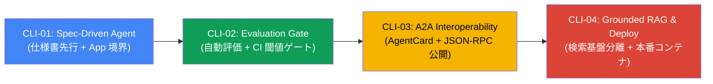

# agents-cli デザインパターン集（`agents_cli_patterns/`）

`patterns/` が `LlmAgent` や `Workflow` の**内部オーケストレーション構造**を扱うのに対し、本ディレクトリは **`google-agents-cli`（v1.12+）を用いてエージェントを独立したソフトウェアパッケージとして設計・評価・公開・デプロイする 4 つのライフサイクル・デザインパターン** を体系化しています。

---

## ライフサイクル全体像とパターン一覧



| ID | パターン名 | ディレクトリ | 解決する設計課題 | 主要な構成要素 |
|---|---|---|---|---|
| **CLI-01** | **Spec-Driven Agent** | [`cli01_spec_driven_agent/`](./cli01_spec_driven_agent/) | 目的や境界を定めずに実装を始め、プロンプトとツールの責務が肥大化する問題 | `.agents-cli-spec.md`, `agents-cli-manifest.yaml`, `App(root_agent=...)`, `AGENTS.md` |
| **CLI-02** | **Evaluation Gate** | [`cli02_evaluation_gate/`](./cli02_evaluation_gate/) | プロンプトやモデルの更新時に発生する回答品質の劣化を見逃す問題 | `tests/eval/eval_config.yaml`, `response_quality.py` (`gemini-3.8-flash`), `scripts/ci_eval_gate.py` |
| **CLI-03** | **A2A Interoperability** | [`cli03_a2a_interoperability/`](./cli03_a2a_interoperability/) | 異なるチーム・言語間のエージェント連携で内部実装が密結合になる問題 | `is_a2a: true`, `AgentCardBuilder`, `A2aAgentExecutor`, `/a2a/app/.well-known/agent-card.json` |
| **CLI-04** | **Grounded RAG & Runtime Separation** | [`cli04_grounded_rag_deploy/`](./cli04_grounded_rag_deploy/) | ローカルテストと本番検索基盤の密結合、および推論エンドポイント（`global`）とセッションリージョンの衝突 | `KnowledgeRetriever` Protocol, `resolve_session_region()`, 非 root `Dockerfile` |

---

## 前提ツールと環境分離

### なぜ `agents-cli` は独立した CLI ツールとして導入するのか

`google-agents-cli`（v1.12.x 時点）は依存関係として `protobuf<7.0.0` を指定する一方、`google-antigravity`（v0.1.23+）は `protobuf>=7.35.0` を指定します。単一の仮想環境に混在させると依存解決が競合するため、`agents-cli` は `uv tool install` でアプリケーション本体の `.venv` から分離して導入します。

```bash
# 1. agents-cli を独立した CLI ツールとしてインストール
uv tool install "google-agents-cli>=1.12.0"

# 2. バージョン確認
agents-cli --version
```

### 基本操作

```bash
# 1. プロジェクト構造・マニフェストの検証（LLM 呼び出しなし）
cd agents_cli_patterns/cli01_spec_driven_agent
agents-cli info --json

# 2. リポジトリルートからデモ実行
cd ../..
PYTHONPATH=. .venv/bin/python agents_cli_patterns/cli01_spec_driven_agent/demo.py

# 3. 全 4 パターンの単体テスト実行（オフライン・決定論的検証）
.venv/bin/pytest tests/unit/test_agents_cli_patterns.py -v
```

---

## `agents-cli` の適用範囲と限界

| 観点 | `agents-cli` が解決できること | 現時点の制約（コード側で補う必要がある点） |
|---|---|---|
| **パッケージ標準化** | `agents-cli-manifest.yaml` と `app/` 構造により、Cloud Run / Agent Runtime / GKE 間で共通のパッケージ規約を統一できる | 初期テンプレートは単一エージェント前提のため、ADK 2.x の複合 `Workflow` グラフは Python コードで明示的に定義する |
| **自動評価実行** | `eval run` / `eval grade` でデータセット実行と LLM 審査・Python 関数採点を一括実行できる | `agents-cli 1.12.0` の `eval grade` はスコアが閾値未満でも終了コード `0` を返すため、CI ブロックには [`ci_eval_gate.py`](./cli02_evaluation_gate/scripts/ci_eval_gate.py) のような判定層が必要 |
| **A2A プロトコル公開** | FastAPI の `lifespan` で ADK Web API と同一の `SessionService` を共有しながら A2A エンドポイントを公開できる | A2A プロトコル自体は通信経路の認証を設定しないため、本番環境では Cloud Run IAM や Agent Gateway による呼び出し元制限を必ず併用する |
