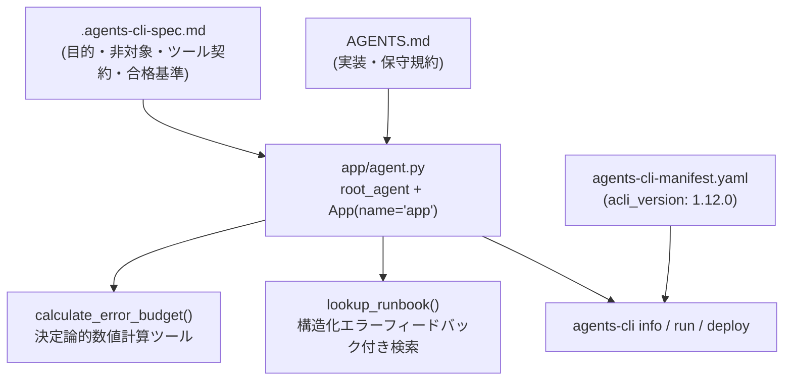

# CLI-01: Spec-Driven Agent パターン

## 概念

**Spec-Driven Agent（仕様駆動エージェント）** は、プロンプトやツール関数を書き始める前に、**エージェントの責務範囲・非対象領域（Out of Scope）・ツール入出力契約・受け入れ基準を機械可読な仕様ファイルとして定義し、ADK `App` コンテナ境界と 1 対 1 で対応させるパターン**です。

従来の API 開発における OpenAPI スキーマ駆動開発と同様に、仕様書（`.agents-cli-spec.md`）・開発規約（`AGENTS.md`）・デプロイマニフェスト（`agents-cli-manifest.yaml`）をパッケージの契約として固定することで、後から場当たり的にプロンプトが継ぎ足されて挙動が不安定化する問題を防ぎます。



## いつ使うか

✅ **適している場合:**
- 複数人チームや AI コーディング支援ツールを併用してエージェントを継続開発・保守する場合
- 「エージェントが実行してよい操作」と「実行してはならない操作（読み取り専用など）」の境界を明確に定義したい場合
- ローカル開発から Cloud Run / Agent Runtime へのデプロイまで一貫したディレクトリ構成を維持したい場合

❌ **不向きな場合・できないこと:**
- アイデア検証の最初期段階で、入出力や対象タスクがまだ一切定まっていない探索的プロトタイピング（先に `patterns/p01_single_agent` で素早く試す方が効率的）
- **仕様書の記述だけではセキュリティ境界を強制できない**: `.agents-cli-spec.md` やプロンプトに「本番環境を変更しない」と書くだけでは悪意ある入力に対する強制力はないため、サービスアカウントからの書き込み IAM 権限の剥奪や [`prod03_guardrails_context_isolation`](../../production_patterns/prod03_guardrails_context_isolation/) のプラグイン制御を別途併用する必要がある

## Single Agent (Lv.1) との違い

| 観点 | Single Agent (`patterns/p01`) | Spec-Driven Agent (`cli01`) |
|---|---|---|
| 主眼 | `LlmAgent` とツール呼び出しの最小動作理解 | 仕様・実装規約・デプロイ境界を含むパッケージ設計 |
| エクスポート単位 | `root_agent` 単体 | `App(name="app", root_agent=...)` コンテナ |
| 仕様と境界の明文化 | コード内の `instruction` のみ | `.agents-cli-spec.md` + `AGENTS.md` + マニフェストの 3 層 |
| `agents-cli` 連携 | 非対応（単体スクリプト） | `agents-cli info / run / eval / deploy` にそのまま対応 |

## このデモのユースケース

**SRE オンコール診断・復旧手順（Runbook）案内エージェント**

SLO（サービスレベル目標）の残余エラーバジェット計算と、障害症状別の一次切り分け手順の検索を提供します。LLM の暗算による計算誤りを防ぐため、四則演算はすべて Python ツール側に委譲し、本番変更コマンドの直接実行は行わない読み取り専用設計としています。

## アーキテクチャと実装のポイント

### 1. `root_agent` 単体ではなく `App` コンテナで公開する理由

ADK 2.x および `agents-cli 1.12+` では、`app/__init__.py` から `google.adk.apps.App` インスタンスを公開します。これにより、エージェント本体のロジックを変更することなく、後からセキュリティプラグイン（`plugins=[...]`）や一時停止・再開設定（`ResumabilityConfig`）をアプリケーション境界に注入できます。

```python
from google.adk.apps import App

app = App(
    name="app",
    root_agent=root_agent,
)
```

### 2. 構造化エラーフィードバックを返すツール契約

`lookup_runbook` ツールでは、LLM が未定義のカテゴリ名を渡した際に Python 例外を送出して実行を異常終了させるのではなく、有効な選択肢一覧（`available_categories`）と再試行の案内（`hint`）を辞書として返します。これにより LLM が次のステップで正しい引数を自律的に選び直せるようになり、例外スタックトレースによるコンテキスト汚染を防げます。

## トレードオフ

| 観点 | 評価 |
|---|---|
| コスト | 🟢 低（単一エージェント構成と同等） |
| レイテンシ | 🟢 低（追加の LLM 呼び出しなし） |
| 複雑性 | 🟡 中（仕様書・マニフェストの管理が加わる） |
| 保守性・拡張性 | 🟢 高（`App` 境界と仕様契約によりチーム開発でも破綻しにくい） |

## 実行方法

```bash
# 1. agents-cli によるプロジェクト構造・マニフェスト検証（LLM 呼び出しなし）
cd agents_cli_patterns/cli01_spec_driven_agent
agents-cli info --json

# 2. デモ実行（リポジトリルートから）
cd ../..
PYTHONPATH=. .venv/bin/python agents_cli_patterns/cli01_spec_driven_agent/demo.py

# 3. ユニットテスト
.venv/bin/pytest tests/unit/test_agents_cli_patterns.py -k "Cli01" -v
```

## 学習ポイント

1. `.agents-cli-spec.md` に目的・非対象スコープ・ツール契約・受け入れ基準を定義してから実装に入る開発手順
2. `google.adk.apps.App` コンテナによるエージェント定義と実行ポリシー境界の分離
3. 例外送出ではなく有効な選択肢を構造化データで返すツールインターフェース設計

## 次のステップ

→ **[CLI-02: Evaluation Gate パターン](../cli02_evaluation_gate/)**: 仕様の受け入れ基準を自動採点データセットと CI リリースゲートに変換する
