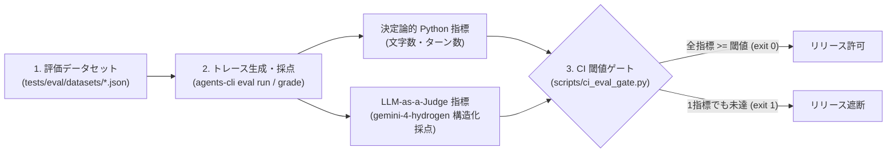

# CLI-02: Evaluation Gate パターン

## 概念

**Evaluation Gate（継続的評価ゲート）** は、ゴールデン評価データセットに対する**決定論的なコード検査と LLM-as-a-Judge 採点を組み合わせて自動実行し、定義した品質閾値を下回った変更を CI/CD パイプラインで機械的にブロックするパターン**です。

エージェント開発では、システムプロンプトを数行修正したりモデルバージョンを更新したりした際に、別のユースケースで回答品質やツール選択精度が劣化する退行（リグレッション）が頻繁に発生します。目視による手動確認に頼らず、変更のたびに定量評価とリリース合否判定を自動実行します。



## いつ使うか

✅ **適している場合:**
- プロンプト改善、ツールの追加、またはベースモデルの移行を継続的に行う本番エージェント
- GitHub Actions や Cloud Build などの CI パイプラインで、品質基準を満たさない変更のマージやデプロイを自動停止したい場合
- 過去の障害・誤回答ケースを再発防止テストとして蓄積したい場合

❌ **不向きな場合・できないこと:**
- **単一試行（1 回実行）の評価だけでは確率的なばらつきを見抜けない**: たまたま 1 回正解しただけの不安定なエージェントを厳密に検出するには、[`prod05_outcome_state_evaluation`](../../production_patterns/prod05_outcome_state_evaluation/) の複数回反復評価 ($\mathrm{pass}^k$) を併用する必要がある
- **LLM 審査器自体の採点誤差はゼロにならない**: LLM-as-a-Judge にも見逃し（偽陽性）や過剰減点（偽陰性）があるため、厳密な合格率推定には定期的な人間監査や [`prod04_model_cascade`](../../production_patterns/prod04_model_cascade/) で扱うバイアス補正が必要

## Review & Critique (Lv.6) との違い

| 観点 | Review & Critique (`patterns/p06`) | Evaluation Gate (`cli02`) |
|---|---|---|
| 実行タイミング | **本番リクエスト処理中（オンライン）** | **デプロイ前の CI/CD 検証時（オフライン）** |
| 目的 | 個々の出力をその場で推敲・修正する | コード・プロンプト変更全体の品質退行を検知してリリースを止める |
| 本番レイテンシへの影響 | 🔴 増加する（生成 + 批評の複数回呼び出し） | 🟢 ゼロ（本番トラフィック外で実行） |
| 判定手段 | Critic エージェントのプロンプト判定 | 決定論的 Python 関数 + 構造化 LLM Judge + 閾値スクリプト |

## このデモのユースケース

**クラウド利用料の急増原因切り分け（FinOps トリアージ）エージェントの品質ゲート**

BigQuery や LLM 推論などのコスト急増要因を特定し、削減見込み額を試算するエージェントに対し、期待される原因説明と試算金額（`reference`）との整合性を自動採点してリリース可否を判定します。

## アーキテクチャと実装のポイント

### 1. 決定論的メトリクスと LLM Judge のハイブリッド構成（`tests/eval/eval_config.yaml`）

すべての観点を LLM で採点すると評価コストと実行時間が増大するため、機械的に判定できる項目は Python 関数で即座に採点し、意味的な整合性のみを LLM Judge に委譲します。

| メトリクス名 | 実装方式 | 検証内容 |
|---|---|---|
| `non_empty_structured_answer` | インライン Python 関数（無料・ミリ秒） | 空応答や極端に短い不完全応答でないか |
| `agent_turn_count` | インライン Python 関数（無料・ミリ秒） | 実行トレース（`agent_data.turns`）が正常に記録されているか |
| `custom_response_quality` | `response_quality.py`（`gemini-4-hydrogen`） | 期待される原因・試算値と矛盾がないかを Pydantic スキーマで 1〜5 点採点 |

### 2. 審査モデル名の外部設定化（`tests/eval/response_quality.py`）

評価コード内に古いモデル名を固定記述すると、モデルの提供終了時に CI パイプライン全体が停止します。環境変数 `EVAL_JUDGE_MODEL`（既定値 `gemini-4-hydrogen`）で外部から注入可能にし、`thinking_level="LOW"` と構造化出力（`response_schema`）で採点の再現性を高めています。

### 3. CLI 終了コード仕様を補完する閾値判定スクリプト（`scripts/ci_eval_gate.py`）

`google-agents-cli` v1.12.0 の `agents-cli eval grade` は、採点処理自体が例外なく完了するとスコアが低くても終了コード `0` を返します。CI パイプラインで確実にジョブを失敗させるため、`artifacts/grade_results/results_*.json` の平均スコアを閾値と照合して `exit 1` を返す専用ゲートスクリプトを組み合わせています。

## トレードオフ

| 観点 | 評価 |
|---|---|
| 本番コスト・レイテンシ | 🟢 影響なし（CI 実行時のみ評価コストが発生） |
| CI 実行時間 | 🟡 中（データセット件数 × Judge 呼び出し時間） |
| 複雑性 | 🟡 中（データセットと閾値の継続メンテナンスが必要） |
| リリース安全性 | 🟢 高（プロンプト変更による品質退行をデプロイ前に遮断可能） |

## 実行方法

```bash
# 1. ローカル ADK API サーバーに対する評価実行例
# ターミナル A（リポジトリルート）:
PYTHONPATH=agents_cli_patterns/cli02_evaluation_gate:. \
  .venv/bin/adk api_server agents_cli_patterns/cli02_evaluation_gate --port 8012

# ターミナル B:
cd agents_cli_patterns/cli02_evaluation_gate
agents-cli eval run \
  --url http://127.0.0.1:8012 \
  --dataset tests/eval/datasets/basic-dataset.json \
  --config tests/eval/eval_config.yaml
python scripts/ci_eval_gate.py

# 2. 単体テスト（オフラインで採点関数と CI ゲートの合否判定を検証）
cd ../..
.venv/bin/pytest tests/unit/test_agents_cli_patterns.py -k "Cli02" -v
```

## 学習ポイント

1. 決定論的な Python 採点関数と構造化 LLM-as-a-Judge を組み合わせるハイブリッド評価設計
2. `agents-cli eval` の出力アーティファクトを CI の終了コード（`0` / `1`）へ接続するゲート実装
3. 審査用モデルのハードコードを避け、構造化スキーマで採点結果のパース失敗を防ぐ方法

## 次のステップ

→ **[CLI-03: A2A Interoperability パターン](../cli03_a2a_interoperability/)**: 品質検証を通過した専門エージェントを標準プロトコルで他チーム・他フレームワークへ公開する
