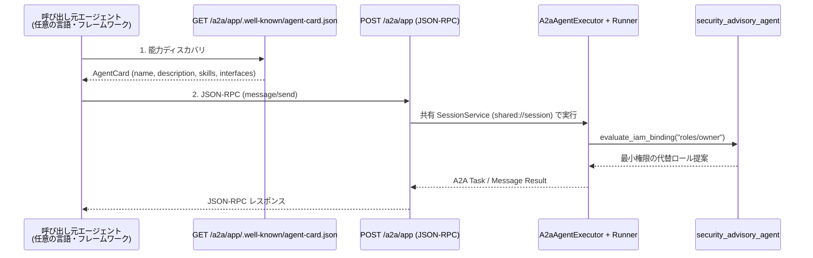

# CLI-03: A2A Interoperability パターン

## 概念

**A2A Interoperability（A2A プロトコル相互運用）** は、エージェントの内部実装（Python クラスやフレームワーク固有のオブジェクト）を直接公開するのではなく、オープン標準である **A2A（Agent2Agent）プロトコルの能力記述カード（AgentCard）と JSON-RPC エンドポイントを介して、ネットワーク越しに疎結合なエージェント間連携を実現するパターン**です。

組織内で複数チームが独立してエージェントを開発する場合、実装言語（Python / Go / TypeScript）やデプロイサイクルが異なります。A2A 境界を設けることで、呼び出し側は相手の内部コードを知ることなく、公開 URL から能力を動的に発見してタスクを委譲できます。



## いつ使うか

✅ **適している場合:**
- 異なるリポジトリ・異なる開発チーム・異なるプログラミング言語で構築されたエージェント同士を連携させる場合
- 専門領域のエージェント（セキュリティ審査、在庫照会、法務確認など）を独立したマイクロサービスとして運用・スケールさせたい場合

❌ **不向きな場合・できないこと:**
- **単一チーム・同一プロセス内で完結する小規模な協調には過剰**: すべてのサブエージェントを HTTP / JSON-RPC 越しに分割すると、ネットワーク遅延・シリアライズ負荷・障害点が増える（同一プロセス内であれば `patterns/p08_coordinator` の `sub_agents` や `Workflow` を使う方が高速でシンプル）
- **A2A エンドポイント単体では認証・認可は自動適用されない**: 本番環境で公開する際は、必ず Cloud Run IAM（`--no-allow-unauthenticated` + `roles/run.invoker`）や Agent Gateway による呼び出し元認証をインフラ層で強制する必要がある

## Coordinator (Lv.8) との違い

| 観点 | Coordinator (`patterns/p08`) | A2A Interoperability (`cli03`) |
|---|---|---|
| 結合方式 | 同一 Python プロセス内の `sub_agents` オブジェクト参照 | HTTP 上の標準 `AgentCard` + JSON-RPC 通信 |
| 言語・フレームワーク依存 | 同一 ADK バージョン・同一言語に限定 | 言語・フレームワーク非依存（異種環境間で連携可能） |
| デプロイ単位 | 全エージェントを一体でデプロイ | エージェントごとに独立してデプロイ・スケール可能 |
| 通信オーバーヘッド | 🟢 極小（メモリ内関数呼び出し） | 🟡 あり（ネットワーク往復 + シリアライズ + 認証） |

## このデモのユースケース

**IAM 最小権限診断・セキュリティ勧告照会 A2A サービス**

他システムの開発エージェントから「このサービスアカウントに `roles/owner` を付与してよいか？」といった審査依頼を A2A プロトコル経由で受け付け、リスク判定と最小権限の代替ロールを返却します。

## アーキテクチャと実装のポイント

### 1. `AgentCardBuilder` によるコードからの自動カード生成（`app/app_utils/a2a.py`）

静的な JSON ファイルを手書きで保守すると、ツールや説明文を更新した際に実装と AgentCard が乖離します。`AgentCardBuilder(agent=root_agent, ...).build()` を FastAPI の起動ライフサイクル（`lifespan`）で実行することで、常に最新のエージェント定義からカードを生成します。

### 2. `shared://` レジストリによるセッション基盤の共有（`app/app_utils/services.py`）

FastAPI 上で ADK 標準ルート（`/run_sse`）と A2A ルート（`/a2a/app`）を同居させる際、別々の `InMemorySessionService()` を生成すると状態が分断されます。ADK のサービスレジストリに `shared://session` を登録し、両経路で単一のセッションストアを共有しています。

### 3. A2A v1 と v0.3 の互換インターフェース公開

`enable_v0_3_compat=True` により、A2A v1 準拠クライアントと v0.3 形式を参照する既存クライアントの双方から同一サーバーへ接続できます。

## トレードオフ

| 観点 | 評価 |
|---|---|
| コスト | 🟢 低（プロトコル変換自体は CPU 処理のみ） |
| レイテンシ | 🟡 中（HTTP / JSON-RPC 通信の往復時間が加わる） |
| 複雑性 | 🟡 中（FastAPI ライフサイクル・認証設計が必要） |
| 組織スケーラビリティ | 🟢 高（チーム間の独立デプロイと契約ベース連携を実現） |

## 実行方法

```bash
# 1. agents-cli マニフェスト検証（is_a2a: true の認識確認）
cd agents_cli_patterns/cli03_a2a_interoperability
agents-cli info --json

# 2. ASGI インプロセス A2A ディスカバリ + JSON-RPC デモ（リポジトリルートから）
cd ../..
PYTHONPATH=. .venv/bin/python agents_cli_patterns/cli03_a2a_interoperability/demo.py

# 3. ユニットテスト（オフライン AgentCard スキーマ・ルート検証）
.venv/bin/pytest tests/unit/test_agents_cli_patterns.py -k "Cli03" -v
```

## 学習ポイント

1. `AgentCardBuilder` と `A2aAgentExecutor` を用いた ADK `App` の A2A サービス化手順
2. `get_service_registry()` の `shared://` スキームによる複数サービング経路間のサービス共有
3. インプロセス統合（`sub_agents` / `Workflow`）とネットワーク境界分離（A2A）の使い分け基準

## 次のステップ

→ **[CLI-04: Grounded RAG & Runtime Separation パターン](../cli04_grounded_rag_deploy/)**: 外部検索基盤のインターフェース分離と Cloud Run / Agent Runtime 本番コンテナ設計を学ぶ
