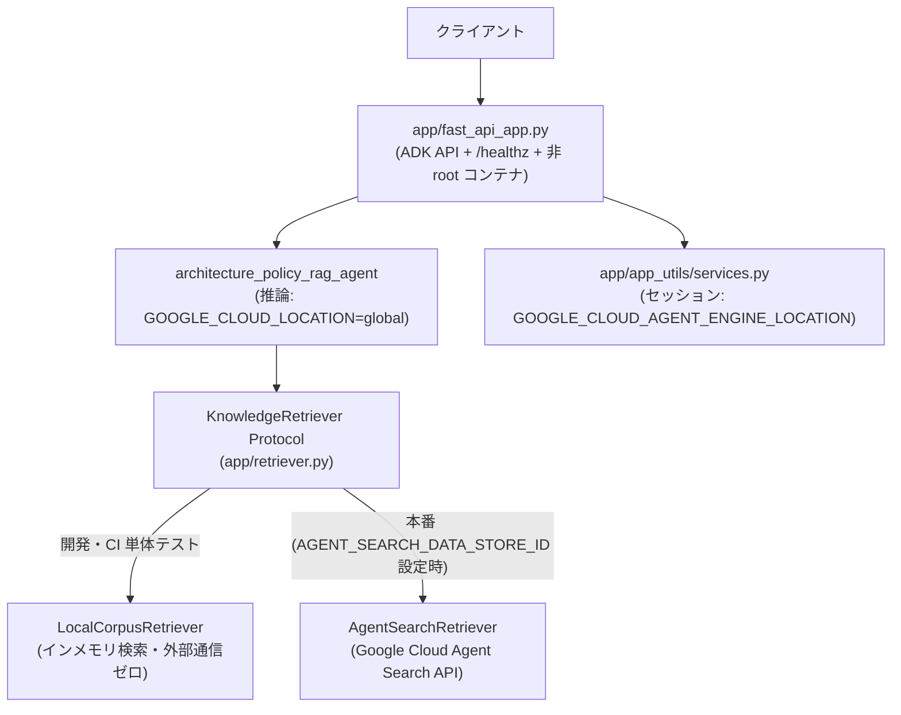

# CLI-04: Grounded RAG & Runtime Separation パターン

## 概念

**Grounded RAG & Runtime Separation（検索基盤分離型グラウンディングとランタイム分離）** は、知識検索バックエンドを抽象インターフェース（`Protocol`）の背後に分離してオフライン検証と本番クラウド検索を無変更で切り替え可能にしつつ、**モデル推論のロケーション（`global`）とステートフルなランタイム・セッションのリージョン（`us-central1` 等）を明示的に分離して本番デプロイするパターン**です。



## いつ使うか

✅ **適している場合:**
- 社内規定・設計標準・製品マニュアルなど、必ず出典 ID を伴う根拠ベースの回答（Grounding）が求められ、記載のない事項には「該当規定なし」と回答させる必要がある場合
- データストア未構築の開発初期やオフライン CI 環境でも、本番と同じエージェントコードを高速に単体テストしたい場合
- `gemini-3.8-flash`（`global` エンドポイント）と Agent Runtime / マネージドセッション（リージョン指定必須）を併用してデプロイする場合

❌ **不向きな場合・できないこと:**
- **単一クエリ検索だけでは複数文書を跨ぐ複雑な条件統合を取りこぼす場合がある**: 「規定 A の原則と別紙 B の例外条件を突き合わせる」ような多段検索が必要な場合は、クエリ分解ステップ（`patterns/p04_parallel` や `Workflow`）を前段に組み合わせる必要がある
- **検索インターフェース単体では文書ごとの閲覧権限（ACL）は自動継承されない**: ユーザーごとに閲覧可能な文書が異なる場合は、サービスアカウント共通権限で全件検索するのではなく、認証済みユーザー識別子に基づくフィルタリングまたは [`prod03_guardrails_context_isolation`](../../production_patterns/prod03_guardrails_context_isolation/) のセッション束縛アクセス制御が必須となる

## Single Agent + Web Search (`patterns/p01`) との違い

| 観点 | Single Agent + 検索直接呼出 (`patterns/p01`) | Grounded RAG & Runtime Separation (`cli04`) |
|---|---|---|
| 検索層の結合度 | 特定検索ツールに直接依存（オフライン単体テスト困難） | `KnowledgeRetriever` Protocol で抽象化（テスト用実装を注入可能） |
| 根拠不在時の挙動 | モデルの一般知識で補完しやすい | `match_count == 0` 時の推測回答を禁止し、出典 ID 明記を強制 |
| ロケーション設計 | 単一 `GOOGLE_CLOUD_LOCATION` 前提 | 推論用 `global` とランタイム用具体リージョンを分離解決 |
| コンテナ運用性 | 開発実行向け | `/healthz` プローブ・非 root 実行 `Dockerfile` 同梱 |

## このデモのユースケース

**社内アーキテクチャ設計標準・セキュリティ基準の根拠付き Q&A サービス**

RPO/RTO 基準やコンテナ運用規約に関する質問には該当文書 ID（`[DOC-ARCH-001]` 等）を添えて回答し、コーパスに存在しない質問（社員食堂の営業時間など）には推測せず「規定に記載がありません」と回答します。

## アーキテクチャと実装のポイント

### 1. `typing.Protocol` による検索バックエンドの依存性逆転（`app/retriever.py`）

エージェントのツール関数（`search_architecture_policies`）は `KnowledgeRetriever` インターフェースのみを参照します。環境変数 `AGENT_SEARCH_DATA_STORE_ID` の有無によって本番用 `AgentSearchRetriever` とローカル用 `LocalCorpusRetriever` を切り替え、単体テスト時は `set_retriever_for_testing()` で任意のモックを注入できます。

### 2. 推論エンドポイント（`global`）とセッションリージョンの分離（`app/app_utils/services.py`）

`gemini-3.8-flash` は `GOOGLE_CLOUD_LOCATION=global` で利用しますが、Agent Runtime や `VertexAiSessionService` は `us-central1` や `asia-northeast1` などの具体リージョンを要求します。同一の環境変数を流用すると `global-aiplatform.googleapis.com` という無効なホスト名で起動時エラーになるため、`resolve_session_region()` でセッション用リージョンを独立して解決しています。

### 3. `agents-cli deploy --dry-run` によるデプロイ構成の事前検証

クラウドリソースへ直接変更を加える前に、`agents-cli deploy --dry-run` でマニフェスト・コンテナ定義・ターゲット設定の整合性をローカルで事前検査できます。

## トレードオフ

| 観点 | 評価 |
|---|---|
| コスト | 🟢 低〜中（検索 API 呼び出し + 単一モデル推論） |
| レイテンシ | 🟢 低〜中（1 回の検索 + 1 回の生成） |
| 複雑性 | 🟡 中（Protocol 抽象化とリージョン環境変数の分離管理） |
| テスタビリティ・移植性 | 🟢 高（クラウド接続なしで検索・API ヘルスチェックまで完全検証可能） |

## 実行方法

```bash
# 1. agents-cli マニフェスト認識確認
cd agents_cli_patterns/cli04_grounded_rag_deploy
agents-cli info --json

# 2. デモ実行（規定ありクエリと規定外クエリの対比）
cd ../..
PYTHONPATH=. .venv/bin/python agents_cli_patterns/cli04_grounded_rag_deploy/demo.py

# 3. ユニットテスト（Retriever 注入・リージョン分離・/healthz 検証）
.venv/bin/pytest tests/unit/test_agents_cli_patterns.py -k "Cli04" -v
```

## 学習ポイント

1. `Protocol` を用いた外部データストア依存の分離とオフラインテスト設計
2. 検索ヒット 0 件時の推測抑止と出典 ID 引用ルールによるハルシネーション低減
3. `global` 推論エンドポイントとリージョナルなセッション・ランタイム基盤の共存設計

## 次のステップ

→ **[Production Design Patterns (`production_patterns/`)](../../production_patterns/)**: 本番環境での事前・事後条件検証、冪等性と人間承認、入出力ガードレール、モデルカスケード、状態評価、コンテキスト・コスト制御の 6 パターンへ進む
