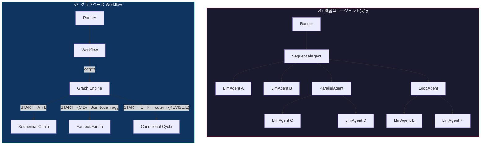
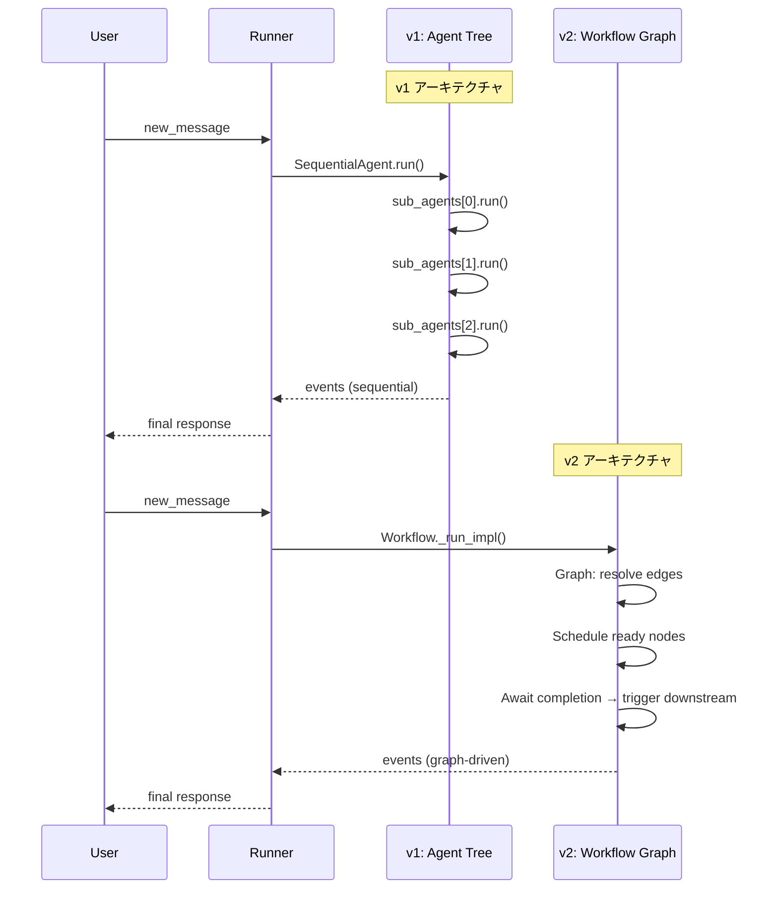
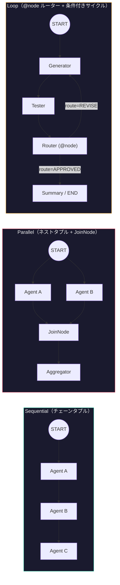
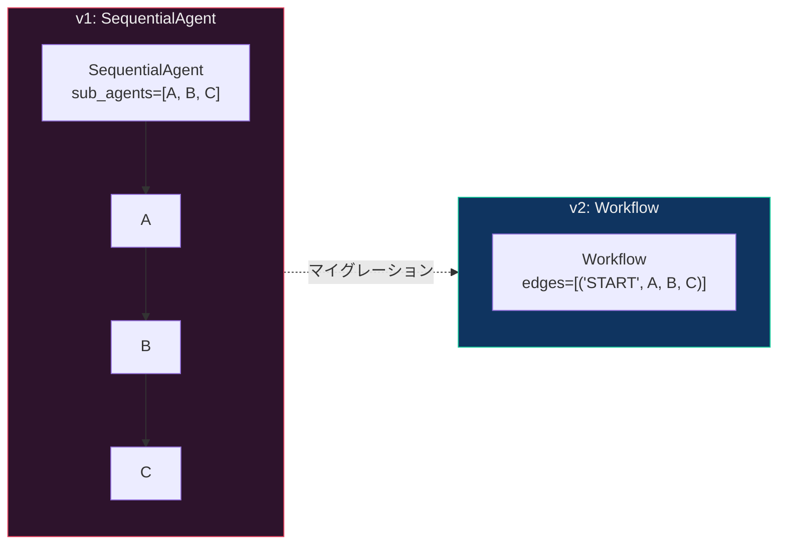
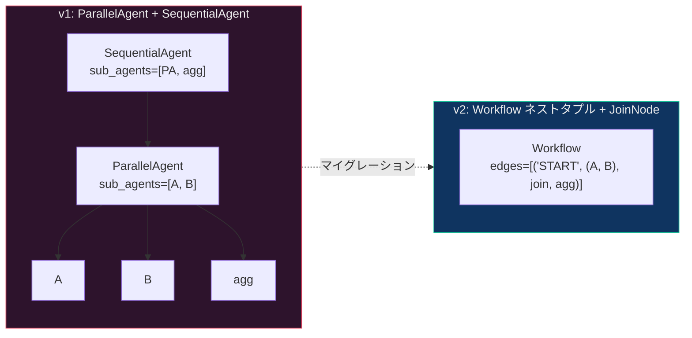
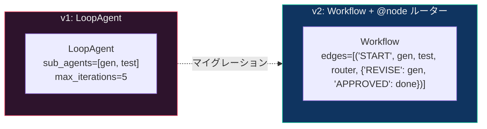
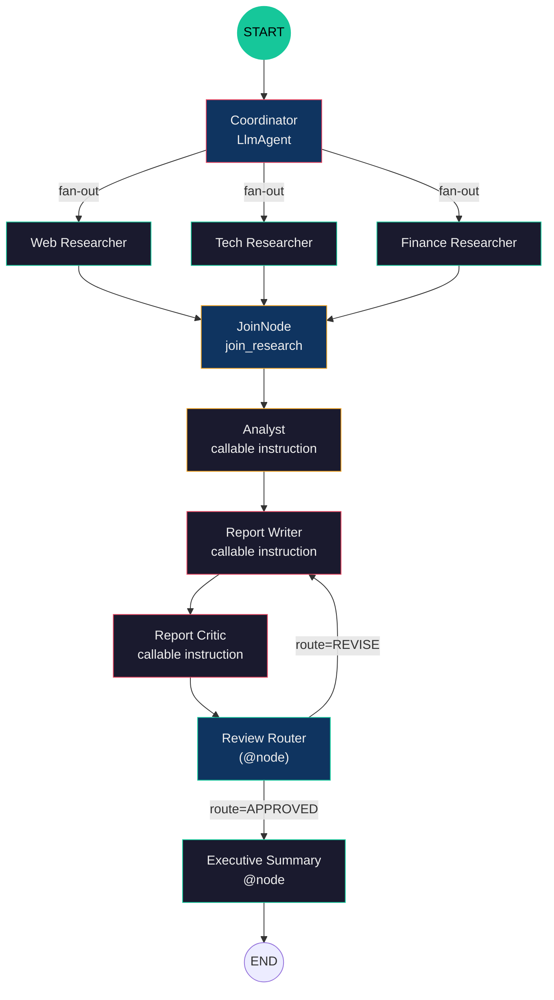
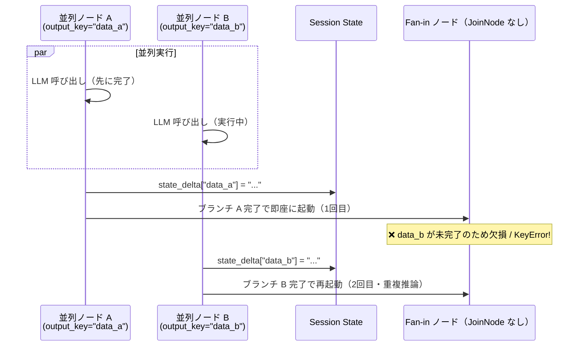

# Google ADK v1 → v2 マイグレーションガイド

> **対象バージョン**: google-adk `>=1.19.0` → `>=2.13.0` (`google-genai>=2.30.0`, `gemini-3.8-flash`)
> **調査日**: 2026-05-25（2026-11 ADK 2.13.0 / Gemini 3.8 Flash 追補）
> **ステータス**: ✅ 移行完了・統合テスト全パス

---

## 目次

1. [エグゼクティブサマリー](#1-エグゼクティブサマリー)
2. [アーキテクチャ変更の全体像](#2-アーキテクチャ変更の全体像)
3. [API 互換性マトリックス](#3-api-互換性マトリックス)
4. [Workflow API リファレンス](#4-workflow-api-リファレンス)
5. [パターン別マイグレーション](#5-パターン別マイグレーション)
6. [依存バージョン制約](#6-依存バージョン制約)
7. [Breaking Changes & 注意事項](#7-breaking-changes--注意事項)
8. [セキュリティ（CVE-2026-4810）](#8-セキュリティcve-2026-4810)
9. [プロジェクト影響度サマリー](#9-プロジェクト影響度サマリー)
10. [テスト結果](#10-テスト結果)

---

## 1. エグゼクティブサマリー

ADK v2 の最大の変更は **グラフベース Workflow Runtime** の導入。
従来の `SequentialAgent` / `ParallelAgent` / `LoopAgent` による階層型エージェント実行が、
`Workflow` クラスの **edges（エッジ定義）** による宣言的なグラフ構造に置き換わった。

| 観点 | v1 | v2 |
|------|----|----|
| 実行モデル | 階層型エージェントツリー | **グラフベース Workflow** |
| Sequential | `SequentialAgent(sub_agents=[...])` | `Workflow(edges=[("START", a, b, c)])` |
| Parallel | `ParallelAgent(sub_agents=[...])` | `Workflow(edges=[("START", (a, b), join, agg)])` |
| Loop | `LoopAgent(sub_agents=[...])` | `Workflow(edges=[("START", a, b, router, {"REVISE": a, "APPROVED": done})])` |
| 移行難易度 | — | **中**（LlmAgent/Runner/Session が互換） |

---

## 2. アーキテクチャ変更の全体像

### v1 → v2 アーキテクチャ比較



### データフロー比較



---

## 3. API 互換性マトリックス

### 3-1. 後方互換（v2 でそのまま使える）✅

| カテゴリ | API | import パス | 備考 |
|---------|-----|-----------|------|
| **エージェント** | `LlmAgent` | `from google.adk.agents import LlmAgent` | クラス名・引数とも変更なし |
| | `model` | `LlmAgent(model="...")` | 省略時のライブラリ内部既定は旧世代モデルのため、必ず `gemini-3.8-flash` または `gemini-4-argon` を明示指定 |
| | `instruction` | `LlmAgent(instruction="...")` | `{variable_name}` プレースホルダーも健在 |
| | `output_key` | `LlmAgent(output_key="...")` | state スコープ (`user:`, `app:`, `temp:`) も同じ |
| | `sub_agents` | `LlmAgent(sub_agents=[...])` | LLM ルーティングで動的委譲 |
| | `description` | `LlmAgent(description="...")` | 変更なし |
| | `tools` | `LlmAgent(tools=[...])` | 関数ツールの自動 FunctionTool ラップも健在 |
| **実行** | `Runner` | `from google.adk.runners import Runner` | コンストラクタ拡張 (`app`, `node` 追加) |
| | `run_async()` | `runner.run_async(user_id, session_id, new_message)` | primary な非同期実行メソッド |
| | `InMemorySessionService` | `from google.adk.sessions import InMemorySessionService` | ローカル/テスト用 |
| **イベント** | `is_final_response()` | `event.is_final_response()` | 変更なし |
| | `content.parts` | `event.content.parts` | 変更なし |
| **ツール** | `google_search` | `from google.adk.tools import google_search` | 変更なし |
| | `code_execution` | `from google.adk.tools import code_execution` | 変更なし |
| | `ToolContext` | `from google.adk.tools import ToolContext` | 変更なし |
| **型** | `Content/Part` | `from google.genai import types` | google-genai パッケージ |
| **CLI** | `adk web` / `adk run` | — | 変更なし |

### 3-2. Deprecated（動作するが DeprecationWarning）⚠️

| API | import パス | v2 の代替 | 備考 |
|-----|-----------|---------|------|
| `SequentialAgent` | `from google.adk.agents import SequentialAgent` | `Workflow` チェーンタプル | `@deprecated` デコレータ付き |
| `ParallelAgent` | `from google.adk.agents import ParallelAgent` | `Workflow` ネストタプル | `@deprecated` デコレータ付き |
| `LoopAgent` | `from google.adk.agents import LoopAgent` | `Workflow` 条件付きサイクル | `@deprecated` デコレータ付き |
| `global_instruction` | `LlmAgent(global_instruction="...")` | `GlobalInstructionPlugin` | 将来バージョンで削除予定 |

### 3-3. 新規追加（v2 only）🆕

| API | import パス | 説明 |
|-----|-----------|------|
| `Agent` | `from google.adk import Agent` | `LlmAgent` のトップレベルエイリアス |
| `Workflow` | `from google.adk.workflow import Workflow` | **グラフベースワークフロー** |
| `Node` / `@node` | `from google.adk.workflow import Node, node` | 関数ノードデコレータ |
| `Edge` | `from google.adk.workflow import Edge` | 明示的なエッジ定義 |
| `JoinNode` | `from google.adk.workflow import JoinNode` | 並列分岐のバリア同期（Fan-in 必須） |
| `exit_loop` | `from google.adk.tools import exit_loop` | ループ終了用ツール |
| `App` / `ResumabilityConfig` | `from google.adk.apps import App, ResumabilityConfig` | アプリケーションコンテナ・中断再開設定 |
| `RequestInput` | `from google.adk.events.request_input import RequestInput` | Workflow ノードからの人間入力要求イベント |
| Task API | — | Chat / Task / Single-Turn モード |
| `static_instruction` | `LlmAgent(static_instruction="...")` | コンテキストキャッシュ最適化 |
| 自動リトライ | `from google.adk.workflow import RetryConfig` | ツール・ノード例外の自動リトライ |
| HITL ネイティブ | `RequestInput` / `require_confirmation` | Human-in-the-Loop 一時停止・再開 |

---

## 4. Workflow API リファレンス

### 4-1. edges 構文



### 4-2. 構文例

| パターン | edges 構文 | 生成されるエッジ |
|---------|-----------|---------------|
| **Sequential** | `("START", a, b, c)` | `START→A`, `A→B`, `B→C` |
| **Parallel** | `("START", (a, b), join, agg)` | `START→A`, `START→B`, `A→join`, `B→join`, `join→agg` |
| **Conditional** | `("START", router, {"X": hx, "Y": hy})` | `START→router`, `router→hx(route=X)`, `router→hy(route=Y)` |
| **Loop** | `("START", a, b, router, {"REVISE": a, "APPROVED": done})` | `START→A`, `A→B`, `B→router`, `router→A(route=REVISE)`, `router→done(route=APPROVED)` |

> ⚠️ **重要な制約**:
> 1. Workflow は **無条件サイクル（unconditional cycle）を禁止**。`(b, a)` のような無条件ループバックは `Graph validation failed` エラーになるため、必ず **dict による条件付きエッジ** でサイクルを定義すること。
> 2. `LlmAgent` 単体は `event.actions.route` を設定しないため、dict 分岐の直前には必ず `Event(output=..., route="...")` を返す **`@node` ルーター関数** を配置すること。
> 3. 並列タプル `(a, b)` の直後に `JoinNode` を置かずに直接 `agg` を繋ぐと、各ブランチ完了のたびに `agg` が複数回実行されるため、Fan-in には必ず **`JoinNode`** を挟むこと。

---

## 5. パターン別マイグレーション

### 5-1. Sequential → Workflow



**v1:**
```python
from google.adk.agents import LlmAgent, SequentialAgent

root_agent = SequentialAgent(
    name="etl_pipeline",
    sub_agents=[extract, transform, load],
)
```

**v2:**
```python
from google.adk.agents import LlmAgent
from google.adk.workflow import Workflow

root_agent = Workflow(
    name="etl_pipeline",
    edges=[("START", extract, transform, load)],
)
```

### 5-2. Parallel → Workflow (fan-out/fan-in)



**v1:**
```python
from google.adk.agents import LlmAgent, ParallelAgent, SequentialAgent

parallel = ParallelAgent(name="gather", sub_agents=[source_a, source_b])
root_agent = SequentialAgent(name="pipeline", sub_agents=[parallel, aggregator])
```

**v2:**
```python
from google.adk.agents import LlmAgent
from google.adk.workflow import JoinNode, Workflow

join_gather = JoinNode(name="join_gather")

root_agent = Workflow(
    name="pipeline",
    edges=[("START", (source_a, source_b), join_gather, aggregator)],
)
```

> ⚠️ **`JoinNode` と `ReadonlyContext.state.get()` の併用**:
> 1. `(source_a, source_b)` の直後に `JoinNode` を挟まないと、各並列ブランチが完了するたびに `aggregator` が個別起動（2 ブランチなら 2 回実行、かつ未完了ブランチの `output_key` が未設定）してしまう。
> 2. `aggregator` の instruction は文字列テンプレート `{変数名}` ではなく **callable**（`ReadonlyContext.state.get()`）にして欠損耐性を持たせること。[詳細は §7-6 参照](#7-6-並列-fan-in-における-joinnode-必須化と-state-参照)

### 5-3. Loop → Workflow (条件付きサイクル + `@node` ルーター)



**v1:**
```python
from google.adk.agents import LlmAgent, LoopAgent

root_agent = LoopAgent(
    name="code_loop",
    sub_agents=[generator, tester],
    max_iterations=5,
)
```

**v2:**
```python
from google.adk.agents import LlmAgent
from google.adk.agents.context import Context
from google.adk.events.event import Event
from google.adk.workflow import Workflow, node

MAX_ITERATIONS = 5


@node(name="loop_router")
def loop_router(ctx: Context) -> Event:
    iteration = int(ctx.state.get("loop_iteration", 0)) + 1
    feedback = str(ctx.state.get("test_feedback", ""))
    needs_revision = "[NEEDS_REVISION]" in feedback.upper() and "[APPROVED]" not in feedback.upper()
    route = "REVISE" if (needs_revision and iteration < MAX_ITERATIONS) else "APPROVED"
    return Event(output=feedback, route=route, state={"loop_iteration": iteration})


root_agent = Workflow(
    name="code_loop",
    edges=[
        (
            "START",
            generator,
            tester,
            loop_router,
            {"REVISE": generator, "APPROVED": final_summary},
        )
    ],
)
```

### 5-4. Coordinator / Hierarchical（変更なし）

LlmAgent の `sub_agents` によるルーティングは v2 でもそのまま動作。

```python
# v1 でも v2 でも同じ
root_agent = LlmAgent(
    name="coordinator",
    sub_agents=[order_handler, refund_handler, general_handler],
    instruction="ユーザーの意図に応じて適切なエージェントに委譲...",
)
```

### 5-5. Capstone（全パターン統合）



---

## 6. 依存バージョン制約

### v2（ADK 2.13+ / Gemini 3.8 Flash）が要求する主要依存

| パッケージ | v1 での要件 | v2 現行構成 | 変更 |
|-----------|-----------|-----------|------|
| `google-adk` | `>=1.19.0` | `>=2.13.0` | 🔴 メジャー更新 |
| `google-genai` | `>=1.52.0` | `>=2.30.0` | 🔴 メジャー更新 |
| `google-antigravity` | — | `>=0.1.23` | 🆕 新規依存 (Agentic Pipeline) |
| `a2a-sdk` | — | `>=1.2.0` | 🆕 新規依存 (A2A 連携) |
| `fastapi` | — | `>=0.124.1` | 🆕 新規依存 |
| `pydantic-settings` | `>=2.4.0` | `>=2.4.0` (`pydantic>=2.12,<3`) | 🟡 マイナー更新 |
| `httpx` | — | `>=0.27.0` | 🟢 互換 |
| `uvicorn` | — | `>=0.34.0` | 🆕 新規依存 (`adk web` / A2A) |
| `opentelemetry-api` / `sdk` | — | `>=1.36` | 🆕 新規依存 (GenAI v2 テレメトリ) |

### pyproject.toml の変更

```diff
# pyproject.toml
dependencies = [
-    "google-adk>=1.19.0",
-    "google-genai>=1.52.0",
+    "google-adk>=2.13.0",
+    "google-genai>=2.30.0",
]
```

---

## 7. Breaking Changes & 注意事項

### 7-1. Event スキーマ変更

Event に `node_info`, `output` フィールドが追加。カスタム DB スキーマを使用している場合は更新が必要。
`InMemorySessionService` 使用なら影響なし。

### 7-2. セッション互換性

v2 セッションは v1 (`<1.28`) の ADK では読めない。v2 統一なら問題なし。

### 7-3. session.events への手動追加は非推奨

`context.session.events` への手動追加はグラフエンジンの決定論性を壊す。

### 7-4. ツールの例外ハンドリング

v2 は自動リトライ機能が組み込まれているが、ツール内で広い `except Exception:` を使うと自動リトライが阻害される。例外キャッチは限定的にすること。

### 7-5. Workflow は BaseNode（BaseAgent ではない）

`Workflow` は `BaseAgent` のサブクラスではなく `BaseNode` のサブクラス。
そのため、`LlmAgent(sub_agents=[Workflow(...)])` は **ValidationError** になる。

```python
# ❌ これはエラー
root_agent = LlmAgent(sub_agents=[Workflow(...)])

# ✅ Coordinator を Workflow の edges 内に組み込む
root_agent = Workflow(edges=[
    ("START", coordinator_llm_agent, ...),
])
```

### 7-6. 並列 Fan-in における `JoinNode` 必須化と `state` 参照

**最も重要な発見**。v2 Workflow のネストタプル（並列実行）で後続の集約ノードを直結（`("START", (a, b), agg)`）すると、**各並列ブランチが完了するたびに `agg` が個別起動**してしまう（2 ブランチなら 2 回、4 ブランチなら 4 回実行）。その結果、未完了ブランチの `output_key` が未設定のまま `agg` が走り、`{変数名}` テンプレートで `KeyError` が発生する。

#### 根本原因（`JoinNode` 未挿入時）



#### 影響するパターン

| パターン | 問題の有無 | 理由 |
|---------|-----------|------|
| Sequential（チェーンタプル） | ✅ 問題なし | 直列実行で 1 回ずつ順番に遷移 |
| **Parallel（ネストタプル）** | ❌ **`JoinNode` なしでは重複起動・欠損** | バリア同期がないとブランチ数だけ後続ノードが発火 |
| Loop（条件付きサイクル） | ⚠️ **`@node` ルーター必須** | [詳細は §7-9 参照](#7-9-条件付きサイクルには-node-ルーターと反復上限が必須) |

#### 解決策: `JoinNode` によるバリア同期 + callable `instruction`

1. **バリア同期**: ネストタプルと集約ノードの間に必ず `JoinNode` を挟み、全ブランチ完了後に 1 回だけ集約ノードを起動する。
2. **欠損耐性のある状態参照**: 集約ノードの `instruction` を callable（`ReadonlyContext.state.get()`）にし、一部ブランチが空応答でも安全にフォールバックできるようにする（DB バックエンドの `SessionService` を併用する場合は上流 `LlmAgent` に `output_schema` を定義すると直列化も安定する）。

```python
from google.adk.agents.readonly_context import ReadonlyContext
from google.adk.workflow import JoinNode, Workflow

join_research = JoinNode(name="join_research")


async def _build_instruction(ctx: ReadonlyContext) -> str:
    google_ai = ctx.state.get("google_ai_news", "（データなし）")
    openai = ctx.state.get("openai_news", "（データなし）")
    return f"""
    {google_ai}
    {openai}
    """


synthesizer = LlmAgent(
    name="news_synthesizer",
    instruction=_build_instruction,
)

root_agent = Workflow(
    name="parallel_news",
    edges=[("START", (google_researcher, openai_researcher), join_research, synthesizer)],
)
```

### 7-7. google.adk.workflows は存在しない

Web 上の情報で `from google.adk.workflows import WorkflowAgent` という記述があるが、
**ADK 2.x には `google.adk.workflows` モジュールは存在しない**。

正しい import: `from google.adk.workflow import Workflow`

### 7-8. 無条件サイクルの禁止

`edges=[(agent_b, agent_a)]` のような無条件ループバックは
`Graph validation failed. Unconditional cycle detected` エラーになる。

```python
# ❌ 無条件サイクル（エラー）
edges=[("START", a, b, a)]

# ✅ 条件付きサイクル（@node ルーター経由）
edges=[("START", a, b, router, {"REVISE": a, "APPROVED": done})]
```

### 7-9. 条件付きサイクルには `@node` ルーターと反復上限が必須

`LlmAgent` はテキスト応答や `output_key` への状態保存は行うが、グラフ分岐用の `event.actions.route` は設定しない（常に `None`）。そのため `("START", generator, tester, {"REVISE": generator})` のように `LlmAgent` の直後に dict を置いても、`REVISE` ルートへは遷移せず **常に 1 回で終了**してしまう。

必ず `@node` デコレータを付与したルーター関数を挟み、以下 2 点を実装すること：

1. `tester` の出力や `ctx.state` を検査して `Event(output=..., route="REVISE" | "APPROVED", state=...)` を返す。
2. `Workflow` には `LoopAgent(max_iterations=...)` 相当の組み込み上限がないため、`ctx.state` で反復回数をカウントして `MAX_ITERATIONS` で強制終了させる。

### 7-10. Workflow の Human-in-the-Loop は `RequestInput` + `ResumabilityConfig`

v2 `Workflow` 内で人間の承認待ち（一時停止・再開）を行う場合は、以下の構成をとる：

1. `@node(name="...", rerun_on_resume=True)` を付けたゲートノードで、初回実行時に `yield RequestInput(interrupt_id=..., message=..., payload=...)` を発行して中断する。
2. ワークフローを `App(name=..., root_agent=workflow, resumability_config=ResumabilityConfig(is_resumable=True))` でラップする。
3. クライアント（または `Runner`）は発行された `FunctionCall(name="adk_request_input")` の `id` に対し、`FunctionResponse(id=..., name="adk_request_input", response={"result": "APPROVE"})` を同一 `invocation_id` で返して再開する。

---

## 8. セキュリティ（CVE-2026-4810）

| 項目 | 詳細 |
|------|------|
| **CVE** | CVE-2026-4810 |
| **深刻度** | **Critical** (CVSS 9.3〜10.0) |
| **脆弱性タイプ** | Code Injection + Missing Authentication (CWE-306) |
| **影響** | 未認証のリモート攻撃者が任意コード実行 (RCE) 可能 |
| **原因** | ADK Web UI のエンドポイントに認証がなく、悪意ある設定アップロードで任意コード実行 |
| **影響バージョン** | **1.7.0 〜 1.28.0**, 2.0.0a1 〜 2.0.0a2 |
| **修正バージョン** | 1.28.1 / 2.0.0a3 以降 |
| **影響範囲** | Cloud Run、GKE、ローカル ADK Web すべて |

> ⚠️ `google-adk>=1.19.0` の設定では、脆弱性のあるバージョンがインストールされ得る。
> **v2 (>=2.13.0) への移行を強く推奨**。

---

## 9. プロジェクト影響度サマリー

### ファイル別影響度（`patterns/` 既存 13 パターン）

| ファイル | 使用 deprecated API | 影響度 | ADK 2.13 対応内容 |
|---------|-------------------|-------|---------|
| `pyproject.toml` | — | 🔴 必須 | `google-adk>=2.13.0`, `google-genai>=2.30.0` |
| `shared/config.py` | なし | 🟡 中 | `gemini-3.8-flash` + `global` + `GOOGLE_GENAI_USE_ENTERPRISE` |
| `shared/demo_runner.py` | なし | 🟡 中 | `Workflow`（`Runner(node=...)`）と `App`（`Runner(app=...)`）両対応 |
| `p01_single_agent/agent.py` | なし | 🟢 軽微 | `LlmAgent` 互換（環境未設定時の遅延検証対応） |
| `p02_react_pattern/agent.py` | なし | 🟢 軽微 | `LlmAgent` 互換 |
| `p03_sequential/agent.py` | `SequentialAgent` | 🔴 大 | → `Workflow` チェーンタプル |
| `p04_parallel/agent.py` | `ParallelAgent`, `SequentialAgent` | 🔴 大 | → `Workflow` ネストタプル + `JoinNode` + callable instruction |
| `p05_loop/agent.py` | `LoopAgent` | 🔴 大 | → `Workflow` 条件付きサイクル + `@node` ルーター + 反復上限 |
| `p06_review_critique/agent.py` | `LoopAgent` | 🔴 大 | → `Workflow` 条件付きサイクル + `@node` ルーター + 反復上限 |
| `p07_iterative_refinement/agent.py` | `LoopAgent` | 🔴 大 | → `Workflow` 条件付きサイクル + `@node` ルーター + スコア閾値 |
| `p08_coordinator/agent.py` | なし | 🟢 軽微 | `LlmAgent(sub_agents=...)` 互換 |
| `p09_hierarchical/agent.py` | なし | 🟡 中 | 多層 `LlmAgent` + 未実行サブエージェント耐性（callable instruction） |
| `p10_swarm/agent.py` | `LoopAgent`, `SequentialAgent` | 🔴 大 | → `Workflow` 直列ラウンド議論 + `@node` ラウンドルーター |
| `p11_human_in_the_loop/agent.py` | 独自ワークフロー | 🔴 大 | → `Workflow` + `RequestInput` (`rerun_on_resume=True`) + `ResumabilityConfig` |
| `capstone/agent.py` | 全4クラス | 🔴 最大 | → `Workflow` 全面移行 + `JoinNode` + `@node` ルーター + callable instruction |
| `agentic_pipeline/agent.py` | なし | 🟡 中 | `BaseAgent`（`BaseNode` 継承）+ `google-antigravity>=0.1.23` |

---

## 10. テスト結果

### Lv.1 ユニットテスト + 決定論的ランタイム検証（外部 API 通信ゼロ）

```
125 passed in 6.54s ✅（tests/unit/ 120 件 + tests/test_calculator.py 5 件）
```

- `tests/unit/test_agent_structure.py`: 全 13 パターンのグラフ構造・`JoinNode`・`@node` ルーター・`ResumabilityConfig` 検証
- `tests/unit/test_existing_patterns_runtime.py`: `ScriptedLlm(BaseLlm)` を用いた既存 13 パターンすべてのインプロセス実行検証（ループ継続/終了、`JoinNode` 単発集約、HITL `RequestInput` 中断・承認・却下再開、`demo.py` インポート検証）
- `tests/unit/test_agents_cli_patterns.py` / `test_production_patterns.py`: Track 2 (`cli01`〜`cli04`)・Track 3 (`prod01`〜`prod06`) の全分岐検証

### Lv.2 統合テスト構成（実 LLM / Gemini Enterprise Agent Platform）

`tests/integration/test_patterns.py` にて全 3 トラック **25 テスト**（`p01`〜`p11` + `capstone` + `agentic_pipeline` の 15 件、`cli01`〜`cli04` の 4 件、`prod01`〜`prod06` の 6 件）を収録。

---

## 付録: 実装時に発見した追加差分

| # | 発見 | 影響 | 対応 |
|---|------|------|------|
| 1 | `google.adk.workflows` モジュール不存在 | import エラー | `google.adk.workflow` を使用 |
| 2 | 無条件サイクルの禁止 | Graph validation エラー | dict 条件付きエッジを使用 |
| 3 | チェーンタプル構文の発見 | より簡潔な記述が可能 | 全パターンで採用 |
| 4 | ネストタプル単体では後続ノードがブランチ数分発火 | 重複推論および未完了キーの欠損 | ネストタプル直後に `JoinNode` を必須化（`p04_parallel`, `capstone`） |
| 5 | `LlmAgent` は `event.actions.route` を設定しない | `{"REVISE": a}` が 1 回で終了しループしない | `Event(route=...)` を返す `@node` ルーター関数と `MAX_ITERATIONS` を実装 |
| 6 | `Workflow` は `BaseNode` | `sub_agents` に入れられない・`Runner(node=...)` が必要 | Coordinator を edges 内に組み込み、`shared/demo_runner.py` で自動判別 |
| 7 | 並列・階層パターンの `{変数名}` テンプレート欠損 | 未実行・空応答時に `KeyError` | `ReadonlyContext.state.get()` を使う callable instruction で解決 |
| 8 | Workflow での HITL 中断・再開プロトコル | 承認待ちなしで最後まで通過してしまう | `@node(rerun_on_resume=True)` + `RequestInput` + `ResumabilityConfig` で実装 |
