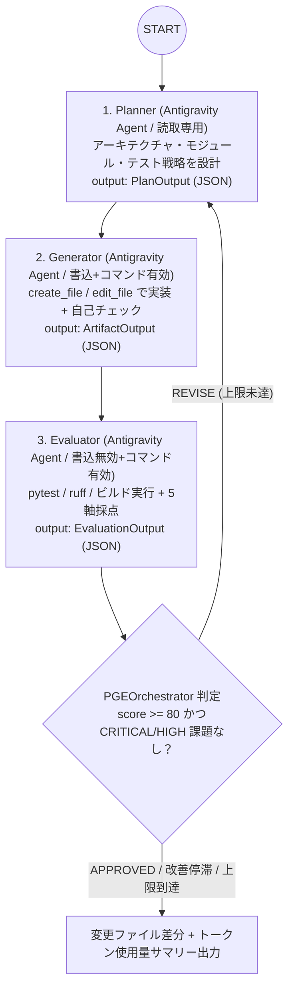

# Agentic Pipeline Pattern（Planner-Generator-Evaluator 自律コード実装パイプライン）

## 概念

**Agentic Pipeline Pattern** は、カスタムオーケストレーター（ADK `BaseAgent` を継承した `PGEOrchestrator`）が全体の品質ループを制御し、各フェーズの内部作業をファイル操作・コマンド実行能力を持つ自律コーディングエージェント（Google Antigravity SDK `0.1.23+` の `Agent` / `LocalAgentConfig`）へ委任する **3 者間自律実装デザインパターン（Planner → Generator → Evaluator）** です。

テキストを返すだけのコード生成ループ（`Lv.5 Loop`）と異なり、実際にワークスペースへファイルを書き出し、`pytest` や `ruff check` などの実コマンドを実行した結果に基づいて合否判定と差分改修を行います。



## いつ使うか

### ✅ 適している場合
- 抽象度の高い業務要件（「ISBN 検証付きの蔵書管理ツールとテストを作って」など）から、複数ファイルの実装・単体テスト・リンター通過までを一気通貫で自動化したい場合
- 生成者（Generator）による自己採点ではなく、**ファイル書き込み権限を剥奪した独立な評価者（Evaluator）** に実テストコマンドを実行させて品質を担保したい場合

### ❌ 不向きな場合・できないこと
- **低レイテンシな対話応答には使えない**: 各フェーズで自律エージェントがファイル探索・コード生成・テスト実行を行うため、1 リクエスト完了まで数分単位の実行時間と相応のトークン消費が発生します。
- **ホスト環境上でサブプロセスを実行するため隔離環境が必須**: コマンド許可リスト・OS サンドボックス（`RunCommandConfig(enable_sandbox=True)`）・書き込み無効化を備えていますが、OS サンドボックス非対応のプラットフォームではポリシー層のみでの制御となるため、信頼できない第三者入力を受け付ける本番環境では必ずコンテナや Cloud Run / GKE サンドボックス内で隔離実行してください。
- **ADK の定型 `Workflow` だけでは表現しにくい複雑な状態遷移を含む**: スコア履歴に基づくリグレッション検出（前回よりスコアが下がったら強制 `REVISE`）や改善停滞打ち切り（前回比 `+5` 点未満なら終了）などを柔軟に扱うため、`BaseAgent._run_async_impl` でカスタムループを実装しています。

## 関連パターンとの違い

| 観点 | Loop (Lv.5) | Review & Critique (Lv.6) | Agentic Pipeline |
|---|---|---|---|
| ループ構造 | 2 者間（生成 → 評価） | 2 者間（執筆 → 批評） | **3 者間（設計 Planner → 実装 Generator → 実機検証 Evaluator）** |
| 各ノードの能力 | 単発の LLM テキスト生成 | 単発の LLM テキスト生成 | **ファイル読み書き・テスト実行を行う自律エージェント** |
| 評価の根拠 | LLM によるコード読解 | LLM によるルーブリック採点 | **`pytest` / `ruff` / ビルドコマンドの実行結果 + 5 軸採点** |
| 権限制御・予算制御 | なし（テキストのみ） | なし（テキストのみ） | **9段階 Policy・OS サンドボックス・フェーズ別 `BudgetConfig`** |

## アーキテクチャと実装のポイント（`google-antigravity 0.1.23+` 準拠）

### 1. 3 つの自律エージェントの責務・権限分離・予算上限（`tools.py`）

各フェーズは `CapabilitiesConfig(enable_subagents=False)` で入れ子サブエージェントを抑止した上で、最小権限とフェーズ別の `BudgetConfig`（モデル呼び出し回数・ツール実行回数・合計トークン上限）を設定しています。

| エージェント | 役割 | 書込 (`allow_writes`) | コマンド (`allow_commands`) | `BudgetConfig` (model / tool / tokens) | 構造化スキーマ |
|---|---|---|---|---|---|
| **Planner** | 要件を技術仕様・ディレクトリ構成・テスト計画へ分解 | **無効**（`CREATE_FILE` / `EDIT_FILE` 除外） | **無効**（`confirm_run_command`） | `12` / `15` / `200,000` | `PlanOutput` |
| **Generator** | 設計に従いコードとテストを作成（2 周目以降は差分修正） | **有効**（出力ディレクトリ内限定） | **有効** + OS サンドボックス | `30` / `60` / `500,000` | `ArtifactOutput` |
| **Evaluator** | 実コマンドで動作検証し課題を重大度付きで報告 | **無効**（`CREATE_FILE` / `EDIT_FILE` 除外） | **有効** + OS サンドボックス | `25` / `45` / `400,000` | `EvaluationOutput` |

### 2. 9 段階優先度ポリシーと OS レベルサンドボックスによる多層防御

`google-antigravity 0.1.23+` では、カスタム `policies` を指定すると既定ポリシーが置き換わり、いずれのルールにも一致しないツール呼び出しは **デフォルト拒否（Fail-Closed）** されます。そこで `allow_commands=True` 時は優先度モデル（`個別拒否 > 個別許可 > ワイルドカード許可`）に従い、以下の 3 層を組み合わせます。

1. **ワークスペース境界保護 (`policy.workspace_only([workspace_dir])`)**: ファイル読み書き・作成操作を出力ディレクトリ配下のみに制限します。`policy.allow_all()` ではなく名前付きワイルドカード `policy.allow("*", name="allow_workspace_tools")` を使うことで、バックエンドのワークスペース境界検証を維持します。
2. **不正・変更系コマンドの優先拒否 (`policy.deny("run_command", when=not _is_allowed_command(...))`)**: `pytest`、`python -m pytest`、`python3 -m pytest`、`ruff check` などの検証コマンドのみを許可し、`--fix`、`install -g`、`rm`、`rmdir`、`sudo` を含むコマンドを最上位優先度で拒否します。
3. **OS レベルのコマンドサンドボックス (`RunCommandConfig(enable_sandbox=True, timeout_seconds=120.0)`)**: ホスト環境が対応している場合はサブプロセス自体を OS サンドボックス内で実行し、120 秒のタイムアウト上限とデーモン起動禁止（`enable_daemons=False`）を強制します。

### 3. コンテキスト圧縮・リトライ・トークン観測性・一時ディレクトリ分離

- **コンテキスト圧縮 (`CompactionConfig(token_threshold=120_000)`)**: 長いツール実行ログが蓄積した際に古い履歴を自動要約し、コンテキスト長超過を防ぎます。
- **自動リトライ (`RetryConfig`)**: 一時的な API レート制限（HTTP 429 / 503）に対する指数バックオフ（`ModelAPIRetryConfig`）と、構造化 JSON スキーマ不一致時の再試行（`ModelOutputRetryConfig`）を設定しています。
- **トークン消費計測 (`agent.conversation.total_usage` / `StopReason`)**: セッション完了ごとに `prompt_token_count` / `candidates_token_count` / `thoughts_token_count` / `total_token_count` と停止理由（`response.stop_reason`）を記録し、最終レポートに出力します。
- **`app_data_dir` の一時分離**: `tempfile.TemporaryDirectory` の絶対パスを `LocalAgentConfig(app_data_dir=...)` に渡し、ユーザーホーム（`~/.gemini/antigravity/brain/`）に一時スクラッチファイルを残しません。

### 4. 6 段階の決定論的 Verdict オーバーライド（優先度順）

Evaluator の LLM が返した `verdict` をそのまま採用せず、`run_evaluator_agent` 内で以下の順序で決定論的に上書き判定します。

1. `iteration >= max_loop_iterations`（既定 `5`） → **強制 `APPROVED`**（無限ループ防止）
2. `CRITICAL` または `HIGH` の課題が 1 件以上残存 → **強制 `REVISE`**
3. リグレッション検出（前回スコアより低下したのに `APPROVED`） → **強制 `REVISE`**
4. `score < approval_threshold`（既定 `80`）なのに `APPROVED` → **強制 `REVISE`**
5. 改善停滞（前回比スコア改善幅 `< min_improvement`（既定 `5`）） → **`APPROVED` で打ち切り**
6. 上記いずれにも該当しない場合のみ LLM の `verdict` を採用

## トレードオフ

| 観点 | 評価 | 理由 |
|---|---|---|
| 生成コードの実動品質 | 最高 | 実テスト・リンター通過とブロッカーゼロをコードで強制できる |
| 役割間のガバナンス | 高 | Planner / Evaluator から書き込みツールを物理剥奪し、評価と修正の責務を分離できる |
| 推論コスト・実行時間 | 高 | 1 反復ごとに 3 つの自律エージェントセッションを起動する（`BudgetConfig` で上限を保護） |
| 実行環境の準備 | 中 | `google-antigravity` SDK と隔離された出力ディレクトリが必要 |

## 実行方法

```bash
# デモ実行（.env に GOOGLE_CLOUD_PROJECT または GEMINI_API_KEY 設定が必要）
PYTHONPATH=. .venv/bin/python patterns/agentic_pipeline/demo.py

# ADK CLI から任意の出力先ディレクトリを指定して実行
.venv/bin/adk run patterns/agentic_pipeline \
  --state '{"output_dir": "/tmp/my-generated-app"}'

# Lv.1 単体テスト（外部 API 通信なし: スキーマ・9段階ポリシー・BudgetConfig・PGE 反復制御を検証）
.venv/bin/pytest tests/unit/test_agent_structure.py::TestAgenticPipelineStructure \
  tests/unit/test_existing_patterns_runtime.py::TestAgenticPipelineRuntime -v

# Lv.2 統合テスト（GOOGLE_CLOUD_PROJECT または GEMINI_API_KEY 設定時に実 SDK ランタイムでコード生成を検証）
.venv/bin/pytest tests/integration/test_patterns.py::TestAgenticPipeline -v
```

## 学習ポイント

1. ADK `BaseAgent`（`_run_async_impl`）によるカスタム反復ループ制御と進捗イベントのストリーミング配信
2. `google-antigravity 0.1.23+` の 9 段階優先度ポリシー（Fail-Closed 対応）・`CapabilitiesConfig.disabled_tools`・`RunCommandConfig(enable_sandbox=True)` による多層防御
3. フェーズ別 `BudgetConfig`・`CompactionConfig`・`agent.conversation.total_usage` を用いた自律エージェントのコスト統制と可観測性

## 次のステップ

- **[Track 2: Agents CLI Lifecycle Patterns](../../agents_cli_patterns/)**: `agents-cli` を用いた仕様駆動開発・CI 評価ゲート・A2A 連携・デプロイ分離へ進む
- **[Track 3: Production Design Patterns](../../production_patterns/)**: 契約ベース実行・冪等承認・コンテキスト隔離・モデルカスケード・状態評価・予算遮断を学ぶ
