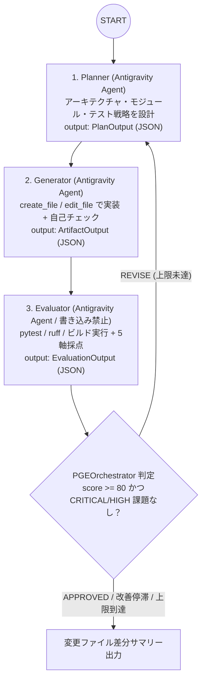

# Agentic Pipeline Pattern（Planner-Generator-Evaluator 自律コード実装パイプライン）

## 概念

**Agentic Pipeline Pattern** は、カスタムオーケストレーター（ADK `BaseAgent` を継承した `PGEOrchestrator`）が全体の品質ループを制御し、各フェーズの内部作業をファイル操作・コマンド実行能力を持つ自律コーディングエージェント（Antigravity SDK `Agent`）へ委任する **3 者間自律実装デザインパターン（Planner → Generator → Evaluator）** です。

テキストを返すだけのコード生成ループ（`Lv.5 Loop`）と異なり、実際にワークスペースへファイルを書き出し、`pytest` や `ruff check` などの実コマンドを実行した結果に基づいて合否判定と差分改修を行います。



## いつ使うか

### ✅ 適している場合
- 抽象度の高い業務要件（「ISBN 検証付きの蔵書管理ツールとテストを作って」など）から、複数ファイルの実装・単体テスト・リンター通過までを一気通貫で自動化したい場合
- 生成者（Generator）による自己採点ではなく、**ファイル書き込み権限を剥奪した独立な評価者（Evaluator）** に実テストコマンドを実行させて品質を担保したい場合

### ❌ 不向きな場合・できないこと
- **低レイテンシな対話応答には使えない**: 各フェーズで自律エージェントがファイル探索・コード生成・テスト実行を行うため、1 リクエスト完了まで数分単位の実行時間と相応のトークン消費が発生します。
- **ホスト環境上でサブプロセスを実行するため隔離環境が必須**: コマンド許可リストと書き込み無効化ポリシーを備えていますが、信頼できない第三者入力を受け付ける本番環境では、必ずコンテナや Cloud Run / GKE サンドボックス内で隔離実行してください。
- **ADK の定型 `Workflow` だけでは表現しにくい複雑な状態遷移を含む**: スコア履歴に基づくリグレッション検出（前回よりスコアが下がったら強制 `REVISE`）や改善停滞打ち切り（前回比 `+5` 点未満なら終了）などを柔軟に扱うため、`BaseAgent._run_async_impl` でカスタムループを実装しています。

## 関連パターンとの違い

| 観点 | Loop (Lv.5) | Review & Critique (Lv.6) | Agentic Pipeline |
|---|---|---|---|
| ループ構造 | 2 者間（生成 → 評価） | 2 者間（執筆 → 批評） | **3 者間（設計 Planner → 実装 Generator → 実機検証 Evaluator）** |
| 各ノードの能力 | 単発の LLM テキスト生成 | 単発の LLM テキスト生成 | **ファイル読み書き・テスト実行を行う自律エージェント** |
| 評価の根拠 | LLM によるコード読解 | LLM によるルーブリック採点 | **`pytest` / `ruff` / ビルドコマンドの実行結果 + 5 軸採点** |
| Evaluator の権限制限 | なし（テキストのみ） | なし（テキストのみ） | **`create_file` / `edit_file` を無効化（勝手な書き換えを防止）** |

## アーキテクチャと実装のポイント

### 1. 3 つの自律エージェントの責務と権限分離（`tools.py`）

| エージェント | 役割 | ファイル書込 (`allow_writes`) | コマンド実行 (`allow_commands`) | 構造化出力スキーマ |
|---|---|---|---|---|
| **Planner** | 要件を技術仕様・ディレクトリ構成・テスト計画へ分解 | 有効（設計のみ指示） | 無効 | `PlanOutput` |
| **Generator** | 設計に従いコードとテストを作成（2 周目以降は差分修正モード） | **有効** | **有効**（セルフチェック用） | `ArtifactOutput` |
| **Evaluator** | 実コマンドで動作検証し課題を重大度付きで報告 | **無効（`CREATE_FILE` / `EDIT_FILE` 無効化）** | **有効**（検証用） | `EvaluationOutput` |

### 2. コマンド実行ポリシー（`_ALLOWED_PREFIXES` / `_BLOCKED_SUBCOMMANDS`）

`allow_commands=True` のエージェントには `google.antigravity.hooks.policy` により以下のプレフィックスのみ自動許可され、破壊的操作や Evaluator による自動修正オプションはブロックされます。

- **許可プレフィックス**: `pytest`, `python -m pytest`, `ruff check`, `python `, `pip install`, `pip check`, `docker build`, `docker compose`, `docker run`, `podman build`, `podman-compose`, `podman run`, `npm run`, `npm test`, `npm start`, `npx `, `node `, `yarn `, `pnpm `, `go build`, `go test`, `go vet`, `go run`, `make`, `sh `, `bash `, `cat `, `head `, `tail `, `ls `, `find `, `wc `, `grep `, `terraform validate`, `terraform plan`, `terraform fmt`, `curl `, `java `, `javac `, `mvn `, `gradle `
- **ブロック部分文字列**: `--fix`, `install -g`, `rm `, `sudo `

### 3. 6 段階の決定論的 Verdict オーバーライド（優先度順）

Evaluator の LLM が返した `verdict` をそのまま鵜呑みにせず、`run_evaluator_agent` 内で以下の順序で決定論的に上書き判定します。

1. `iteration >= max_loop_iterations`（既定 `5`） → **強制 `APPROVED`**（無限ループ防止）
2. `CRITICAL` または `HIGH` の課題が 1 件以上残存 → **強制 `REVISE`**
3. リグレッション検出（前回スコアより低下したのに `APPROVED`） → **強制 `REVISE`**
4. `score < approval_threshold`（既定 `80`）なのに `APPROVED` → **強制 `REVISE`**
5. 改善停滞（前回比スコア改善幅 `< min_improvement`（既定 `5`）） → **`APPROVED` で打ち切り**
6. 上記いずれにも該当しない場合のみ LLM の `verdict` を採用

### 4. Pydantic 構造化スキーマ一覧（`schemas.py`）

| スキーマ | 用途 | 定義フィールド |
|---|---|---|
| `PlanOutput` | Planner 出力 | `architecture`, `modules`, `test_strategy`, `directory_structure` |
| `ArtifactOutput` | Generator 出力 | `files_created`, `summary` |
| `EvaluationOutput` | Evaluator 出力 | `score`, `test_result`, `lint_result`, `execution_result`, `issues`, `suggestions`, `verdict`, `reasoning` |
| `Issue` | 検出された個別課題 | `severity`, `description`, `file`, `suggestion` |
| `Severity` | 課題の重大度列挙型 | `CRITICAL`, `HIGH`, `MEDIUM`, `LOW` |

## トレードオフ

| 観点 | 評価 | 理由 |
|---|---|---|
| 生成コードの実動品質 | 最高 | 実テスト・リンター通過とブロッカーゼロをコードで強制できる |
| 役割間のガバナンス | 高 | Evaluator から書き込みツールを剥奪しており、評価と修正の責務が混ざらない |
| 推論コスト・実行時間 | 高 | 1 反復ごとに 3 つの自律エージェントセッションを起動する |
| 実行環境の準備 | 中 | `google-antigravity` SDK と隔離された出力ディレクトリが必要 |

## 実行方法

```bash
# デモ実行（.env に GOOGLE_CLOUD_PROJECT または GEMINI_API_KEY 設定が必要）
PYTHONPATH=. .venv/bin/python patterns/agentic_pipeline/demo.py

# ADK CLI から任意の出力先ディレクトリを指定して実行
.venv/bin/adk run patterns/agentic_pipeline \
  --state '{"output_dir": "/tmp/my-generated-app"}'

# Lv.1 単体テスト（外部 API 通信なし: スキーマ・権限制御構成・PGEOrchestrator 反復制御を検証）
.venv/bin/pytest tests/unit/test_agent_structure.py::TestAgenticPipelineStructure \
  tests/unit/test_existing_patterns_runtime.py::TestAgenticPipelineRuntime -v

# Lv.2 統合テスト（GEMINI_API_KEY 設定時に実 SDK ランタイムでコード生成を検証）
.venv/bin/pytest tests/integration/test_patterns.py::TestAgenticPipeline -v
```

## 学習ポイント

1. ADK `BaseAgent`（`_run_async_impl`）による高度なカスタムループ制御と進捗イベントのストリーミング配信
2. 評価エージェントから書き込み権限（`BuiltinTools.CREATE_FILE`, `EDIT_FILE`）を物理的に外す権限分離設計
3. LLM の自己申告スコアに対するリグレッションガード・ブロッカー強制差し戻し・改善停滞打ち切りの実装

## 次のステップ

- **[Track 2: Agents CLI Lifecycle Patterns](../../agents_cli_patterns/)**: `agents-cli` を用いた仕様駆動開発・CI 評価ゲート・A2A 連携・デプロイ分離へ進む
- **[Track 3: Production Design Patterns](../../production_patterns/)**: 契約ベース実行・冪等承認・コンテキスト隔離・モデルカスケード・状態評価・予算遮断を学ぶ
