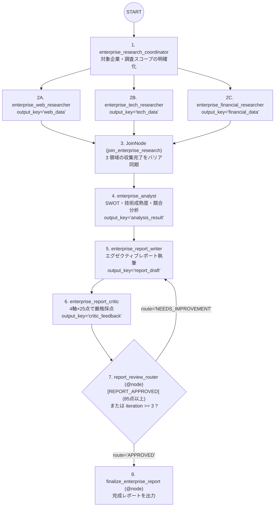

# Capstone: Enterprise Research Agent（複合オーケストレーション統合パターン）

## 概念

**Capstone Pattern** は、単一のデザインパターンでは満たせないエンタープライズ向け複合要件に対し、**スコープ定義（Coordinator）→ 並列データ収集（Parallel Fan-out + `JoinNode`）→ 統合戦略分析（Sequential）→ 執筆・品質審査ループ（Review & Critique + `@node` Loop）** を単一の ADK 2.x `Workflow` グラフへ統合した実践リファレンス構成です。



## いつ使うか

### ✅ 適している場合
- 複数領域の情報収集（高速化のための並列化）と、専門分析の積み上げ（直列化）、さらに対外・経営層提出レベルの品質保証（批評ループ）を 1 本の再現可能なパイプラインとして運用したい場合
- `Lv.9 Hierarchical` のような LLM 任せの委譲ではなく、「必ず 3 領域すべてを調査してから統合し、必ず品質審査を通す」という実行順序を決定論的に保証したい場合

### ❌ 不向きな場合・できないこと
- **定型外のアドホックな対話には柔軟性が低い**: 全リクエストが同じグラフ構造を通るため、「ちょっとした 1 問 1 答」に対しても最低 7 エージェント分のモデル呼び出しが発生します。軽量クエリと重厚なレポート生成が混在するシステムでは、前段に [`Lv.8 Coordinator`](../p08_coordinator/) や [`PROD-04 Model Cascade`](../../production_patterns/prod04_model_cascade/) を置いて振り分けます。
- **ADK 2.x では `Workflow` を `LlmAgent.sub_agents` の要素として直接渡すことはできない**: `Workflow` は `BaseAgent` ではなく `BaseNode` のサブクラスであるため、`LlmAgent(sub_agents=[Workflow(...)])` と書くとバリデーションエラーになります。本実装のように `Workflow` を最上位の `root_agent` とし、その内部エッジに `LlmAgent` を配置します。

## 統合しているデザインパターンの役割対応

| 組み込まれているパターン | 対応ノード・構文 | パイプライン内での責務 |
|---|---|---|
| **Lv.8 Coordinator** | `enterprise_research_coordinator` | 曖昧なユーザー依頼から対象企業と分析観点を構造化 |
| **Lv.4 Parallel + Join** | `(web_researcher, tech_researcher, financial_researcher)` + `JoinNode` | 企業・技術・財務の 3 領域を同時収集し、後続の多重起動を防止 |
| **Lv.3 Sequential** | `join_research` → `analysis_agent` → `report_writer` | 生データを戦略分析（SWOT 等）へ昇華させてからレポート化 |
| **Lv.6 Review & Critique** | `enterprise_report_writer` + `enterprise_report_critic` | 執筆者と品質審査官（各 25 点 × 4 軸 = 100 点満点）の分離 |
| **Lv.5 Loop (`@node` 制御)** | `report_review_router` (`MAX_REVIEW_ITERATIONS = 3`) | 85 点未満なら改善指示を注入して再執筆、上限到達で安全停止 |

## アーキテクチャと実装のポイント

```python
root_agent = Workflow(
    name="enterprise_research_workflow",
    edges=[
        (
            "START",
            coordinator,
            (web_researcher, tech_researcher, financial_researcher),
            join_research,  # 必須: analysis_agent が 3 回重複実行されるのを防ぐ
            analysis_agent,
            report_writer,
            report_critic,
            report_review_router,
            {
                "NEEDS_IMPROVEMENT": report_writer,
                "APPROVED": finalize_enterprise_report,
            },
        ),
    ],
)
```

1. **並列タプル直後の `JoinNode` によるコスト爆発防止**:
   `join_research` を挟むことで、3 名のリサーチャー全員が完了した後に `analysis_agent` → `report_writer` → `report_critic` の後続チェーンが **厳密に 1 回だけ** 起動します（`JoinNode` がないと後続チェーン全体が 3 回重複実行されてしまいます）。
2. **改稿ループでの `critic_feedback` 注入**:
   `_build_report_writer_instruction(ctx)` は 2 周目以降に前回の `report_draft` と `critic_feedback` を自動で読み込み、審査官から指摘された不足項目をピンポイントで補強します。

## トレードオフ

| 観点 | 評価 | 理由 |
|---|---|---|
| レポート網羅性・品質 | 最高 | 多面並列収集 + 戦略分析 + 独立品質審査の多段構えで抜け漏れを防ぐ |
| フローの再現性 | 高 | グラフ定義により全工程の実行順序と上限回数がコードで保証される |
| 推論コスト | 高 | 1 リクエストあたり 7 回（改稿発生時は 9〜11 回）のモデル呼び出しを行う |
| レイテンシ | 中〜高 | 収集フェーズは並列化されるが、後段の分析・執筆・審査は直列で実行される |

## 実行方法

```bash
# デモ実行（企業の技術戦略評価レポートを一気通貫で生成）
PYTHONPATH=. .venv/bin/python patterns/capstone/demo.py

# Lv.1 単体テスト（外部 API 通信なし: JoinNode 単一実行保証 + 改稿ループ完走を検証）
.venv/bin/pytest tests/unit/test_agent_structure.py::TestCapstoneStructure \
  tests/unit/test_existing_patterns_runtime.py::TestCapstoneRuntime -v

# Lv.2 統合テスト（Google Cloud ADC 認証が必要）
.venv/bin/pytest tests/integration/test_patterns.py::TestCapstone -v
```

## 学習ポイント

1. ADK 2.x の `Workflow` 1 つで直列・並列（`JoinNode`）・条件付きサイクル（`@node`）をシームレスに合成する方法
2. `Workflow`（`BaseNode`）と `LlmAgent`（`BaseAgent`）の型階層の違いと正しい組み合わせ順序
3. 大規模パイプラインで各ノードの `output_key` と `ReadonlyContext.state.get()` を整理する状態設計

## 次のステップ

- **[Agentic Pipeline](../agentic_pipeline/)**: ADK `BaseAgent` と Antigravity SDK を組み合わせ、実際にファイル生成・`pytest`・`ruff` 実行まで行う自律コード実装パイプラインへ進む
- **[Track 2: Agents CLI Patterns](../../agents_cli_patterns/)** / **[Track 3: Production Patterns](../../production_patterns/)**: 仕様駆動・評価ゲート・本番運用ガードレールを学ぶ
