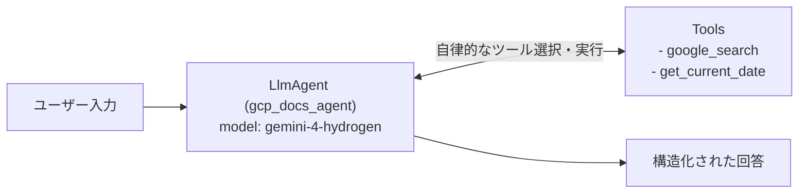

# Lv.1 Single Agent Pattern（単一エージェントパターン）

## 概念

**Single Agent Pattern** は、1 つの `LlmAgent` がシステム指示（`instruction`）とツール群（`tools`）を持ち、ユーザーからの入力に対して「どのツールをどの順序で呼び出し、どう回答を組み立てるか」を自律的に判断して完結させる最も基本的なデザインパターンです。

マルチエージェント構成を導入する前に、まず単一エージェントで要件を満たせるかを検証する**ベースライン構成**として位置づけられます。



## いつ使うか

### ✅ 適している場合
- 1 つの明確な専門領域（例: 製品ドキュメント Q&A、社内規定照会）で完結するタスク
- 登録するツール数が少なく（目安として 5 個以下）、ツール間の役割重複がない場合
- 新規プロジェクトの初期プロトタイプ（PoC）や、マルチエージェント化が必要かを判断するための比較基準を作る場合

### ❌ 不向きな場合・できないこと
- **多数のツール登録による選択精度の低下**: 10〜20 個以上のツールを 1 つのエージェントに持たせると、コンテキスト肥大化により誤ったツール選択や引数欠落が増えます（→ [`Lv.8 Coordinator`](../p08_coordinator/) で専門エージェントへ分割します）。
- **厳密な実行順序の強制ができない**: LLM がツール呼び出し順序を決めるため、「必ず抽出 → 検証 → 変換の順で 1 回ずつ実行する」といった決定論的な順序保証はできません（→ [`Lv.3 Sequential`](../p03_sequential/) を使います）。
- **独立した観点での客観的レビューができない**: 同一コンテキスト内で生成と自己チェックを行うため、自身の誤りを見逃す確証バイアスが生じます（→ [`Lv.6 Review & Critique`](../p06_review_critique/) を使います）。

## 関連パターンとの違い

| 観点 | Single Agent (Lv.1) | ReAct Pattern (Lv.2) | Sequential (Lv.3) |
|---|---|---|---|
| エージェント数 | 1 | 1 | 複数（直列） |
| 制御主体 | LLM が自律判断 | LLM が自律判断（中間推論・行動を可視化） | グラフ（`Workflow`）が決定論的に制御 |
| 主な目的 | 最小構成でのタスク遂行 | 推論・ツール実行過程の追跡と検証 | 複数工程の順序保証と責務分離 |

## このデモのユースケース

**Google Cloud ドキュメント Q&A エージェント**

Google Cloud のサービス仕様やベストプラクティスに関する質問に対し、`get_current_date` で現在日付（UTC）を確認したうえで、`google_search` で公式ドキュメントを検索して日本語で回答します。

## アーキテクチャと実装のポイント

```
patterns/p01_single_agent/
├── agent.py   # root_agent (gcp_docs_agent) と get_current_date ツール定義
└── demo.py    # 共通ランナーによるデモ実行スクリプト
```

1. **関数ツールの型注釈と Docstring**:
   ADK は Python 関数を自動的に `FunctionTool` としてラップし、引数名・型アノテーション・Docstring から関数宣言スキーマ（JSON Schema）を生成してモデルに渡します。そのため、すべてのツール関数には正確な型注釈と役割説明が必要です。
2. **Gemini 3 系における組み込み検索ツールとカスタム関数ツールの併用**:
   `gemini-4-hydrogen` をルートエージェントで使う場合、組み込みの `google_search` とカスタム関数ツール（`get_current_date`）を同一の `tools=[...]` リストに登録できます。なお、マルチエージェント構成のサブエージェント内で併用する場合は ADK の制約回避のため `GoogleSearchTool(bypass_multi_tools_limit=True)` を明示的に指定する必要があります。

## トレードオフ

| 観点 | 評価 | 理由 |
|---|---|---|
| 推論コスト | 低 | 単一エージェントの最小ラウンド数で完結する |
| レイテンシ | 低〜中 | ツール呼び出し回数分の往復時間のみで応答できる |
| 実装・保守の容易さ | 高 | グラフ定義や状態受け渡し設計が不要 |
| 決定論的な制御性 | 低 | ツールを呼ぶかどうかも含めてモデルの判断に依存する |
| 拡張の上限 | 中 | 責務やツールが増えるとプロンプトの指示競合が発生する |

## 実行方法

```bash
# デモ実行（プロジェクトルートから実行、.env に GOOGLE_CLOUD_PROJECT 設定が必要）
PYTHONPATH=. .venv/bin/python patterns/p01_single_agent/demo.py

# Lv.1 単体テスト（外部 API 通信なし: 構成検証 + ScriptedLlm ランタイム検証）
.venv/bin/pytest tests/unit/test_agent_structure.py::TestSingleAgentStructure \
  tests/unit/test_existing_patterns_runtime.py::TestP01SingleAgentRuntime -v

# Lv.2 統合テスト（Google Cloud ADC 認証が必要）
.venv/bin/pytest tests/integration/test_patterns.py::TestSingleAgent -v
```

## 学習ポイント

1. `LlmAgent` の基本構成要素（`name`, `model`, `description`, `instruction`, `tools`）の役割
2. Python 関数の型アノテーションと Docstring から ADK がツールスキーマを自動生成する仕組み
3. 単一エージェントで解決できる範囲と、マルチエージェントパターンへ分割すべき境界の見極め方

## 次のステップ

→ **[Lv.2 ReAct Pattern](../p02_react_pattern/)**: エージェント内部の「思考 → 行動 → 観察」イベントストリームを解析・可視化する
