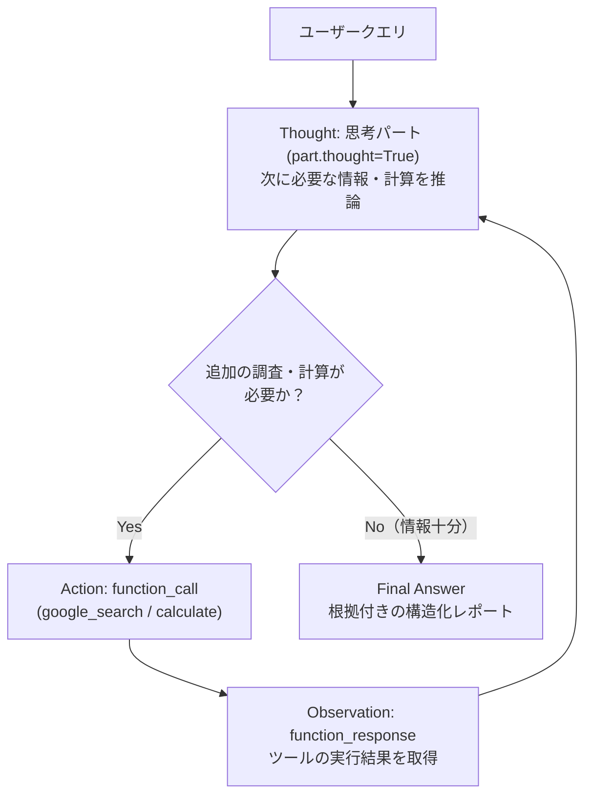

# Lv.2 ReAct Pattern（推論・行動ループ可視化パターン）

## 概念

**ReAct (Reasoning and Acting) Pattern** は、LLM が「次に何を調べるべきか考える（Thought）→ 外部ツールを呼び出す（Action）→ 実行結果を評価する（Observation）」というサイクルを段階的に回して問題を解くデザインパターンです。

ADK の `LlmAgent` は内部でこのループを自動実行していますが、本パターンでは `Runner.run_async()` が返すイベントストリームを分解し、Gemini 3.8 Flash の**ネイティブ思考パート（`part.thought=True`）**・**関数呼び出し（`function_call`）**・**関数応答（`function_response`）**・**最終回答（`Final Answer`）** を分離して可視化する方法を示します。



## いつ使うか

### ✅ 適している場合
- 1 回の検索や計算では答えが出ず、中間結果を見て次の検索クエリや計算式を動的に組み立てる多段階調査タスク
- エージェントが「なぜその結論に至ったのか」「途中でどのツールにどんな引数を渡したのか」を人間が監査・デバッグしたい場合
- 数値計算を LLM の暗算に任せず、決定論的な計算ツールへ委譲して計算誤りを防ぎたい場合

### ❌ 不向きな場合・できないこと
- **最大ステップ数や終了条件の厳密な業務保証はできない**: LLM 自身が「情報が揃った」と判断するまでループするため、入力によっては不要な検索を繰り返したり、逆に浅い調査で回答を終えたりすることがあります（厳密な事前・事後検証が必要な場合は [`PROD-01 Contract-Based Execution`](../../production_patterns/prod01_contract_based_execution/) を併用します）。
- **低レイテンシが求められる即時応答用途には不向き**: ツール往復のたびに LLM 推論が直列に発生するため、ステップ数に比例して応答時間とトークン消費量が増加します。

## 関連パターンとの違い

| 観点 | Single Agent (Lv.1) | ReAct Pattern (Lv.2) | Loop Pattern (Lv.5) |
|---|---|---|---|
| ループの単位 | `LlmAgent` 内部の自動ツールループ | `LlmAgent` 内部ループをイベント単位で可視化 | `Workflow` 上の複数ノード（生成・検証）のサイクル |
| 思考パートの扱い | 最終応答テキストのみ取得 | `part.thought=True` と最終回答を明確に分離 | 各ノードの `output_key` とルーターで制御 |
| 主な用途 | シンプルな Q&A | 多段階リサーチ・推論トレースの監査 | テスト合格や品質基準を満たすまでの反復改善 |

## このデモのユースケース

**段階的技術調査 & コスト試算エージェント**

技術トピックの最新動向を `google_search` で複数の角度から調査し、必要な数値試算を安全な数式評価ツール `calculate` で実行しながら、思考・行動・観察の全ステップをコンソールにトレース表示します。

## アーキテクチャと実装のポイント

```
patterns/p02_react_pattern/
├── agent.py   # root_agent, AST 安全数式評価ツール calculate(), run_with_react_trace()
└── demo.py    # トレース付きデモ実行スクリプト
```

1. **`eval()` を使わない AST ベースの安全な数式評価（`calculate`）**:
   LLM が生成した文字列を Python の組み込み `eval()` に直接渡すと任意コード実行の脆弱性になります。また Python では `^` がべき乗ではなくビット排他的論理和（XOR）として評価される罠があります。本実装では標準ライブラリ `ast.parse(..., mode="eval")` で四則演算・剰余・べき乗（指数上限付き）のみを許可し、`^` が含まれる場合は `'**' を使用してください` という明示的なエラー辞書を返して LLM の自己修正を促します。
2. **イベントストリームからの 4 フェーズ分離（`run_with_react_trace`）**:
   Gemini 3 系モデルでは最終応答イベント（`event.is_final_response() == True`）の中に思考チャンク（`part.thought == True`）と最終回答チャンク（`part.thought == False`）が同居することがあります。各 `Part` の `thought` 属性を検査することで、内部思考が最終回答パネルに混入したり最終回答が欠落したりする問題を防いでいます。

## トレードオフ

| 観点 | 評価 | 理由 |
|---|---|---|
| 推論精度 | 高 | 検索結果や計算結果を確認しながら段階的に仮説を修正できる |
| 可観測性・デバッグ性 | 高 | 思考パート・ツール引数・ツール応答をステップ単位で追跡できる |
| レイテンシ | 中〜高 | ツール呼び出しラウンド数に比例して待機時間が増える |
| トークンコスト | 中 | 過去のツール入出力履歴が後続ステップのコンテキストに累積する |

## 実行方法

```bash
# デモ実行（Thought / Action / Observation / Final Answer が順番に表示される）
PYTHONPATH=. .venv/bin/python patterns/p02_react_pattern/demo.py

# Lv.1 単体テスト（外部 API 通信なし: AST 計算ガード検証 + トレース分離検証）
.venv/bin/pytest tests/unit/test_agent_structure.py::TestReActStructure \
  tests/unit/test_existing_patterns_runtime.py::TestP02ReactPatternRuntime -v

# Lv.2 統合テスト（Google Cloud ADC 認証が必要）
.venv/bin/pytest tests/integration/test_patterns.py::TestReAct -v
```

## 学習ポイント

1. `runner.run_async()` が生成する `Event` と `Part`（`thought`, `function_call`, `function_response`, `text`）の構造
2. LLM に計算ツールを提供する際のセキュリティ境界（`ast` による構文制限）と自己修正しやすいエラーメッセージ設計
3. Gemini 3.8 Flash の思考パート（`part.thought=True`）とユーザー向け最終回答の正しい分離方法

## 次のステップ

→ **[Lv.3 Sequential Pattern](../p03_sequential/)**: 複数の専門エージェントを `Workflow` で固定順序のパイプラインとして直列接続する
