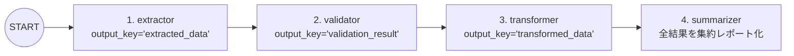

# Lv.3 Sequential Pattern（直列パイプラインパターン）

## 概念

**Sequential Pattern** は、責務を分割した複数のエージェントを **あらかじめ定めた固定順序で 1 回ずつ直列実行** するデザインパターンです。

ADK 2.x では `Workflow` のチェーンタプル構文 `edges=[("START", step_1, step_2, step_3, step_4)]` を使って宣言的にパイプラインを定義し、各ステップの出力を `output_key` 経由でセッション状態（`ctx.state`）に保存して後続ステップへ引き渡します。



## いつ使うか

### ✅ 適している場合
- 処理工程が明確に決まっており、前の工程の出力が次の工程の必須入力になるタスク（例: 抽出 → 品質検証 → 正規化変換 → レポート作成）
- 1 つの巨大なプロンプトに全工程を詰め込むと指示漏れが起きるため、工程ごとにプロンプトと役割を分離したい場合
- LLM によるルーティング判断を介さず、**毎回必ず同じ順序で全工程を通過すること**をコードレベルで保証したい場合

### ❌ 不向きな場合・できないこと
- **条件に応じたステップのスキップや差し戻しはできない**: 直列チェーンは常に先頭から末尾まで一方向に進むため、「検証で重大エラーが見つかったら変換を中止して再抽出する」といった分岐・ループはできません（→ [`Lv.5 Loop`](../p05_loop/) または条件付きエッジを使います）。
- **独立した処理の同時実行による時間短縮はできない**: 全ステップが直列に待機するため、合計レイテンシは全エージェントの応答時間の総和になります（互いに依存しない調査は [`Lv.4 Parallel`](../p04_parallel/) で並列化します）。

## 関連パターンとの違い

| 観点 | Single Agent (Lv.1) | Sequential Pattern (Lv.3) | Coordinator (Lv.8) |
|---|---|---|---|
| 実行順序の決定者 | LLM（プロンプト依存） | **グラフ定義（100% 決定的）** | Coordinator LLM（入力に応じて動的選択） |
| プロンプトの粒度 | 全工程を 1 つに記述 | 工程ごとに単一責務へ分割 | ルーター + 専門領域ごとに分割 |
| ルーティング用 LLM 呼出 | なし | **なし（オーバーヘッドゼロ）** | あり（振り分け判断に 1 回以上必要） |

## このデモのユースケース

**4 段階 ETL データ処理パイプライン**

欠損値や表記揺れを含む CSV 生データを入力すると、以下の 4 エージェントが順番に処理を引き継ぎます。

1. `extractor` (`output_key="extracted_data"`): カラム型・レコード数・欠損や異常値を構造化抽出
2. `validator` (`output_key="validation_result"`): `{extracted_data}` を参照し、完全性・一貫性・正確性・一意性を 100 点満点で採点
3. `transformer` (`output_key="transformed_data"`): `{extracted_data}` と `{validation_result}` を参照し、欠損補完・正規化・統計値を算出
4. `summarizer`: 上記 3 つの状態変数をすべて統合し、最終的な ETL 実行レポートを作成

## アーキテクチャと実装のポイント

```python
from google.adk.workflow import Workflow

root_agent = Workflow(
    name="etl_pipeline",
    edges=[
        ("START", extractor_agent, validator_agent, transformer_agent, summarizer_agent),
    ],
)
```

1. **先頭エージェントでは `{変数名}` プレースホルダーを使わない**:
   ADK の `instruction` 内の `{extracted_data}` のような波括弧記法は、実行開始時点のセッション状態（`session.state`）から値を展開します。パイプライン先頭の `extractor` 実行時はまだ状態が空のため、`extractor` はユーザーメッセージから直接生データを読み取り、2 番目以降の `validator` から `{extracted_data}` を参照する設計にします。
2. **ADK 2.x での廃止 API からの移行**:
   ADK 1.x の `SequentialAgent(sub_agents=[...])` は ADK 2.x で `@deprecated` となりました。新規実装では `Workflow(edges=[("START", a, b, c)])` を使用します。

## トレードオフ

| 観点 | 評価 | 理由 |
|---|---|---|
| 動作の予測可能性 | 高 | グラフ定義通りの順序で確実に実行される |
| プロンプトの保守性 | 高 | 各エージェントが 1 つの工程だけに集中でき、個別に改善しやすい |
| レイテンシ | 中〜高 | 4 エージェント分の LLM 呼び出しが直列に積み上がる |
| 動的な柔軟性 | 低 | 入力内容に応じた工程スキップや動的ルーティングは行わない |

## 実行方法

```bash
# デモ実行（4 段階の ETL 処理結果と最終レポートを表示）
PYTHONPATH=. .venv/bin/python patterns/p03_sequential/demo.py

# Lv.1 単体テスト（外部 API 通信なし: グラフ構造 + 4 段階の state 伝播検証）
.venv/bin/pytest tests/unit/test_agent_structure.py::TestSequentialStructure \
  tests/unit/test_existing_patterns_runtime.py::TestP03SequentialRuntime -v

# Lv.2 統合テスト（Google Cloud ADC 認証が必要）
.venv/bin/pytest tests/integration/test_patterns.py::TestSequential -v
```

## 学習ポイント

1. `Workflow` のチェーンタプル構文 `("START", a, b, c, d)` による直列パイプラインの宣言方法
2. `output_key` によるセッション状態への書き込みと、後続エージェントの `{key}` 展開によるデータ受け渡し
3. 先頭ノードにおける未定義キー参照エラー（`KeyError`）を避ける初期入力設計

## 次のステップ

→ **[Lv.4 Parallel Pattern](../p04_parallel/)**: 独立した複数のリサーチタスクを並列実行し、`JoinNode` でバリア同期して統合する
