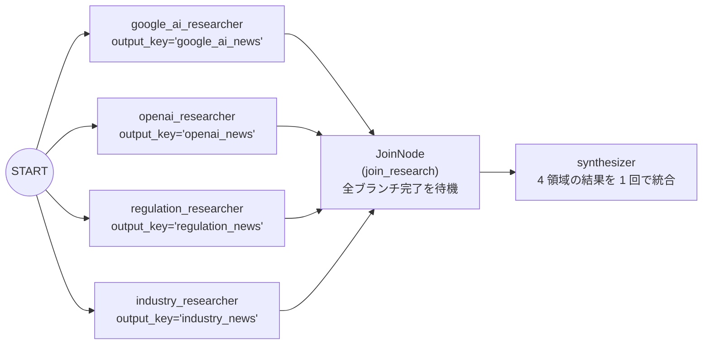

# Lv.4 Parallel Pattern（並列 Fan-out / Join バリア同期パターン）

## 概念

**Parallel Pattern** は、互いにデータ依存のない複数のエージェントを **同時並行（Fan-out）で実行** し、全ブランチの完了をバリア同期（`JoinNode`）で待ち合わせてから、後続の集約エージェント（Fan-in）を **1 回だけ** 起動するデザインパターンです。

全体レイテンシを「全エージェントの合計時間」から「最も遅い 1 エージェントの時間 + 集約時間」へと短縮できます。



## いつ使うか

### ✅ 適している場合
- 同一テーマを異なる観点・情報源（技術・競合・法規制・産業事例など）から独立して調査し、最後に 1 つのレポートへ統合するタスク
- 直列実行では待ち時間が長すぎるため、I/O 待機やモデル推論を同時実行して応答時間を短縮したい場合

### ❌ 不向きな場合・できないこと
- **ブランチ間で途中結果を参照し合うタスクには使えない**: 並列タプル内の各エージェントは同時に起動するため、ブランチ A の出力を見てからブランチ B の方針を変えることはできません（依存関係がある場合は [`Lv.3 Sequential`](../p03_sequential/) を使います）。
- **同一の `output_key` を複数ブランチで共有できない**: 並列エージェントが同じキー名に書き込むと完了順によって上書き競合（Race Condition）が起きるため、必ずブランチごとに一意の `output_key` を割り当てます。
- **同時リクエスト数（RPM / TPM クォータ）のスパイクに注意が必要**: 1 ユーザーリクエストあたり N 個の LLM 呼び出しが一斉に発火するため、高トラフィック環境ではレート制限に達しやすくなります。

## 関連パターンとの違い

| 観点 | Sequential (Lv.3) | Parallel + JoinNode (Lv.4) | Swarm (Lv.10) |
|---|---|---|---|
| 実行形態 | 直列（1 つずつ順番） | **並列同時実行 + バリア合流** | 複数ラウンドの合議サイクル |
| ブランチ間の依存 | 前段の出力に依存可能 | 完全に独立している必要あり | 前ラウンドの合意案を次ラウンドが参照 |
| 全体レイテンシ | $\sum T_i$（合計時間） | $\max(T_i) + T_{\text{synth}}$ | ラウンド数 $\times$ 各専門家の処理時間 |

## このデモのユースケース

**マルチソース AI トレンド集約エージェント**

1 つの調査テーマに対して、以下 4 名のリサーチャーが同時並行で動向を調査し、`JoinNode` で全件揃った後に `synthesizer` が包括的なトレンドレポートを作成します。

- `google_ai_researcher` (`output_key="google_ai_news"`)
- `openai_researcher` (`output_key="openai_news"`)
- `regulation_researcher` (`output_key="regulation_news"`)
- `industry_researcher` (`output_key="industry_news"`)

## アーキテクチャと実装のポイント

```python
from google.adk.workflow import JoinNode, Workflow

join_research = JoinNode(name="join_research")

root_agent = Workflow(
    name="news_aggregator",
    edges=[
        (
            "START",
            (
                google_ai_researcher,
                openai_researcher,
                regulation_researcher,
                industry_researcher,
            ),
            join_research,  # 必須: 全 4 ブランチ完了まで待機し、後続を 1 回だけ起動する
            synthesizer,
        ),
    ],
)
```

> [!IMPORTANT]
> **ADK 2.x における `JoinNode` の必須性（重複実行の防止）**
> `Workflow` で `("START", (a, b, c, d), synthesizer)` のように **`JoinNode` を挟まずに直接後続ノードを接続すると、`a`, `b`, `c`, `d` が完了するたびに `synthesizer` が個別にトリガーされ、計 4 回重複実行されてしまいます**（さらに早いブランチの完了時点では他ブランチの `output_key` が未設定となります）。
> 全ブランチの結果を 1 回で統合したい場合は、必ず間に `JoinNode` を挿入してください。

1. **防御的な状態参照（Callable Instruction）**:
   `synthesizer` の `instruction` には `ReadonlyContext` を受け取る関数（`_build_synthesizer_instruction`）を渡し、`ctx.state.get("google_ai_news", "（データなし）")` で安全に状態を取得しています。
2. **DB セッションサービス利用時の補足**:
   `InMemorySessionService` ではそのまま動作しますが、本番で `DatabaseSessionService` 等の永続化セッションサービスと `JoinNode` を組み合わせる場合は、`JoinNode` が待機中に保持する中間出力を JSON シリアライズできるよう、前段の並列 `LlmAgent` に `output_schema` を設定することを推奨します。

## トレードオフ

| 観点 | 評価 | 理由 |
|---|---|---|
| レイテンシ | 低 | 4 エージェントを並列実行するため待ち時間を大幅に短縮できる |
| 網羅性 | 高 | 観点ごとに専任プロンプトを割り当てられるため調査漏れが減る |
| 推論コスト | 中 | 1 リクエストで並列ブランチ数 + 集約分の計 5 回モデルを呼び出す |
| 設計上の制約 | 中 | 各ブランチの完全独立性、一意な `output_key`、`JoinNode` の配置が必要 |

## 実行方法

```bash
# デモ実行（4 リサーチャーの並列収集と統合レポートを表示）
PYTHONPATH=. .venv/bin/python patterns/p04_parallel/demo.py

# Lv.1 単体テスト（外部 API 通信なし: JoinNode 構造検証 + synthesizer が 1 回だけ呼ばれることを検証）
.venv/bin/pytest tests/unit/test_agent_structure.py::TestParallelStructure \
  tests/unit/test_existing_patterns_runtime.py::TestP04ParallelJoinRuntime -v

# Lv.2 統合テスト（Google Cloud ADC 認証が必要）
.venv/bin/pytest tests/integration/test_patterns.py::TestParallel -v
```

## 学習ポイント

1. `Workflow` の並列タプル `(a, b, c, d)`（Fan-out）と `JoinNode`（Fan-in バリア同期）の正しい組み合わせ方
2. `JoinNode` を省略した場合に後続ノードがブランチ数だけ多重起動する ADK 2.x グラフエンジンの動作仕様
3. 並列ノード間で状態キーの衝突を避ける一意な `output_key` 設計と `ReadonlyContext.state.get()` の活用

## 次のステップ

→ **[Lv.5 Loop Pattern](../p05_loop/)**: 決定論的ルーター `@node` と条件付きサイクルを使って品質基準を満たすまで反復改善する
