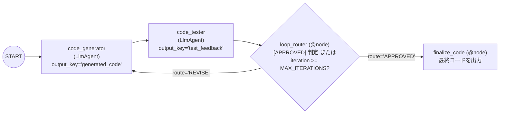

# Lv.5 Loop Pattern（条件付き反復ループパターン）

## 概念

**Loop Pattern** は、「生成 → 検証・評価 → ルーティング判定」のサイクルを、品質基準を満たすか最大反復回数（`MAX_ITERATIONS`）に到達するまで繰り返し実行するデザインパターンです。

ADK 2.x の `Workflow` では無限ループを防ぐため無条件サイクルが禁止されており、**`Event(route=...)` を返す決定論的な判定ノード（`@node`）** と **辞書形式の条件付きエッジ（`{"REVISE": ..., "APPROVED": ...}`）** を組み合わせてループを構成します。



## いつ使うか

### ✅ 適している場合
- 1 回の生成では品質や要件充足が保証しにくく、テスト評価やチェックリスト判定の結果をもとに自己修正させたいタスク（例: コード生成、SQL クエリ生成、構造化ドキュメント作成）
- 「合格条件」と「最大試行回数」を明示的に定義できるタスク

### ❌ 不向きな場合・できないこと
- **`LlmAgent` の直後に条件辞書エッジだけを置いてもループしない（ADK 2.x の重要仕様）**: `LlmAgent` 自体は `event.actions.route` を設定しない（常に `None`）ため、`("START", generator, tester, {"REVISE": generator})` とだけ書くと 1 周目でルート不一致となり終了してしまいます。必ず間に `@node` ルーター関数を挟んで `Event(route="REVISE")` を明示発行する必要があります。
- **LLM による静的コードレビューだけでは実行時の動作保証はできない**: 本デモの `code_tester` は LLM による品質検査を行う基礎例です。実際に `pytest` や `ruff` コマンドを実行して合否判定したい場合は [`Agentic Pipeline`](../agentic_pipeline/)、入出力スキーマと事後不変条件を Python コードで 100% 強制したい場合は [`PROD-01 Contract-Based Execution`](../../production_patterns/prod01_contract_based_execution/) を使用します。
- **反復回数に比例してコストとレイテンシが増大する**: 最悪ケースでは `MAX_ITERATIONS` 倍のモデル呼び出しが発生するため、必ず上限値を設定します。

## 関連パターンとの違い

| 観点 | Sequential (Lv.3) | Loop Pattern (Lv.5) | Review & Critique (Lv.6) |
|---|---|---|---|
| 実行回数 | 常に 1 回（固定） | 条件達成または上限到達まで反復（最大 `MAX_ITERATIONS` 回） | 条件達成または上限到達まで反復 |
| ループ制御の主眼 | なし | 合格・不合格判定と反復上限による汎用サイクル制御 | 生成者（Generator）と批評者（Critic）の役割・評価軸の分離 |

## このデモのユースケース

**Python コード生成 & 品質評価ループ**

ユーザーの要件から `code_generator` が型注釈・Docstring・例外処理付きの Python コードを生成し、`code_tester` が 5 観点（正確性・型注釈・例外処理・可読性・テスト容易性）で採点します。スコア 80 未満（`[NEEDS_REVISION]`）の場合は `loop_router` が `REVISE` ルートを発行し、指摘事項をプロンプトに注入して最大 5 回まで修正を繰り返します。

## アーキテクチャと実装のポイント

```python
from google.adk.events.event import Event
from google.adk.workflow import Workflow, node

MAX_ITERATIONS = 5

@node(name="loop_router")
def loop_router(ctx: Context, node_input: Any) -> Event:
    iteration = int(ctx.state.get("loop_iteration", 0)) + 1
    feedback = _extract_text(node_input) or str(ctx.state.get("test_feedback", ""))
    needs_revision = "[NEEDS_REVISION]" in feedback.upper() and "[APPROVED]" not in feedback.upper()

    if needs_revision and iteration < MAX_ITERATIONS:
        return Event(
            output=feedback,
            route="REVISE",
            state={"loop_iteration": iteration, "test_feedback": feedback},
        )
    return Event(
        output=str(ctx.state.get("generated_code", feedback)),
        route="APPROVED",
        state={"loop_iteration": iteration, "test_feedback": feedback},
    )

root_agent = Workflow(
    name="code_generation_loop",
    edges=[
        ("START", code_generator, code_tester, loop_router, {"REVISE": code_generator, "APPROVED": finalize_code}),
    ],
)
```

1. **決定論的ルーター `@node` によるルート発行と上限強制**:
   ADK 2.x の `Workflow` には `LoopAgent(max_iterations=...)` のような組み込み反復回数引数が存在しません。`loop_router` 内で `ctx.state["loop_iteration"]` をインクリメントし、`iteration < MAX_ITERATIONS` を超えた場合は強制的に `APPROVED`（完了側ルート）へ抜けることで無限ループを確実に防止します。
2. **2 周目以降へのフィードバック引き継ぎ（Callable Instruction）**:
   1 周目の実行時にはまだ `test_feedback` が存在しないため、`code_generator` の `instruction` を関数（`_build_code_generator_instruction`）として定義し、2 周目以降のみ前回のコード（`generated_code`）と指摘事項（`test_feedback`）をプロンプトへ差し込みます。

## トレードオフ

| 観点 | 評価 | 理由 |
|---|---|---|
| 出力品質 | 高 | 初回生成での抜け漏れ（型注釈忘れ・例外処理不足など）を反復修正で解消できる |
| 停止の安全性 | 高 | `@node` ルーターが `MAX_ITERATIONS` を決定論的に強制するため無限ループしない |
| 推論コスト | 中〜高 | 反復回数 $\times 2$ 回の LLM 呼び出しが発生する |
| レイテンシ | 中〜高 | 反復が発生すると応答完了まで複数ラウンド分の時間がかかる |

## 実行方法

```bash
# デモ実行（コード生成 → QA 評価 → 必要に応じた自動再生成を実行）
PYTHONPATH=. .venv/bin/python patterns/p05_loop/demo.py

# Lv.1 単体テスト（外部 API 通信なし: REVISE 再実行・フィードバック注入・MAX_ITERATIONS 停止検証）
.venv/bin/pytest tests/unit/test_agent_structure.py::TestLoopStructure \
  tests/unit/test_existing_patterns_runtime.py::TestP05LoopRuntime -v

# Lv.2 統合テスト（Google Cloud ADC 認証が必要）
.venv/bin/pytest tests/integration/test_patterns.py::TestLoop -v
```

## 学習ポイント

1. ADK 2.x `Workflow` で条件付きサイクルを動かすための必須構成（`@node` による `Event(route=...)` 返却 + 辞書エッジ）
2. フレームワーク非依存で安全な最大反復回数ガード（`loop_iteration < MAX_ITERATIONS`）の実装方法
3. 初回実行と 2 周目以降でプロンプトを動的に切り替える `ReadonlyContext` 関数プロンプトの設計

## 次のステップ

→ **[Lv.6 Review & Critique Pattern](../p06_review_critique/)**: 生成者（Generator）と批評者（Critic）のペルソナ・採点基準を明確に分離してコンテンツ品質を高める
