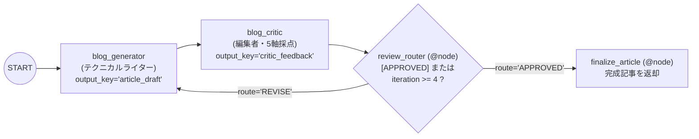

# Lv.6 Review & Critique Pattern（生成・批評分離パターン）

## 概念

**Review & Critique Pattern** は、成果物を作成する **Generator（生成者）** と、明確な採点ルーブリックに基づいて客観的に審査する **Critic（批評者）** を別々のエージェントとして分離し、合格基準に達するまで改稿を繰り返すデザインパターンです。

単一エージェントに「書きながら自分でチェックして」と指示するよりも、生成と批評のコンテキスト・役割を分けることで、自己正当化バイアスを抑えた具体的な改善フィードバックが得られます。



## いつ使うか

### ✅ 適している場合
- 技術記事、提案書、顧客向けメール、設計ドキュメントなど、複数の品質軸（正確性・構成・具体性・読者適合性など）を満たす必要がある成果物の生成
- 「書く視点」と「厳しく検査する視点（法務・セキュリティ・編集基準など）」を明確に切り分けたい場合

### ❌ 不向きな場合・できないこと
- **Generator と Critic の指示が矛盾していると収束しない**: 例として Generator に「600〜800 文字で簡潔に書け」と命じつつ、Critic が「網羅的なコード例と詳細な背景をすべて追記せよ」と要求し続けると、上限回数までループが空回りします。両者の要件定義を整合させるとともに、必ず `MAX_ITERATIONS` を設けます。
- **事実関係の外部裏付け（ハルシネーション検知）はプロンプト批評だけでは完結しない**: 検索ツールや原典データを持たない Critic は「もっともらしい誤情報」を見抜けない場合があります（原典照合が必要な場合は [`CLI-04 Grounded RAG`](../../agents_cli_patterns/cli04_grounded_rag_deploy/) と組み合わせます）。
- **軽量タスクではコスト過剰になる**: 1 反復ごとに 2 回の LLM 呼び出しが発生するため、簡易な文章整形であれば [`Lv.7 Iterative Refinement`](../p07_iterative_refinement/) の方が低コストです。

## 関連パターンとの違い

| 観点 | Loop (Lv.5) | Review & Critique (Lv.6) | Iterative Refinement (Lv.7) |
|---|---|---|---|
| エージェント構成 | 生成 + テスト判定 | **Generator（執筆）+ Critic（批評）の 2 役分離** | 単一エージェントによる生成 + 自己採点 |
| 評価の独立性 | 機能要件・テスト中心 | **高い（別ペルソナ・5 軸ルーブリック）** | 低い（同一エージェントの自己評価） |
| 1 反復あたりの LLM 呼出 | 2 回 | 2 回 | 1 回 |

## このデモのユースケース

**技術ブログ記事の執筆・編集レビューループ**

1. `blog_generator` (`output_key="article_draft"`): 初中級クラウドエンジニア向けに 600〜800 文字の技術解説記事を執筆（2 周目以降は `critic_feedback` の改善指示をすべて反映して改稿）。
2. `blog_critic` (`output_key="critic_feedback"`): 5 項目（技術的正確性・読みやすさ・具体性・読者適合・実用性、各 20 点 = 100 点満点）で採点し、80 点以上なら `[APPROVED]`、80 点未満なら具体的な改善点（3 点以内）とともに `[NEEDS_REVISION]` を出力。
3. `review_router` (`@node`): 判定タグと最大反復回数（`MAX_ITERATIONS = 4`）を検査し、`REVISE` または `APPROVED` へ決定論的に分岐。

## アーキテクチャと実装のポイント

```python
from google.adk.workflow import Workflow

root_agent = Workflow(
    name="blog_review_loop",
    edges=[
        (
            "START",
            generator,
            critic,
            review_router,
            {"REVISE": generator, "APPROVED": finalize_article},
        ),
    ],
)
```

1. **定量ルーブリックと具体的な改善点数制限**:
   Critic に「自由に批評せよ」とだけ指示すると、抽象的な感想や過剰な要求を返しやすくなります。「5 項目 × 各 20 点」「改善指示は具体的な 3 点以内」「80 点以上で `[APPROVED]`」と構造化することで、Generator が次の反復で確実に修正できるフィードバックになります。
2. **前回のドラフトと批評の両方を Generator に渡す**:
   `_build_blog_generator_instruction(ctx)` では、2 周目以降に `ctx.state["article_draft"]`（前回の原稿）と `ctx.state["critic_feedback"]`（編集者の指摘）の両方を提示し、良かった部分を壊さずに指摘箇所を改善できるようにしています。

## トレードオフ

| 観点 | 評価 | 理由 |
|---|---|---|
| コンテンツ品質 | 高 | 独立した編集者ペルソナが多角的な採点基準で抜け漏れを指摘する |
| 制御の明確さ | 高 | 100 点満点のスコア閾値と `@node` ルーターで合否判定が明瞭 |
| 推論コスト | 中 | 最大 `MAX_ITERATIONS`（4 回）× 2 エージェント分の呼び出しが発生する |
| プロンプト設計負荷 | 中 | Generator の制約（文字数等）と Critic の要求水準を矛盾なく揃える必要がある |

## 実行方法

```bash
# デモ実行（執筆 → 編集者採点 → 改稿ループを実行）
PYTHONPATH=. .venv/bin/python patterns/p06_review_critique/demo.py

# Lv.1 単体テスト（外部 API 通信なし: Critic 指摘による再執筆とフィードバック注入を検証）
.venv/bin/pytest tests/unit/test_agent_structure.py::TestReviewCritiqueStructure \
  tests/unit/test_existing_patterns_runtime.py::TestP06ReviewCritiqueRuntime -v

# Lv.2 統合テスト（Google Cloud ADC 認証が必要）
.venv/bin/pytest tests/integration/test_patterns.py::TestReviewCritique -v
```

## 学習ポイント

1. 生成者（Generator）と批評者（Critic）の責務・ペルソナを分離することによる品質向上メカニズム
2. 採点基準（ルーブリック）の定量化と、Generator/Critic 間の要件整合性の取り方
3. `article_draft` と `critic_feedback` の 2 つの状態キーを循環させる改稿プロンプト設計

## 次のステップ

→ **[Lv.7 Iterative Refinement](../p07_iterative_refinement/)**: 単一エージェントの自己評価ループでコストを抑えながら段階的に改善する
