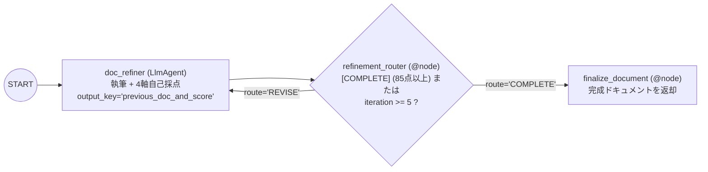

# Lv.7 Iterative Refinement Pattern（自己評価・反復改善パターン）

## 概念

**Iterative Refinement Pattern** は、1 つの `LlmAgent` が「成果物の生成・改善」と「定量ルーブリックに基づく自己採点」の両方を担い、決定論的ルーター `@node` が目標スコア到達（`[COMPLETE]`）または最大反復回数（`MAX_ITERATIONS`）まで自己ループを回すデザインパターンです。

`Lv.6 Review & Critique` が生成者と批評者を 2 エージェントに分けるのに対し、本パターンは 1 反復あたり 1 回のモデル呼び出しで完結するため、コストとレイテンシを半分に抑えられます。



## いつ使うか

### ✅ 適している場合
- 網羅すべき章立て・コード例・図表などのチェック項目が明確であり、1 つのエージェントでも抜け漏れを自己点検しやすいタスク（技術解説書、議事録整形、翻訳推敲など）
- 反復改善による品質向上は欲しいが、`Lv.6 Review & Critique` のように毎ループ 2 エージェント分のトークンと時間をかけたくない場合

### ❌ 不向きな場合・できないこと
- **自己評価バイアス（採点の甘さ）を完全には排除できない**: 同じモデル・同じプロンプトが自分の出力を採点するため、論理の飛躍や事実誤認があっても高得点を付けて早期終了する傾向があります。独立した厳しい審査が必要な場面では [`Lv.6 Review & Critique`](../p06_review_critique/) または異種モデル審査を行う [`PROD-04 Model Cascade`](../../production_patterns/prod04_model_cascade/) を選択します。
- **外部システムの状態変化を伴う検証はできない**: 自己採点はテキスト上のルーブリック評価にとどまります。実際にコードが動くか、DB が正しく更新されたかを検証するには実行ツールや [`PROD-05 Outcome State Evaluation`](../../production_patterns/prod05_outcome_state_evaluation/) が必要です。

## 関連パターンとの違い

| 観点 | Review & Critique (Lv.6) | Iterative Refinement (Lv.7) |
|---|---|---|
| エージェント数 | 2（Generator + Critic） | **1（`doc_refiner` 単体で完結）** |
| 1 反復あたりの LLM 呼出 | 2 回 | **1 回（低コスト・低遅延）** |
| 評価の客観性 | 高い（別ペルソナによる批評） | 中程度（自己採点インフレの傾向あり） |
| 適した用途 | 厳格な品質保証・対外公開文書 | 構造化ドキュメントの段階的な肉付け |

## このデモのユースケース

**Google Cloud 技術ドキュメント自動生成・自己改善エージェント**

指定された技術テーマについて、以下の 4 軸（計 100 点満点）で自己採点しながら、85 点以上（`[COMPLETE]`）に達するまで最大 5 回ドキュメントを改善します。

- 技術的正確性（30 点）
- 網羅性（25 点）
- 読みやすさ・構成・ASCII 図解（25 点）
- 実用性・コード例（20 点）

## アーキテクチャと実装のポイント

```python
from google.adk.workflow import Workflow

MAX_ITERATIONS = 5

root_agent = Workflow(
    name="doc_refinement_loop",
    edges=[
        (
            "START",
            doc_refiner,
            refinement_router,
            {"REVISE": doc_refiner, "COMPLETE": finalize_document},
        ),
    ],
)
```

1. **前回の出力と自己採点を次ラウンドへ再注入（`previous_doc_and_score`）**:
   `doc_refiner` の出力には `---DOCUMENT---` と `---SCORE---`（減点理由を含む）の両方が含まれ、`output_key="previous_doc_and_score"` に保存されます。2 周目以降は `_build_doc_refiner_instruction(ctx)` がこの値をプロンプトに埋め込み、「前回の減点理由をすべて解消する」よう明示的に誘導します。
2. **`@node` ルーター（`refinement_router`）による決定論的制御**:
   `LlmAgent` 単体はルート値を発行しないため、`refinement_router` が `[COMPLETE]` / `[CONTINUE]` タグと `refinement_iteration < MAX_ITERATIONS` を検査して `Event(route="REVISE")` または `Event(route="COMPLETE")` を返します。

## トレードオフ

| 観点 | 評価 | 理由 |
|---|---|---|
| 推論コスト | 低〜中 | 反復回数 $\times 1$ エージェント分の呼び出しで済む |
| レイテンシ | 中 | 初回で 85 点以上に達すれば 1 ラウンドで即座に完了する |
| 構成のシンプルさ | 高 | `LlmAgent` 1 つと軽量な `@node` ルーターのみで実装できる |
| 監査の厳格さ | 中 | 自己採点のため、重大なコンプライアンス審査には不向き |

## 実行方法

```bash
# デモ実行（ドキュメント作成と自己採点ループを実行）
PYTHONPATH=. .venv/bin/python patterns/p07_iterative_refinement/demo.py

# Lv.1 単体テスト（外部 API 通信なし: [CONTINUE] → [COMPLETE] の自己ループ検証）
.venv/bin/pytest tests/unit/test_agent_structure.py::TestIterativeRefinementStructure \
  tests/unit/test_existing_patterns_runtime.py::TestP07IterativeRefinementRuntime -v

# Lv.2 統合テスト（Google Cloud ADC 認証が必要）
.venv/bin/pytest tests/integration/test_patterns.py::TestIterativeRefinement -v
```

## 学習ポイント

1. 単一 `LlmAgent` の自己ループ構造（`doc_refiner` → `refinement_router` → `doc_refiner`）の組み方
2. ドキュメント本文と自己採点結果を同一出力に構造化して次イテレーションの改善指針にする手法
3. `Lv.6 Review & Critique` と `Lv.7 Iterative Refinement` のコスト対品質の使い分け

## 次のステップ

→ **[Lv.8 Coordinator Pattern](../p08_coordinator/)**: ユーザーの意図を LLM が解釈し、複数の専門エージェントへ動的にルーティングする
