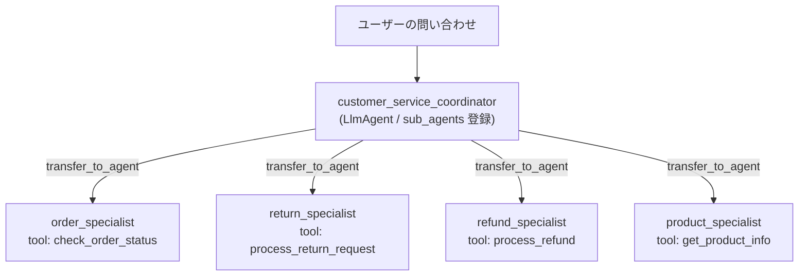

# Lv.8 Coordinator Pattern（動的ルーティング・委譲パターン）

## 概念

**Coordinator Pattern** は、窓口となる親 `LlmAgent`（Coordinator）がユーザーの自然言語リクエストの意図を解釈し、`sub_agents` に登録された複数の専門エージェント（Specialist）の中から最適な担当者を **動的に 1 つ選択して処理を委譲** するデザインパターンです。

各専門エージェントは自分の担当領域に必要な専用ツールだけを持つため、単一エージェントに全ツールを詰め込むことによる誤選択を防げます。



## いつ使うか

### ✅ 適している場合
- カスタマーサポート、社内ヘルプデスク、マルチドメイン窓口のように、ユーザーの入力意図が多岐にわたり正規表現や固定ルールだけでは分類しきれない場合
- ドメインごとに扱う API・ツール・業務ルール（返品条件、返金手続き、在庫照会など）が明確に分かれており、関心の分離を図りたい場合

### ❌ 不向きな場合・できないこと
- **100% 決定論的な振り分け保証はできない**: ルーティング自体を LLM が行うため、境界が曖昧な問い合わせでは意図しない専門エージェントへ転送される可能性があります。金額閾値やテナント権限など **絶対に誤判定が許されない分岐** には、`Workflow` の `@node` ルーター（コードによる確定分岐）を使用します。
- **全専門エージェントを毎回順番に実行する用途には不向き**: 全ステップを必ず通過させたいパイプライン処理に `Coordinator` を使うと、不要なルーティング推論コストがかかるうえ実行順序の揺らぎが生じます（→ [`Lv.3 Sequential`](../p03_sequential/) を使います）。
- **複数専門エージェントの同時並列実行は行わない**: `sub_agents` の委譲（`transfer_to_agent`）は対話の主導権を 1 つのエージェントへ移す仕組みであり、並列データ収集には [`Lv.4 Parallel`](../p04_parallel/) を使います。

## 関連パターンとの違い

| 観点 | Single Agent (Lv.1) | Sequential (Lv.3) | Coordinator (Lv.8) |
|---|---|---|---|
| ルーティング方式 | 1 エージェントが全ツールを直接選択 | グラフ定義に従い固定順序で全員実行 | **Coordinator LLM が `description` を見て動的委譲** |
| ツールの分離 | 全ツールが 1 コンテキストに混在 | 工程ごとに分離 | **専門ドメインごとに最小限のツールのみ保持** |
| 新領域の追加 | プロンプト肥大化・干渉しやすい | パイプライン全体の見直しが必要 | 新しい専門 `LlmAgent` を `sub_agents` に追加するだけ |

## このデモのユースケース

**EC カスタマーサポート自動振り分けシステム**

`customer_service_coordinator` が問い合わせ内容を受け付け、自らは実処理を行わずに以下 4 名の専門スタッフへ委譲します。

- `order_specialist`: 注文番号（`ORD-001` 等）の配送状況を `check_order_status` で照会
- `return_specialist`: 破損・サイズ違い等の返品手続きを `process_return_request` で受付
- `refund_specialist`: 重複請求等の返金処理を `process_refund` で実行
- `product_specialist`: 購入前の在庫・価格帯の質問に `get_product_info` で回答

## アーキテクチャと実装のポイント

```python
root_agent = LlmAgent(
    name="customer_service_coordinator",
    model=settings.default_model,
    description="カスタマーサポートのコーディネーター。",
    instruction="...自分では問題を解決しようとせず、必ず専門エージェントに委譲してください...",
    sub_agents=[order_agent, return_agent, refund_agent, product_agent],
)
```

1. **ADK 内部の委譲メカニズム（`transfer_to_agent`）**:
   `LlmAgent` に `sub_agents=[...]` を設定すると、ADK は自動的に組み込み関数 `transfer_to_agent(agent_name=...)` と各サブエージェントの `name` / `description` 一覧を Coordinator のモデルコンテキストへ注入します。
2. **`description` の具体性がルーティング精度を決める**:
   Coordinator の LLM はサブエージェントの `instruction` 全文ではなく **`description`** を読んで委譲先を選びます。「注文に関するエージェント」のような曖昧な記述を避け、「いつこのエージェントに回すべきか・何を扱わないか」を具体的に記述することが設計上の最重要ポイントです。

## トレードオフ

| 観点 | 評価 | 理由 |
|---|---|---|
| 拡張性・保守性 | 高 | 専門領域ごとにプロンプトとツールを独立して開発・テストできる |
| 未知表現への対応力 | 高 | 自然言語の言い換えや複合的な相談文脈を柔軟に解釈できる |
| レイテンシ・コスト | 中 | Coordinator の振り分け推論 + 専門エージェントの実行で最低 2 回モデルを呼ぶ |
| 厳密な決定性 | 中 | 境界ケースでの振り分けミスを防ぐには `description` の継続的な評価が必要 |

## 実行方法

```bash
# デモ実行（注文照会・返品・返金の 3 クエリがそれぞれの専門エージェントへ委譲される）
PYTHONPATH=. .venv/bin/python patterns/p08_coordinator/demo.py

# Lv.1 単体テスト（外部 API 通信なし: 専門ツール検証 + transfer_to_agent 委譲経路検証）
.venv/bin/pytest tests/unit/test_agent_structure.py::TestCoordinatorStructure \
  tests/unit/test_existing_patterns_runtime.py::TestP08CoordinatorRuntime -v

# Lv.2 統合テスト（Google Cloud ADC 認証が必要）
.venv/bin/pytest tests/integration/test_patterns.py::TestCoordinator -v
```

## 学習ポイント

1. `LlmAgent(sub_agents=[...])` と組み込み `transfer_to_agent` による動的ハンドオフの仕組み
2. ルーティング精度を左右する `description` の設計原則（境界条件の明示）
3. Coordinator に「自身では回答せず委譲に専念する」ガードレールを課す理由

## 次のステップ

→ **[Lv.9 Hierarchical Pattern](../p09_hierarchical/)**: 統括ディレクター → 部門マネージャー → 専門ワーカーの 3 層階層で大規模タスクを分割統治する
