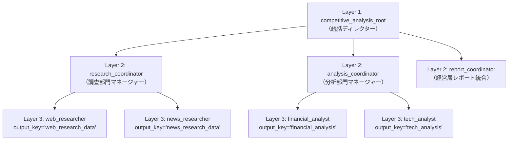

# Lv.9 Hierarchical Task Decomposition Pattern（階層型タスク分解パターン）

## 概念

**Hierarchical Task Decomposition Pattern** は、大規模で複合的なタスクを「統括ディレクター（Layer 1）→ 部門コーディネーター（Layer 2）→ 実務ワーカー（Layer 3）」の **多層エージェントツリー** に分割して段階的に遂行するデザインパターンです。

`Lv.8 Coordinator` が 1 段階の窓口振り分けを行うのに対し、本パターンでは中間管理層を設けることで、1 つのエージェントが抱えるサブエージェント数と認知負荷を適正範囲（各層 2〜4 個程度）に保ちます。



## いつ使うか

### ✅ 適している場合
- 専門ワーカーが 6〜10 個以上に増え、1 人の Coordinator の直下にフラットに並べると振り分け精度が落ちる大規模ドメイン
- 調査・財務分析・技術評価・経営レポート作成のように、部門単位で中間要約や進捗判断を行いながら進めたいタスク

### ❌ 不向きな場合・できないこと
- **委譲順序や全ワーカーの実行が 100% 保証されるわけではない**: 各階層の `LlmAgent` が対話転送（`transfer_to_agent`）で次の担当を選ぶため、モデルの判断によって一部のワーカーがスキップされたり順序が前後したりすることがあります。「必ず全リサーチャーを並列実行してから統合する」という決定論的保証が必要な場合は、`Workflow` と `JoinNode` を使う [`Capstone`](../capstone/) 構成を選択します。
- **トークン消費量とレイテンシが大きい**: 親 → 中間管理職 → ワーカー → 中間管理職 → 親と制御が往復するたびに LLM 呼び出しが発生するため、小〜中規模のタスクでは過剰設計（オーバーエンジニアリング）になります。

## 関連パターンとの違い

| 観点 | Coordinator (Lv.8) | Hierarchical (Lv.9) | Capstone Workflow (🏆) |
|---|---|---|---|
| 階層構造 | 2 層（Root → Specialists） | **3 層以上（Root → Managers → Workers）** | `Workflow` グラフによるハイブリッド統合 |
| 制御方式 | LLM による単発委譲 | LLM による多段階タスク分解・委譲 | グラフによる決定論的順序・並列・ループ制御 |
| 適した規模 | 2〜5 個の独立した専門窓口 | 部門横断の複合プロジェクト | 本番の定型エンタープライズ分析パイプライン |

## このデモのユースケース

**企業競合分析レポートの 3 層自動生成**

分析対象企業を指定すると、統括ディレクターが以下の 3 部門へ段階的に指示を出し、SWOT 分析と戦略的示唆を含む経営層向けレポートを作成します。

1. `research_coordinator`: `web_researcher`（企業概要・製品）と `news_researcher`（直近動向）に基礎データ収集を委譲
2. `analysis_coordinator`: `financial_analyst`（収益性・投資傾向）と `tech_analyst`（技術競争力・AI 活用）に専門分析を委譲
3. `report_coordinator`: 収集・分析された全データを統合してエグゼクティブレポートを執筆

## アーキテクチャと実装のポイント

```python
async def _build_tech_analyst_instruction(ctx: ReadonlyContext) -> str:
    """動的委譲で前段ワーカーが未実行でも KeyError を起こさず安全に参照する。"""
    web_data = ctx.state.get("web_research_data", "（基礎調査データ未取得）")
    news_data = ctx.state.get("news_research_data", "（ニュース調査データ未取得）")
    return f"...\n{web_data}\n...\n{news_data}\n..."
```

> [!IMPORTANT]
> **動的委譲ツリーでは固定文字列テンプレート `{key}` ではなく `ReadonlyContext.state.get()` を使う**
> 直列 `Workflow`（`Lv.3`）と異なり、`sub_agents` による動的委譲では LLM の判断で `web_researcher` より先に `news_researcher` や `financial_analyst` が呼ばれることがあります。その際、`instruction` に固定文字列 `"{web_research_data}"` を書いていると未定義キー参照で `KeyError` が発生します。
> 本実装では下流エージェントすべてに `ReadonlyContext` を受け取る関数プロンプトを採用し、任意の委譲順序でもクラッシュしない堅牢な設計にしています。

## トレードオフ

| 観点 | 評価 | 理由 |
|---|---|---|
| 大規模タスクの整理性 | 高 | 組織図と同じ構造で責務とプロンプトを階層分割できる |
| 拡張性 | 高 | 既存の他部門に影響を与えず新しい部門 Coordinator を追加できる |
| 推論コスト | 高 | 管理層と実務層の間で多数の委譲ターンが発生する |
| レイテンシ | 高 | 対話転送が直列に連鎖するため完了まで時間がかかる |

## 実行方法

```bash
# デモ実行（3 層エージェント階層による競合分析レポート生成）
PYTHONPATH=. .venv/bin/python patterns/p09_hierarchical/demo.py

# Lv.1 単体テスト（外部 API 通信なし: 階層構造検証 + state 未設定時の KeyError 耐性検証）
.venv/bin/pytest tests/unit/test_agent_structure.py::TestHierarchicalStructure \
  tests/unit/test_existing_patterns_runtime.py::TestP09HierarchicalRuntime -v

# Lv.2 統合テスト（Google Cloud ADC 認証が必要）
.venv/bin/pytest tests/integration/test_patterns.py::TestHierarchical -v
```

## 学習ポイント

1. 3 層 `LlmAgent` ツリーにおける統括層・中間管理層・実務層の役割分担
2. 動的委譲ツリーで `KeyError` を防ぐ `ReadonlyContext.state.get()` による防御的状態参照
3. 柔軟な LLM 階層委譲（`Lv.9`）と決定論的なグラフ統合（`Capstone`）の使い分け基準

## 次のステップ

→ **[Lv.10 Swarm Pattern](../p10_swarm/)**: 上下関係のない複数の専門家エージェントが多角的に議論し、合意形成（コンセンサス）に至るまでラウンドを重ねる
