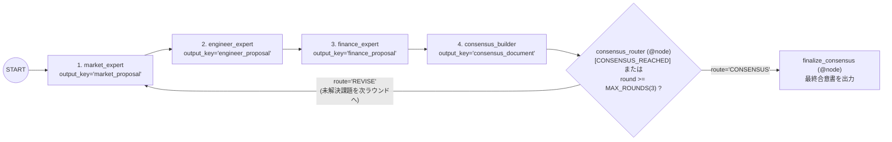

# Lv.10 Swarm Pattern（多専門家合議・コンセンサスパターン）

## 概念

**Swarm Pattern（合議コンセンサスパターン）** は、異なる専門視点（市場・技術・財務など）を持つ複数のエージェントが互いの提案と懸念事項を参照しながら議論ラウンドを重ね、ファシリテーターが合意成立（`[CONSENSUS_REACHED]`）と判定するか最大ラウンド数（`MAX_ROUNDS`）に達するまで設計案を洗練させるデザインパターンです。

`Lv.9 Hierarchical` が上位者からのトップダウン分解であるのに対し、本パターンは **相反するトレードオフ（例: 市場が求める豊富な機能 vs 開発工数と予算制約）を対等な議論ですり合わせるボトムアップ合意形成** を目的とします。



## いつ使うか

### ✅ 適している場合
- 新規プロダクト企画、アーキテクチャ選定、投資優先度決定など、単一の正解がなく複数の専門領域（ビジネス・エンジニアリング・財務/リスク）の折り合いをつける必要がある意思決定支援
- 1 回の多面分析だけでは各専門家の意見が食い違ったまま終わるため、未解決論点を次ラウンドへ持ち越してスコープ調整（MVP 切り出し等）を行わせたい場合

### ❌ 不向きな場合・できないこと
- **トークン消費量とレイテンシが全パターン中で最も大きい**: 1 ラウンドあたり 4 エージェントが直列に発言し、最大 `MAX_ROUNDS`（3 ラウンド = 計 12 回の LLM 呼び出し）まで反復するため、リアルタイム応答や単純な調査タスクには不向きです。
- **法的責任や最終決済の承認を AI 合議だけで完結させることはできない**: AI エージェント同士が合意しても実世界のコンプライアンス責任や予算執行権限は担保されないため、高リスクな実行判断には [`Lv.11 Human-in-the-Loop`](../p11_human_in_the_loop/) を後段に組み合わせます。

## 関連パターンとの違い

| 観点 | Parallel (Lv.4) | Hierarchical (Lv.9) | Swarm (Lv.10) |
|---|---|---|---|
| エージェント間の関係 | 独立（他者の出力を見ない） | 上下階層（マネージャーが委譲） | **対等な専門家が前者の提案に反論・補完** |
| 実行サイクル | 1 回のみ（並列 → 統合） | タスク完了まで動的委譲 | **合意成立まで複数ラウンド循環** |
| 主な価値 | 調査時間の短縮 | 大規模タスクの分割統治 | トレードオフの解消と合意案の創出 |

## このデモのユースケース

**新規クラウド製品設計の 3 専門家コンセンサス形成**

製品アイデアを入力すると、以下の 4 エージェントがラウンド制で議論を進めます。

1. `market_expert` (`output_key="market_proposal"`): ターゲット顧客・TAM/SAM/SOM・差別化を提案。2 ラウンド目以降は前ラウンドの `consensus_document` に記載された未解決課題を解消するようスコープを調整。
2. `engineer_expert` (`output_key="engineer_proposal"`): `{market_proposal}` の技術的実現可能性・構成・開発工数・リスクを評価し修正案を提示。
3. `finance_expert` (`output_key="finance_proposal"`): `{market_proposal}` と `{engineer_proposal}` をもとに初期投資・ROI・MVP フェーズ分けを評価。
4. `consensus_builder` (`output_key="consensus_document"`): 3 者の意見を統合し、合意が十分なら `[CONSENSUS_REACHED]`、重大な対立や未解決論点が残っていれば `[NEEDS_ANOTHER_ROUND]` を出力。

## アーキテクチャと実装のポイント

```python
from google.adk.workflow import Workflow

MAX_ROUNDS = 3

root_agent = Workflow(
    name="product_design_swarm",
    edges=[
        (
            "START",
            market_expert,
            engineer_expert,
            finance_expert,
            consensus_builder,
            consensus_router,
            {"REVISE": market_expert, "CONSENSUS": finalize_consensus},
        ),
    ],
)
```

1. **状態キーを上書き潰しせず履歴を引き継ぐ設計**:
   各専門家の提案キー（`market_proposal`, `engineer_proposal`, `finance_proposal`）とファシリテーターの統合キー（`consensus_document`）を分離しています。2 ラウンド目に入る際、`_build_market_expert_instruction(ctx)` が前ラウンドの `consensus_document` を読み取って改訂提案を行うため、各ラウンドの文脈が明確に保たれます。
2. **決定論的ルーター `@node`（`consensus_router`）によるラウンド上限管理**:
   `swarm_round` カウンタをセッション状態で管理し、`[NEEDS_ANOTHER_ROUND]` が出続けても `MAX_ROUNDS = 3` で確実に合意文書を確定させて終了します。

## トレードオフ

| 観点 | 評価 | 理由 |
|---|---|---|
| 多角的な意思決定品質 | 高 | 市場性・技術実現性・採算性の三すくみを段階的に解消できる |
| 拡張性 | 高 | セキュリティ専門家や法務専門家をチェーンに追加しやすい |
| 推論コスト | 高 | 4 エージェント $\times$ 最大 3 ラウンド（最大 12 回）のモデル呼び出しが発生 |
| レイテンシ | 高 | 各専門家が前者の発言を読んで順番に議論するため応答時間は長い |

## 実行方法

```bash
# デモ実行（市場・技術・財務の 3 専門家による製品設計合議を実行）
PYTHONPATH=. .venv/bin/python patterns/p10_swarm/demo.py

# Lv.1 単体テスト（外部 API 通信なし: [NEEDS_ANOTHER_ROUND] → Round 2 合意到達の検証）
.venv/bin/pytest tests/unit/test_agent_structure.py::TestSwarmStructure \
  tests/unit/test_existing_patterns_runtime.py::TestP10SwarmRuntime -v

# Lv.2 統合テスト（Google Cloud ADC 認証が必要）
.venv/bin/pytest tests/integration/test_patterns.py::TestSwarm -v
```

## 学習ポイント

1. 1 つの `Workflow` エッジ定義で「直列の専門家リレー」と「条件付き合議ラウンド」を統合する方法
2. 前ラウンドの未解決課題（`consensus_document`）を次ラウンドの先頭エージェントへ安全にフィードバックする設計
3. 議論の発散を防ぐための明確な合意判定タグと `MAX_ROUNDS` 上限ガードの実装

## 次のステップ

→ **[Lv.11 Human-in-the-Loop Pattern](../p11_human_in_the_loop/)**: ADK 2.x の `RequestInput` と `ResumabilityConfig` を使い、高リスク判定時にワークフローを一時停止して人間の承認・却下を受け取る
