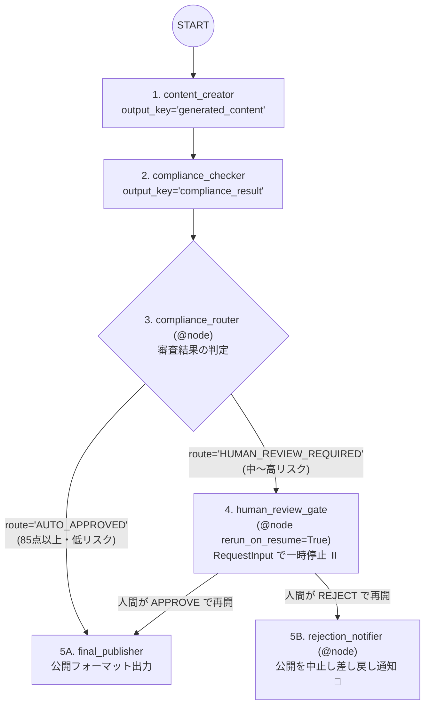

# Lv.11 Human-in-the-Loop Pattern（人間介入・承認ゲートパターン）

## 概念

**Human-in-the-Loop (HITL) Pattern** は、AI エージェントのワークフロー実行中に法的リスク・高額決済・対外公開などの重要局面を検出した際、**ワークフローの状態を保持したまま決定論的に一時停止（Interrupt）し、人間の明示的な承認（Approve）または却下（Reject）を受け取ってから再開（Resume）** するデザインパターンです。

低リスク案件は自動承認で高速に通過させ、中〜高リスク案件のみ人間にエスカレーションすることで、ガバナンスと運用効率を両立します。



## いつ使うか

### ✅ 適している場合
- 景品表示法・薬機法などのコンプライアンス審査を伴うマーケティング原稿やプレスリリースの公開フロー
- 本番インフラの設定変更、高額返金、外部顧客へのメール送信など、誤実行時の取り返しがつかない操作の最終ゲート

### ❌ 不向きな場合・できないこと
- **ミリ秒〜秒単位のリアルタイム同期応答が必須の API には直接組み込めない**: 人間が確認・応答するまで数分〜数時間かかることがあるため、実運用ではセッション状態を DB 等に永続化した非同期イベント駆動構成にします。
- **`InMemorySessionService` 単体ではプロセス再起動をまたいで再開できない**: デモや単体テストではインメモリで動作しますが、本番運用では永続化対応のセッションサービスを使用する必要があります。
- **再開時の外部 API 二重実行防止（冪等性）は別途実装が必要**: ネットワーク障害等で再開リクエストが再送された場合に備え、決済や DB 書き込みを行うツールには [`PROD-02 Idempotent Tool & Approval Gate`](../../production_patterns/prod02_idempotent_approval_gate/) の冪等性台帳（Idempotency Ledger）を併用します。

## 関連パターンとの違い

| 観点 | Review & Critique (Lv.6) | Human-in-the-Loop (Lv.11) | Idempotent Approval Gate (PROD-02) |
|---|---|---|---|
| 最終承認者 | Critic エージェント（AI） | **人間のレビュアー** | 人間のレビュアー + 冪等性台帳 |
| ADK 2.13 機能 | `Workflow` 条件付きサイクル | **`RequestInput` + `ResumabilityConfig`** | `require_confirmation` + `@node(require_confirmation=...)` + SHA-256 台帳 |
| 主な焦点 | テキスト品質の自動改善 | リスクに応じた一時停止・承認/却下分岐 | 副作用ツールの二重実行防止と金額閾値承認 |

## このデモのユースケース

**マーケティング原稿のコンプライアンス審査・公開承認ワークフロー**

1. `content_creator`: 訴求ポイントを含むプロモーション原稿を作成。
2. `compliance_checker`: 法令リスク・誇大表現（「工数 80% 削減」等の根拠有無）を審査し、`[AUTO_APPROVED]` / `[HUMAN_REVIEW_REQUIRED]` / `[REJECTED]` を判定。
3. `compliance_router` (`@node`): `[AUTO_APPROVED]` なら人間を煩わせず `final_publisher` へ直行し、それ以外は `human_review_gate` へ遷移。
4. `human_review_gate` (`@node(rerun_on_resume=True)`): `RequestInput` を発行して実行を一時停止。再開時に人間が `APPROVE` を返せば公開、`REJECT` を返せば `rejection_notifier` で公開を確実にブロック。

## アーキテクチャと実装のポイント

### 1. サーバー側: `RequestInput` と `ResumabilityConfig` による一時停止・再開ノード

```python
from google.adk.apps import App, ResumabilityConfig
from google.adk.events.request_input import RequestInput
from google.adk.workflow import Workflow, node

@node(name="human_review_gate", rerun_on_resume=True)
async def human_review_gate(ctx: Context, node_input: Any):
    # 初回到達時: RequestInput を yield してワークフローを一時停止する
    if not ctx.resume_inputs or "compliance_human_review" not in ctx.resume_inputs:
        yield RequestInput(
            interrupt_id="compliance_human_review",
            message="公開を承認する場合は 'APPROVE'、却下する場合は 'REJECT' を入力してください。",
            payload={"generated_content": ctx.state.get("generated_content", "")},
        )
        return

    # 再開時: ctx.resume_inputs から人間の回答を取り出してルートを決定する
    reply = ctx.resume_inputs["compliance_human_review"]
    decision = str(reply.get("result") if isinstance(reply, dict) else reply)
    if decision.upper().startswith("APPROVE"):
        yield Event(output=decision, route="APPROVED", state={"human_review": decision})
    else:
        yield Event(output=decision, route="REJECTED", state={"human_review": decision})

app = App(
    name="content_approval_app",
    root_agent=root_agent,
    resumability_config=ResumabilityConfig(is_resumable=True),
)
```

### 2. クライアント側: `adk_request_input` への `FunctionResponse` 送信による再開

`RequestInput` が発行されると、イベントストリームに `name="adk_request_input"` の `FunctionCall` が流れます。再開時は通常のテキストメッセージではなく、**その `FunctionCall.id` に対応する `FunctionResponse`** を送信します（通常のテキストを送ると最初から新規実行される点に注意してください）。

```python
resume_message = types.Content(
    role="user",
    parts=[
        types.Part(
            function_response=types.FunctionResponse(
                id=pending_interrupt.id,
                name="adk_request_input",
                response={"result": "APPROVE: 注意書きを添えて公開承認"},
            )
        )
    ],
)
async for event in runner.run_async(user_id=uid, session_id=sid, new_message=resume_message):
    ...
```

## トレードオフ

| 観点 | 評価 | 理由 |
|---|---|---|
| リスク統制・安全性 | 最高 | 人間が却下した原稿はグラフ分岐により `final_publisher` に絶対到達しない |
| 運用効率 | 高 | 低リスク原稿は `AUTO_APPROVED` ルートで人間待ちなしに通過できる |
| エンドツーエンド所要時間 | 低（待機発生時） | 人間レビュアーの応答速度が全体のボトルネックになる |
| クライアント実装要件 | 中 | `adk_request_input` の検出と `FunctionResponse` 送信の実装が必要 |

## 実行方法

```bash
# デモ実行（コンプライアンス審査後、対話コンソールで承認 y/n を入力して再開）
PYTHONPATH=. .venv/bin/python patterns/p11_human_in_the_loop/demo.py

# Lv.1 単体テスト（外部 API 通信なし: 自動承認・人間承認公開・人間却下ブロックの全 3 分岐を検証）
.venv/bin/pytest tests/unit/test_agent_structure.py::TestHumanInTheLoopStructure \
  tests/unit/test_existing_patterns_runtime.py::TestP11HumanInTheLoopRuntime -v

# Lv.2 統合テスト（Google Cloud ADC 認証が必要）
.venv/bin/pytest tests/integration/test_patterns.py::TestHumanInTheLoop -v
```

## 学習ポイント

1. ADK 2.13 の `RequestInput` と `@node(rerun_on_resume=True)` を使った宣言的な一時停止・再開設計
2. `App(..., resumability_config=ResumabilityConfig(is_resumable=True))` によるチェックポイント再開の有効化
3. クライアント側から `FunctionResponse(name="adk_request_input")` を返して `ctx.resume_inputs` へ応答を渡すプロトコル

## 次のステップ

→ **[Capstone: Enterprise Research Agent](../capstone/)**: これまでに学んだ直列・並列（`JoinNode`）・生成批評ループ・Coordinator を単一の `Workflow` パイプラインへ統合する
