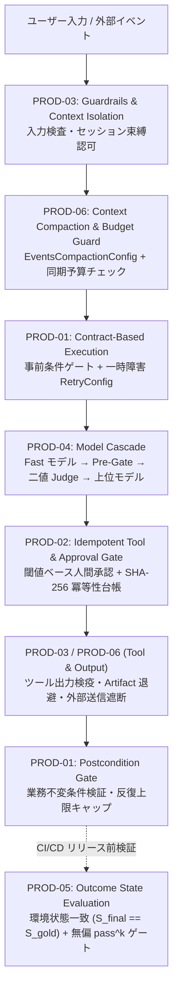

# Production Design Patterns（本番運用デザインパターン集）

基礎オーケストレーション（[`patterns/`](../patterns/)）および開発ライフサイクル管理（[`agents_cli_patterns/`](../agents_cli_patterns/)）に加え、ミッションクリティカルな本番システムでエージェントを安全・高品質・低コストに稼働させるための **6 つの普遍的デザインパターン** を実装したトラックです。

特定の業種・プロジェクトに依存せず、ADK 2.x（`google-adk >= 2.13`）を採用するあらゆる本番エージェントにそのまま組み込める再利用可能な設計パターンとして構成しています。

---

## 全体アーキテクチャ（6 パターンの責務配置）



---

## パターン一覧と選定ガイド

| ID | デザインパターン | ディレクトリ | 解決する本番課題 | 主要な ADK 2.13 構成要素 |
|---|---|---|---|---|
| **PROD-01** | **Contract-Based Execution** | [`prod01_contract_based_execution/`](prod01_contract_based_execution/) | 不正入力での無駄な推論、業務ルール違反のサイレント通過、無限自己修正ループ | `Workflow`, `@node(retry_config=RetryConfig, timeout=...)`, Pydantic 事前・事後不変条件 |
| **PROD-02** | **Idempotent Tool & Approval Gate** | [`prod02_idempotent_approval_gate/`](prod02_idempotent_approval_gate/) | リトライ・再開時の二重決済・二重送信、高額操作の無承認実行 | `FunctionTool(require_confirmation=predicate)`, `@node(require_confirmation=...)`, `ResumabilityConfig` |
| **PROD-03** | **Guardrails & Context Isolation** | [`prod03_guardrails_context_isolation/`](prod03_guardrails_context_isolation/) | テナント横断の情報漏洩、外部データ経由の間接プロンプトインジェクション、不正外部送信 | `BasePlugin` 4 フック、`tool_context.state["auth:tenant_id"]`、ホストホワイトリスト |
| **PROD-04** | **Model Cascade** | [`prod04_model_cascade/`](prod04_model_cascade/) | 全件上位モデル利用による高コスト・高遅延、および審査モデルの採点バイアス | 決定論的 Pre-Gate、Fail-Closed 二値 Judge、Rogan–Gladen 推定量 |
| **PROD-05** | **Outcome State Evaluation** | [`prod05_outcome_state_evaluation/`](prod05_outcome_state_evaluation/) | 「変更しました」と答えて DB 未更新のハルシネーション、`Pass@k` による信頼性過大評価 | 環境状態検証 ($S_{\text{final}} == S_{\text{gold}}$)、無偏 `pass^k`、Wilson 信頼区間 |
| **PROD-06** | **Context Compaction & Budget Guard** | [`prod06_context_compaction_budget/`](prod06_context_compaction_budget/) | 大容量ツール出力による $O(D^2)$ トークン膨張、暴走時の推論費青天井、請求ラベル上限枯渇 | `ArtifactService`, `EventsCompactionConfig`, 同期予算遮断プラグイン, ラベル検証 |

---

## 実行とテスト

すべてのパターンは、外部ネットワークやクラウド認証情報を一切必要としない決定論的 `ScriptedLlm(BaseLlm)` ダブルによって、インプロセスで ADK `Runner` の全分岐を単体検証できます。

```bash
# 全 6 パターンの単体・インプロセス結合テストを一括実行
.venv/bin/pytest tests/unit/test_production_patterns.py -v
```
