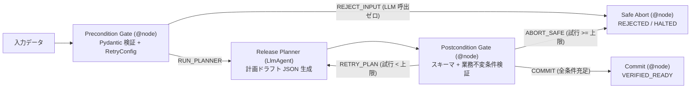

# PROD-01: Contract-Based Execution パターン

## 概念

**Contract-Based Execution（事前・事後条件による契約実行）** は、古典的ソフトウェア工学の「契約による設計（Design by Contract）」をエージェントワークフローに適用し、**確率的に動作する `LlmAgent` の前後を決定論的な事前条件（Precondition）ゲートと事後不変条件（Postcondition / Invariant）ゲートで保護するパターン**です。

LLM に制御フロー全体（入力妥当性の確認・再試行回数の判断・完了宣言）を委ねると、不正入力に対する不要なトークン消費や、業務ルールに違反した出力を「完了」と誤報告するサイレント障害が発生します。本パターンでは「何を満たせば実行してよいか」「何を満たせば完了とみなすか」「何回失敗したら安全停止するか」をすべて Python コード側の契約として強制します。



## いつ使うか

✅ **適している場合:**
- インフラ構成変更計画、注文データ変換、SQL / API パラメータ生成など、厳格な数値上限・型・業務ルールを守る必要がある業務処理
- 壊れた入力データを LLM 呼び出し前に即座に弾き、不要な推論コストを防ぎたい場合
- 条件を満たせない場合に曖昧な回答を返すのではなく、明示的なステータス（`HALTED_FOR_HUMAN`）で後続システムや人間へ引き継ぎたい場合

❌ **不向きな場合・できないこと:**
- **コードで定式化できない定性的な品質までは保証できない**: 事後条件ゲートが100%保証できるのは「スキーマ・数値範囲・必須要素・整合性ルール」までであり、「文章の表現が丁寧か」といった主観的評価には [`prod04_model_cascade`](../prod04_model_cascade/) の審査モデルや人間レビューの併用が必要
- **自由形式の対話・ブレインストーミングには不向き**: 入出力を構造化スキーマで拘束するため、探索的な雑談チャットに適用すると柔軟性を損なう

## Loop (Lv.5) / Review & Critique (Lv.6) との違い

| 観点 | Loop / Review & Critique (`patterns/p05`, `p06`) | Contract-Based Execution (`prod01`) |
|---|---|---|
| 事前検証 | なし（不正入力もそのまま初回 LLM へ渡る） | **あり**（`precondition_gate` が LLM 呼び出し前に遮断） |
| 合否判定主体 | 批評用の別 `LlmAgent`（確率的・追加トークン発生） | **決定論的 Python 関数**（ミリ秒・推論コストゼロ・100% 再現可能） |
| 一時障害リトライ | なし | `@node(retry_config=RetryConfig(...))` による指数バックオフ再試行 |
| 上限到達時の挙動 | 最終ターンの未検証テキストがそのまま返りやすい | 明示的に `HALTED_FOR_HUMAN` と未解決違反リストを返して停止 |

## このデモのユースケース

**本番リリース計画の自動生成と安全性契約の検証**

変更チケット（例: `checkout-api` を本番環境で 60 レプリカへ増設したい要求）を受け取り、サービスごとの許容上限（最大 40 レプリカ、本番カナリア比率 20% 以下、ロールバック手順の必須記載）を満たす計画 JSON へ収束させます。

## アーキテクチャと実装のポイント

### 1. 事前条件ゲートと通信リトライ（`precondition_gate`）

`ChangeTicketInput`（Pydantic）で入力形式を検査し、違反時は LLM を 1 トークンも呼ばずに `REJECT_INPUT` ルートへ分岐します。また、マスタ DB 参照時の一時的な通信切断に対しては `@node(retry_config=RetryConfig(max_attempts=3, exceptions=[ConnectionError]))` で自動再試行を行います（※ Python 3.11 以降では組み込みの `TimeoutError` が `asyncio.TimeoutError` と同一クラスであるため、`@node(timeout=...)` と併用する際はリトライ対象に `ConnectionError` 等の具体的な通信例外を指定します）。

### 2. 構造化エラーフィードバックを返すツール設計（`lookup_service_bounds`）

エージェントが未登録のサービス名を照会した際、例外でプロセスをクラッシュさせるのではなく、`available_services`（有効な選択肢一覧）と `hint` を含む辞書を返却して自律的な修正を促します。

### 3. 事後不変条件ゲートと反復上限キャップ（`postcondition_gate`）

ADK 2.13 の `Workflow` グラフ自体は条件付きサイクルの自動回数上限を持たないため、セッション状態 `ctx.state["attempt_count"]` で試行回数を厳密にカウントし、`MAX_REFINEMENT_ITERATIONS`（既定 3 回）に達した時点で `ABORT_SAFE` へ分岐して無限ループを防止します。

## トレードオフ

| 観点 | 評価 |
|---|---|
| コスト | 🟢 低〜中（不正入力は 0 トークン、再生成時のみ最大 $N$ 回呼び出し） |
| レイテンシ | 🟢 低（事後検証自体は Python 処理のため 1ms 未満） |
| 複雑性 | 🟡 中（入出力の Pydantic モデルと不変条件関数の実装が必要） |
| 信頼性・予測可能性 | 🟢 最高（契約違反データが後続処理へ流出しないことを保証） |

## 実行方法

```bash
# 1. 単体テスト（決定論的 BaseLlm ダブルで事前拒否・自己修正・上限停止の全分岐を検証）
.venv/bin/pytest tests/unit/test_production_patterns.py -k "Prod01" -v

# 2. デモ実行（GOOGLE_CLOUD_PROJECT 設定時）
PYTHONPATH=. .venv/bin/python production_patterns/prod01_contract_based_execution/demo.py
```

## 学習ポイント

1. 確率的な `LlmAgent` の前後に決定論的な `@node` を配置する契約駆動ワークフロー設計
2. `@node(retry_config=RetryConfig(...), timeout=...)` を用いたインフラ一時障害への耐性付与
3. セッション状態（`attempt_count`）による明示的なループ上限管理と安全なエスカレーション停止

## 次のステップ

→ **[PROD-02: Idempotent Tool & Approval Gate パターン](../prod02_idempotent_approval_gate/)**: 検証を通過した計画が外部システムへ書き込みを行う際の「二重実行防止（冪等性）」と「閾値ベースの人間承認」を学ぶ
