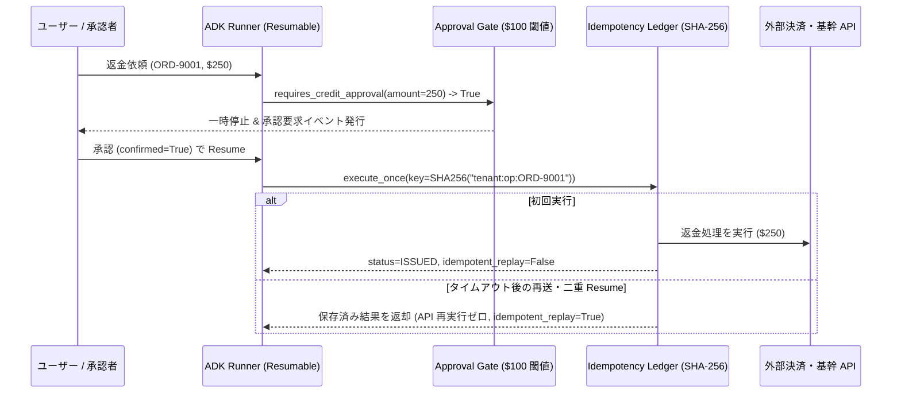

# PROD-02: Idempotent Tool & Approval Gate パターン

## 概念

**Idempotent Tool & Approval Gate（冪等ツール実行・閾値承認ゲート）** は、決済・発注・リソース変更などの副作用を伴う操作において、**フレームワーク組み込みの宣言的承認ゲート（`require_confirmation`）で実行前に人間の承認を強制しつつ、決定論的な冪等キー（Idempotency Key）台帳によって再試行・再開時の二重実行を防止するパターン**です。

ネットワーク瞬断によるリトライや、一時停止（Pause）から承認再開（Resume）を挟む非同期実行は、原理的に **At-Least-Once（少なくとも 1 回実行）** となります。承認ゲートと冪等性台帳をセットで設計することで、「無承認での高額操作」と「再開時の二重課金・二重返金」の双方を防ぎます。



## いつ使うか

✅ **適している場合:**
- 返金・決済・在庫引当・外部メール送信・クラウド構成変更など、2 回実行されると実害が生じるツールを持つエージェント
- リスクや金額の低い定型処理は即時自動実行し、一定の閾値（例: 100 USD 以上）を超える操作だけ人間の承認を必須にしたい場合

❌ **不向きな場合・できないこと:**
- **インメモリ台帳のままでは複数コンテナ・再起動を跨いだ重複排除はできない**: サンプルの `IdempotencyLedger` は学習・単体テスト向けにプロセスメモリ上に保持しているため、Cloud Run 等で本番運用する際は必ず **Cloud SQL（PostgreSQL）や Spanner 等の ACID トランザクション対応 DB の `UNIQUE` 制約付きテーブル**へ置き換える必要がある
- **単発の金額閾値だけでは「少額への分割要求」は防げない**: 1 回あたり 90 USD の要求を複数回繰り返して 100 USD の承認ゲートを回避する挙動を防ぐには、同一注文・同一ユーザーの期間累積額を台帳側で合算判定する必要がある
- **`ResumabilityConfig` の永続化互換確認が必須**: `google-adk 2.13.0` 時点では `ResumabilityConfig` は `@experimental` 扱いのため、長時間待機を伴う本番システムでは採用する永続 `SessionService` 上で再開イベントの統合テストを必ず実施すること

## Human-in-the-Loop (Lv.11) との違い

| 観点 | Human-in-the-Loop (`patterns/p11`) | Idempotent Tool & Approval Gate (`prod02`) |
|---|---|---|
| 承認インターフェース | コンソール標準入力（`Confirm.ask` による同期ブロッキング） | **イベント駆動の一時停止・再開**（Web / Chat UI からの非同期承認に対応） |
| 条件付き承認 | 全件固定またはプロンプト評価に依存 | Python 述語関数（`amount_usd >= 100`）で引数に基づき決定論的に分岐 |
| 再試行・二重再開耐性 | なし（再実行すると副作用が重複する） | **あり**（SHA-256 冪等キーとペイロードハッシュ検証で 1 回のみ実行） |

## このデモのユースケース

**EC カスタマーサポートにおける金額閾値付き返金クレジット発行**

100 USD 未満の少額お詫びクレジットは承認待ちなしで即時発行し、100 USD 以上の高額返金は自動的に実行を一時停止して承認者の判断を仰ぎます。また、同一注文番号に対する重複リクエストは台帳で検出し、二重返金を防止します。

## アーキテクチャと数式・実装のポイント

### 1. 決定論的 Idempotency Key とペイロード整合性検査

冪等キーに毎回ランダムな `UUIDv4` を生成してしまうと、リトライのたびに別のキーとみなされ重複排除が機能しません。必ず「テナント ID」「操作種別」「業務上の一意キー（注文番号など）」から決定論的なハッシュ値を算出します。

$$\text{IdempotencyKey} = \text{SHA256}(\text{tenant\_id} \parallel \text{":"} \parallel \text{operation} \parallel \text{":"} \parallel \text{business\_key})$$

さらに、同一の `IdempotencyKey` に対して**前回と異なる金額やパラメータ**（例: 初回 `\$45` だった注文番号に対し `\$450`）で再送された場合は、キャッシュ結果をそのまま返すと引数不整合が隠蔽されるため、引数全体の SHA-256 ハッシュ `payload_hash` を照合して `CONFLICT (IDEMPOTENCY_PAYLOAD_MISMATCH)` を返します。

### 2. ツールレベルとワークフローレベルの 2 種類の宣言的承認ゲート

- **ツール単位**: `FunctionTool(issue_customer_credit, require_confirmation=requires_credit_approval)`
- **ノード単位**: `@node(..., require_confirmation=_node_needs_confirmation, rerun_on_resume=True)`

いずれも LLM のプロンプト解釈に頼らず、ADK ランタイムが関数実行の直前で割り込みイベントを発行します。

## トレードオフ

| 観点 | 評価 |
|---|---|
| コスト | 🟢 低（冪等性チェック・閾値判定ともに Python / DB 処理のみ） |
| レイテンシ | 🟡 閾値未満は低遅延、閾値以上は人間の承認応答時間に依存 |
| 複雑性 | 🟡 中（永続 DB 台帳と再開イベントハンドリングの実装が必要） |
| 安全性・整合性 | 🟢 最高（無承認実行と二重書き込みの双方を構造的に防止） |

## 実行方法

```bash
# 1. 単体テスト（重複排除・引数不一致競合・承認一時停止と再開をオフライン検証）
.venv/bin/pytest tests/unit/test_production_patterns.py -k "Prod02" -v

# 2. デモ実行（GOOGLE_CLOUD_PROJECT 設定時）
PYTHONPATH=. .venv/bin/python production_patterns/prod02_idempotent_approval_gate/demo.py
```

## 学習ポイント

1. At-Least-Once 実行環境において業務キーから決定論的な冪等キーを設計する方法
2. 同一キー・異パラメータ再送を `IDEMPOTENCY_PAYLOAD_MISMATCH` として検出する防御設計
3. `FunctionTool(require_confirmation=...)` と `@node(require_confirmation=...)` による非同期承認フローの構築

## 次のステップ

→ **[PROD-03: Guardrails & Context Isolation パターン](../prod03_guardrails_context_isolation/)**: マルチテナント環境でのデータ漏洩や外部入力経由の間接プロンプトインジェクションを防ぐ境界制御を学ぶ
