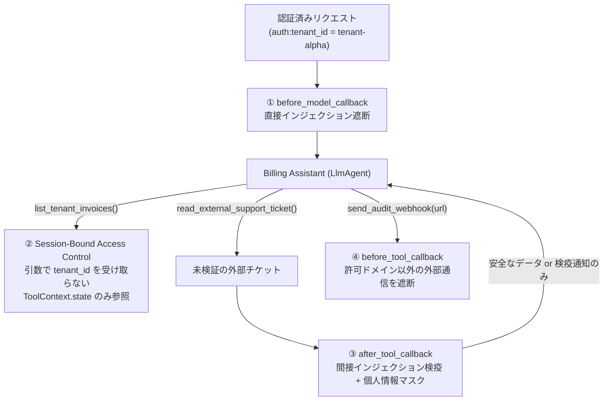

# PROD-03: Guardrails & Context Isolation パターン

## 概念

**Guardrails & Context Isolation（入出力ガードレールと最小権限コンテキスト分離）** は、ADK の横断プラグイン（`BasePlugin`）とセッション束縛型ツール設計を組み合わせ、**「機密データの参照範囲の制限」「未検証外部入力の検疫」「外部送信先のホワイトリスト制限」をプロンプトではなくコード境界で強制するセキュリティパターン**です。

1 つのエージェントが「機密データへのアクセス」「外部から届いた未検証テキストの読み取り」「外部 URL への送信ツール」の 3 つを無制限に同時に持つと、外部テキスト内に埋め込まれた隠し命令（間接プロンプトインジェクション）によって機密データが外部サーバーへ送信されるリスクが生じます。LLM にとってシステムプロンプトもツールの戻り値も同じトークン列であるため、プロンプトの注意書きだけで防ぐのではなく、ライフサイクルの各フックで決定論的に遮断します。



## いつ使うか

✅ **適している場合:**
- マルチテナント SaaS や顧客サポートシステムなど、他テナント・他ユーザーのデータが絶対に混入してはならない環境
- メール本文・問い合わせフォーム・外部 Web ページなど、信頼できない第三者のテキストをツール経由で読み取るエージェント
- Webhook や API 呼び出しなど外部通信を行うツールを持つエージェント

❌ **不向きな場合・できないこと:**
- **正規表現ルール単体では未知の自然な言い換えによる命令注入を 100% 検出することはできない**: パターンマッチは既知の攻撃構文や不可視制御文字を高速（1ms 未満）に遮断できますが、巧妙に言い換えられた間接指示を見逃す可能性があります。そのため本番では、① Google Cloud Model Armor 等の専用分類器プラグインの併用と、②「仮にプロンプト層が突破されても、セッション束縛アクセス制御と送信先許可リストによって情報漏洩が成立しない」多層防御（Defense in Depth）を必ず組み合わせる必要があります

## Single Agent のプロンプト制約との違い

| 観点 | プロンプトによる指示のみ (`patterns/p01`) | Guardrails & Context Isolation (`prod03`) |
|---|---|---|
| テナント分離 | LLM が引数 `tenant_id` を正しく渡す前提（詐称に脆弱） | ツール引数から `tenant_id` を排除し、`ToolContext.state` に固定 |
| 外部データ経由の攻撃 | ツール戻り値が無検査で LLM コンテキストに入る | `after_tool_callback` が LLM 到達前に検疫・マスク |
| 不正 URL への外部送信 | LLM が騙されると任意 URL へ送信しうる | `before_tool_callback` が許可ホスト以外をツール実行前に遮断 |
| 適用漏れリスク | エージェント追加時に書き忘れが起きやすい | `App(plugins=[...])` により配下の全エージェント・全ツールへ自動適用 |

## このデモのユースケース

**マルチテナント請求照会・問い合わせチケット確認エージェント**

認証済みセッション（`tenant-alpha`）の請求情報のみを返し、外部サポートチケットに悪意ある命令上書きと攻撃者サーバーへの送信指示が含まれていた場合（`TKT-666`）はツール出力段階で検疫し、さらに未許可ドメインへの Webhook 送信も遮断します。

## アーキテクチャと実装のポイント

### 1. セッション束縛型アクセス制御（Row-Level Security）

`list_tenant_invoices` ツールの関数シグネチャには、あえて `tenant_id` 引数を用意していません。サーバー側の認証ミドルウェアがセッション生成時に設定した `tool_context.state["auth:tenant_id"]` のみを参照し、未設定時は空配列ではなく `PERMISSION_DENIED` で即座に拒否（Fail-Closed）します。

### 2. `SecurityGuardrailsPlugin` による 4 段階ライフサイクル保護

ADK 公式の [Callbacks Design Patterns — Guardrails & Policy Enforcement](https://adk.dev/callbacks/design-patterns-and-best-practices/) に従い、`BasePlugin` の 4 フックで境界を制御します。
- `before_model_callback`: ユーザー入力の命令上書き構文を検査し、違反時は `LlmResponse` を直接返して LLM 呼び出し自体をスキップ
- `before_tool_callback`: `destination_url` が HTTPS かつ `ALLOWED_EGRESS_HOSTS` に含まれるかを検証
- `after_tool_callback`: ツール戻り値内の間接インジェクションを検疫し、メールアドレス・カード番号・シークレット文字列を `[REDACTED_*]` に置換
- `after_model_callback`: 最終応答テキストに残存する機密パターンを再マスク

### 3. Google Cloud Model Armor との併用時の注意点

本番環境では `App(plugins=[...])` に `google.adk.integrations.model_armor.ModelArmorPlugin` を追加できます。`gemini-3.8-flash` は `GOOGLE_CLOUD_LOCATION=global` エンドポイントを使用しますが、Model Armor API は `us-central1` 等のリージョンエンドポイントを使用するため、それぞれのロケーション設定を分離し、ユーザー入力だけでなくツール出力検査も有効化してください。

## トレードオフ

| 観点 | 評価 |
|---|---|
| コスト | 🟢 低（インプロセス規則検査は追加 API 費用ゼロ、Model Armor 併用時は検査単価のみ） |
| レイテンシ | 🟢 低（インラインコールバックは数ミリ秒以下） |
| 複雑性 | 🟡 中（認証コンテキスト連携と許可ドメイン設計が必要） |
| セキュリティ強度 | 🟢 最高（プロンプト突破時でもクロステナント参照と外部流出が構造的に不成立） |

## 実行方法

```bash
# 1. 単体テスト（RLS 境界・間接インジェクション検疫・外部送信遮断・PII マスクを検証）
.venv/bin/pytest tests/unit/test_production_patterns.py -k "Prod03" -v

# 2. デモ実行（GOOGLE_CLOUD_PROJECT 設定時）
PYTHONPATH=. .venv/bin/python production_patterns/prod03_guardrails_context_isolation/demo.py
```

## 学習ポイント

1. LLM に権限識別子（`tenant_id` / `user_id`）を引数指定させず、`ToolContext.state` から取得する最小権限ツール設計
2. `BasePlugin` の `before_tool_callback` / `after_tool_callback` による横断的な入出力検疫
3. プロンプト層の防御が突破される前提で被害範囲を封じ込める多層防御アーキテクチャ

## 次のステップ

→ **[PROD-04: Model Cascade パターン](../prod04_model_cascade/)**: 安全性境界を保ったまま、軽量モデルと上位モデルを段階的に組み合わせて推論コストとレイテンシを最適化する
