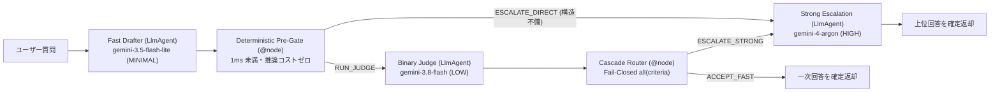

# PROD-04: Model Cascade パターン

## 概念

**Model Cascade（段階的モデルエスカレーション）** は、まず低遅延・低単価な軽量モデル（例: `gemini-3.5-flash-lite`）で一次回答を生成し、決定論的な事前検査と校正済みの二値審査モデル（Judge: `gemini-3.8-flash`）を通過した場合はそのまま即答し、品質基準を満たさない難問だけを最上位推論モデル（`gemini-4-argon` / 高思考レベル `HIGH`）へ段階的にエスカレーションするデザインパターンです。

単一モデル構成では「全件に上位モデルを使って定型質問のレイテンシと推論費が増大する」か「全件を軽量モデルにして複雑な問い合わせで品質低下を招く」かの二択になります。本パターンでは以下の 3 要素を組み合わせることで、品質とコスト・応答速度のバランスを最適化します。

1. **決定論的 Pre-Gate（ミリ秒・推論コストゼロ）**: 文字数不足や未完成マーカーを含む一次出力は、審査モデルすら呼ばずに直接上位モデルへ転送する。
2. **二値ルーブリックによる Fail-Closed 審査**: 審査モデルには曖昧な 5 段階評価ではなく具体的な真偽値（Boolean）項目のみを出力させ、Python 側の `all(...)` で合否を確定する。
3. **Rogan–Gladen 補正と解決 1 件あたり実効コスト評価**: 審査モデル自身の採点誤差（感度・特異度）を統計的に補正し、真の解決率と経済性を定量評価する。



## いつ使うか

✅ **適している場合:**
- 本番トラフィックの大多数（例: 70〜85%）が定型的な質問であり、残り 15〜30% に深い推論を要する複雑な質問が混在するワークロード
- 1 リクエストあたりの平均単価だけでなく、「真に課題を解決できた 1 件あたりの実効コスト」を最小化したい場合

❌ **不向きな場合・できないこと:**
- **エスカレーション発生時の応答時間は単一モデル直呼び出しより長くなる**: `Fast → Judge → Strong` と直列に実行されるため、最初から大半が難問だと分かっている専門バッチ処理（エスカレーション率が概ね 70% を超える領域）では、カスケードにせず最初から上位モデルを直接呼ぶ方が低遅延・低コストになる
- **根拠データなしの事実誤認までは検出できない**: 審査モデルに質問文と回答文だけを渡しても、外部知識が必要なハルシネーションは見抜けない。事実整合性を審査する場合は、検索結果やツール出力も審査プロンプトへ渡す必要がある

## Coordinator (Lv.8) との違い

| 観点 | Coordinator (`patterns/p08_coordinator`) | Model Cascade (`prod04`) |
|---|---|---|
| ルーティングのタイミング | **事前分岐**（入力質問だけを見て担当エージェントを1つ選ぶ） | **事後品質分岐**（軽量モデルの実際の出力品質を見てエスカレーションするか決める） |
| 難易度の事前予測 | 必要（一見短いが実は難しい質問で誤ルーティングしやすい） | **不要**（実際に解かせてみて基準未達なら上位モデルが引き継ぐ） |
| 審査器の採点誤差補正 | なし | **Rogan–Gladen 推定量**で偽陽性・偽陰性を補正 |

## このデモのユースケース

**クラウド技術サポートの二段階応答ワークフロー**

定型的な実装手順の問い合わせ（例: HTTP 429 エラー時の指数バックオフ実装）は `gemini-3.5-flash-lite` で即答し、回答が不十分な場合のみ `gemini-4-argon`（`HIGH` 思考）へ自動エスカレーションします。あわせて、審査モデルの感度・特異度から真の合格率と実効コストを算出します。

## アーキテクチャと実装のポイント

### 1. Rogan–Gladen 推定量による審査バイアスの補正（基礎からの導出）

審査モデル（Judge）も確率モデルであり、100% 正確ではありません。人間がラベル付けした検証データで審査モデルを事前にテストすると、次の 2 つの指標が測定できます。
- **感度（Sensitivity）** $q_1$: 本当に正しい回答を、審査モデルが正しく合格（PASS）と判定できる確率
- **特異度（Specificity）** $q_0$: 本当は不十分な回答を、審査モデルが正しく不合格（FAIL）と見抜ける確率

本番トラフィックにおける **真の合格率** を $\theta$ とすると、審査モデルが合格を出す観測割合 $p_{\text{obs}}$ は「真に正しい回答を見抜いた割合」と「不十分な回答を見逃した偽陽性 ($1 - q_0$)」の和になります。

$$
p_{\text{obs}} = \theta \cdot q_1 + (1 - \theta)(1 - q_0)
$$

この一次方程式を $\theta$ について解くと、採点誤差を取り除いた **真の合格率の推定値** $\hat{\theta}$（Rogan–Gladen 推定量）が得られます。

$$
\hat{\theta} = \mathrm{clip}_{[0, 1]}\left(\frac{p_{\text{obs}} + q_0 - 1}{q_1 + q_0 - 1}\right)
$$

> [!IMPORTANT]
> 分母の $J = q_1 + q_0 - 1$ は **Youden の J 統計量** と呼ばれます。 $q_1 + q_0 \le 1$ の審査器はランダム当て推量以下の識別力しか持たないため、`rogan_gladen_estimate` は `ValueError` を送出して誤用を防止します。

### 2. 解決 1 件あたり実効コスト（Effective Cost per Solved Task）

見かけの平均 API 単価が下がっても、未解決のまま顧客へ返却される割合が増えれば再問い合わせで総コストは悪化します。`evaluate_cascade_economics` では、Pre-Gate 通過率 $r_{\text{pre}}$ と審査誤差を踏まえた「真に解決された 1 件あたりの実効コスト」を計算します。

$$
E[\text{Cost}] = C_{\text{fast}} + r_{\text{pre}} \cdot C_{\text{judge}} + (1 - r_{\text{pre}} \cdot p_{\text{obs}}) \cdot C_{\text{strong}}
$$

$$
\text{Effective Cost per Solved Task} = \frac{E[\text{Cost}]}{P(\text{Truly Solved})}
$$

## トレードオフ

| 観点 | 評価 |
|---|---|
| コスト | 🟢 低（定型比率が高いほど全件上位モデル比で大幅に削減） |
| レイテンシ | 🟡 定型時は高速、エスカレーション発生時のみ直列呼び出し分増加 |
| 複雑性 | 🟡 中（審査ルーブリックの設計と検証データによる $q_1, q_0$ 測定が必要） |
| 品質保証 | 🟢 高（Fail-Closed 判定と統計的バイアス補正により品質劣化を監視可能） |

## 実行方法

```bash
# 1. 単体テスト（Pre-Gate 直送・一次合格・Judge 不合格エスカレーション・Rogan-Gladen 数理検証）
.venv/bin/pytest tests/unit/test_production_patterns.py -k "Prod04" -v

# 2. デモ実行（GOOGLE_CLOUD_PROJECT 設定時）
PYTHONPATH=. .venv/bin/python production_patterns/prod04_model_cascade/demo.py
```

## 学習ポイント

1. 審査モデルの推論コストすら節約する決定論的 Pre-Gate の設計
2. 総合判定を LLM に委ねず Boolean 構造化出力をコード側で集計する Fail-Closed 審査
3. Rogan–Gladen 推定量を用いた LLM-as-a-Judge の採点誤差補正と経済性評価

## 次のステップ

→ **[PROD-05: Outcome State Evaluation パターン](../prod05_outcome_state_evaluation/)**: 応答文面ではなく「最終的な環境状態の一致」と「連続成功確率 `pass^k`」で本番リリース可否を判定するパターンを学ぶ
