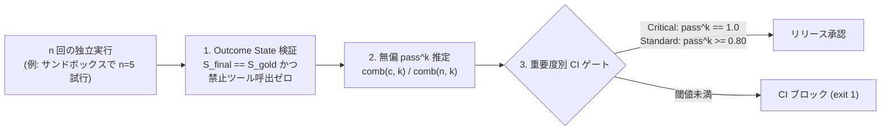

# PROD-05: Outcome State Evaluation パターン

## 概念

**Outcome State Evaluation（最終環境状態の一致検証と連続成功確率ゲート）** は、エージェントの応答文面ではなく**実行後のデータベース・セッション状態が期待状態と一致しているか（$S_{\text{final}} == S_{\text{gold}}$）および禁止ツールを呼んでいないか**を決定論的に検証し、さらに独立な反復実行に対する**連続成功確率 `pass^k`** を CI/CD リリースゲートに据えるデザインパターンです。

会話テキストだけを LLM-as-a-Judge で採点していると、「配送先を変更しました」と丁寧に回答しながら実際にはデータベースが未更新である不整合を見逃します。また、ベンチマークで多用される `Pass@k`（「$k$ 回中 1 回でも成功すれば合格」）を本番ゲートに使うと、単発成功率 80% の不安定なエージェントが見かけ上 `Pass@3 = 99.2%` と評価され、本番の単発対話で高い確率で障害を引き起こします。



## いつ使うか

✅ **適している場合:**
- 注文変更、在庫引当、設定更新、チケット起票など、外部またはセッションの状態を更新する業務エージェントのリリース判定
- モデル更新（例: 新世代モデルへの移行）やプロンプト変更時に、クリティカルな業務シナリオで「たまたま 1 回通っただけ」の回帰（リグレッション）を確実にブロックしたい場合

❌ **不向きな場合・できないこと:**
- **本番の外部 API や本番 DB に対して直接反復評価を実行することはできない**: 同一テストケースを $n$ 回実行するため、副作用の漏洩やレート制限が発生する。必ずインメモリのフェイク DB またはトランザクションロールバック可能な検証環境に対して実行する
- **状態変化を伴わない純粋な要約・翻訳タスクには状態比較は適用できない**: 副作用を持たない文章生成タスクでは、[`cli02_evaluation_gate`](../../agents_cli_patterns/cli02_evaluation_gate/) や [`prod04_model_cascade`](../prod04_model_cascade/) の構造化ルーブリック審査を使用する

## CLI-02 Evaluation Gate との違い

| 観点 | Evaluation Gate (`cli02_evaluation_gate`) | Outcome State Evaluation (`prod05`) |
|---|---|---|
| 主な検証対象 | 応答テキスト品質・ツール呼び出し軌跡 | **実行後の環境状態（$S_{\text{final}} == S_{\text{gold}}$）と禁止ツール不呼び出し** |
| 試行回数と統計指標 | 各テストケース 1 回実行の平均スコア | 各ケース $n$ 回独立実行による **無偏 `pass^k` と Wilson 信頼区間** |
| 重要度別の厳格度 | 全ケース共通の合格閾値 | **Critical ケースは `pass^k == 1.0`（全試行無欠陥）を必須化** |

## このデモのユースケース

**注文サポートにおける配送先住所変更の状態検証とリリース判定**

未発送（`unshipped`）の注文のみ住所を更新し、発送済み（`shipped`）の注文では管理者用強制書き換えツール（`force_override_shipped_order`）を決して呼ばずに案内することを、最終の `orders_db` 状態から検証します。さらに ADK の評価履歴 JSON（`.adk/eval_history/*.evalset_result.json`）から `pass^k` を集計してリリース可否を判定します。

## アーキテクチャと実装のポイント

### 1. 無偏 `Pass@k` と無偏 `pass^k` の違い（基礎からの導出）

各評価ケースを独立に $n$ 回（例: $n=5$）実行し、そのうち $c$ 回合格したとします。この標本から母集団の指標を偏りなく推定する**無偏推定量（Unbiased Estimator）**は、二項係数 $\binom{n}{k}$ を用いて厳密に計算できます。

- **無偏 `Pass@k`（参考指標: $k$ 回中少なくとも 1 回成功する確率）**:
  $n$ 個の結果から $k$ 個を無作為に選んだとき、「$k$ 個すべてが失敗（$n-c$ 個から選ばれる）」する確率を $1$ から引きます。

$$\widehat{\text{Pass}@k} = 1 - \frac{\binom{n - c}{k}}{\binom{n}{k}}$$

- **無偏 `pass^k`（本番ゲート指標: $k$ 回連続ですべて成功する確率）**:
  $n$ 個の結果から $k$ 個を無作為に選んだとき、「選ばれた $k$ 個すべてが成功（$c$ 個から選ばれる）」する組み合わせの比率です。

$$\widehat{\text{pass\textasciicircum}k} = \frac{\binom{c}{k}}{\binom{n}{k}} \quad (\text{ただし } c < k \text{ のときは } 0)$$

**数値で見る違い（$n = 5$ 回実行して $c = 4$ 回成功、$k = 3$ の場合）**:
- 単発成功率: $4 / 5 = 0.80$（80%）
- $\widehat{\text{Pass}@3} = 1 - \binom{1}{3}/\binom{5}{3} = 1.000$（見かけ上 100% に見える）
- $\widehat{\text{pass\textasciicircum}3} = \binom{4}{3}/\binom{5}{3} = 4 / 10 = 0.400$（**3 回連続で正しく動作する確率は 40% しかないと正確に警告できる**）

### 2. Wilson スコア信頼区間による小標本での過信防止

試行回数 $n$ が小さいとき（例: $n=5$）、単純な正規近似区間 $p \pm 1.96\sqrt{p(1-p)/n}$ は $5$ 回全勝時に区間幅ゼロ（$1.00 \pm 0.00$）となって過信を招きます。`wilson_score_interval` を用いることで、$5/5$ 全勝時でも「95% 信頼区間の下限は約 $0.566$ である」とサンプル数に応じた不確実性を定量化できます。

### 3. ADK 2.13 評価履歴 JSON の自動パース（`parse_adk_eval_history`）

PyPI 版 `google-adk 2.13.0` では `adk eval` が失敗時に終了コード `1` を返す一方、`pass^k` の組み込み集計器はまだ同梱されていません（また `adk eval` 既定の審査モデル名が旧世代のままハードコードされている箇所があるため、評価設定では現行の `gemini-3.8-flash` を明示指定する必要があります）。本パターンでは `.adk/eval_history/*.evalset_result.json` を直接集計する純粋関数を提供しています。

## トレードオフ

| 観点 | 評価 |
|---|---|
| コスト | 🟡 中（評価ケースあたり $n$ 回実行するため CI 推論コストは $n$ 倍） |
| 評価時間 | 🟡 中（並列実行で短縮可能） |
| 複雑性 | 🟡 中（サンドボックスの初期状態投入と期待状態の定義が必要） |
| リリース安全性 | 🟢 最高（文面上のハルシネーションと確率的な不安定性の双方を検出） |

## 実行方法

```bash
# 1. 単体テスト（状態一致検証・禁止ツール検出・Pass@k vs pass^k・履歴 JSON 集計）
.venv/bin/pytest tests/unit/test_production_patterns.py -k "Prod05" -v

# 2. デモ実行
PYTHONPATH=. .venv/bin/python production_patterns/prod05_outcome_state_evaluation/demo.py
```

## 学習ポイント

1. 会話文面ではなく最終環境状態（$S_{\text{final}} == S_{\text{gold}}$）を検査する決定論的オラクル設計
2. `Pass@k` と `pass^k` の数理的な違いと、クリティカル業務における `pass^k == 1.0` ゲート
3. Wilson スコア信頼区間による少ない反復回数での統計的信頼度評価

## 次のステップ

→ **[PROD-06: Context Compaction & Budget Guard パターン](../prod06_context_compaction_budget/)**: 長期対話や大容量ツール出力による $O(D^2)$ のトークン膨張を `ArtifactService` 退避と予算サーキットブレーカーで制御するパターンを学ぶ
