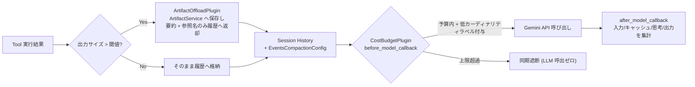

# PROD-06: Context Compaction & Budget Guard パターン

## 概念

**Context Compaction & Budget Guard（コンテキスト圧縮・退避と同期予算ガード）** は、マルチターン対話や大容量ツール呼び出しによって $O(D^2)$ で膨張するコンテキストを **① 大容量ツール出力の `ArtifactService` 外部退避** と **② `EventsCompactionConfig` による古い履歴の要約圧縮** で抑制し、さらに **③ インプロセスの同期トークン・金額サーキットブレーカー** で予算超過を即座に遮断するデザインパターンです。

LLM API は原則ステートレスであり、第 1 ターンでツールが 10,000 トークンの生ログを会話履歴へ直接返すと、第 2 ターンから第 $D$ ターンまで毎回その 10,000 トークンが再送信・再課金され、レイテンシとコストが急増します。また、クラウド請求システムの予算アラートは非同期通知であるため、無限ループや大量リクエストの暴走をその場で止める機能は持っていません。



## いつ使うか

✅ **適している場合:**
- ログ分析、SQL 実行、ドキュメント検索、API レスポンス調査など、1 回のツール出力が数 KB〜数 MB に達しうるエージェント
- 10 ターン以上の長期対話セッションで応答速度と推論コストを一定範囲内に維持したい場合
- 1 セッションあたりの最大トークン数・最大推論コスト（USD）に厳格な上限（ハードキャップ）を設けたい場合

❌ **不向きな場合・できないこと:**
- **Cloud Billing の予算アラート単体では同期遮断はできない**: Cloud Billing の予算通知（Pub/Sub 連携含む）は集計遅延を伴う非同期仕組みであり、実行中のリクエストをミリ秒単位で止めることはできない。必ずアプリケーション層（`CostBudgetPlugin` やレート制限ゲートウェイ）で同期制御を行う必要がある
- **複数プロセス・複数コンテナを跨ぐ合算予算まではインメモリ単体では強制できない**: 本デモの `CostBudgetPlugin` は 1 セッション / インプロセス単位の遮断器である。テナント全体の日次・月次予算を複数インスタンス横断で強制する場合は、Redis や Spanner 等の共有アトミックカウンタと連携させる必要がある
- **キャッシュ仕様はモデルごとに異なる**: たとえば `gemini-3.8-flash` は暗黙的キャッシュ（Implicit Caching: インメモリ + デュラブル、最小 6,144 トークン、ストレージ課金ゼロ、90% 割引）に対応しており、明示的キャッシュ作成 API の対象モデルとは運用方法が異なるため、対象モデルの公式ドキュメント仕様を必ず確認する

## ReAct (Lv.2) との違い

| 観点 | ReAct (`patterns/p02_react`) | Context Compaction & Budget Guard (`prod06`) |
|---|---|---|
| 大容量ツール出力の扱い | 全文がそのまま会話履歴に残り、後続ターンで毎回再送信される | **`ArtifactOffloadPlugin` が `ArtifactService` へ退避し、必要行のみ `read_artifact_lines` で取得** |
| 古い会話履歴の扱い | 全イベントを無制限に保持 | **`EventsCompactionConfig` がトークン閾値超過時に古い履歴を要約圧縮** |
| コスト上限・請求帰属 | 上限なし（`max_llm_calls` 既定 500 回まで継続） | **`CostBudgetPlugin` が思考トークン込みの USD 単価で同期遮断し、請求ラベル規約を検証** |

## このデモのユースケース

**本番障害ログの診断エージェント**

`fetch_incident_log_dump` が返す 120 行の構造化ログを `ArtifactOffloadPlugin` が自動的に `ArtifactService` へ退避し、エージェントは `read_artifact_lines` で該当箇所のみをページング参照します。同時に `CostBudgetPlugin` が各モデル呼び出しのトークン内訳とコストを集計し、上限到達時は即座に呼び出しを遮断します。

## アーキテクチャと実装のポイント

### 1. ステートレス対話における $O(D^2)$ 累積入力トークンの導出（`estimate_cumulative_input_tokens`）

システム指示を $T_{\text{sys}}$ トークン、各ターンの発話増分を $T_{\text{turn}}$ トークン、各ターンで履歴にそのまま残るツール出力を $T_{\text{tool}}$ トークンとすると、第 $t$ ターン（$t = 1, \dots, D$）に送信される入力トークン数は $T_{\text{sys}} + t \cdot T_{\text{turn}} + (t - 1) T_{\text{tool}}$ となります。全 $D$ ターンの累積入力トークン数は次の二次式で増大します。

$$\text{Cumulative Input Tokens}(D) = D \cdot T_{\text{sys}} + \frac{D(D + 1)}{2} T_{\text{turn}} + \frac{D(D - 1)}{2} T_{\text{tool}}$$

たとえば $D = 20$ ターン、$T_{\text{sys}} = 2{,}000$、$T_{\text{turn}} = 500$ のとき、$T_{\text{tool}} = 8{,}000$ を毎回履歴に残すと累積入力は **1,665,000 トークン** に膨れ上がりますが、`ArtifactOffloadPlugin` で要約ポインタ（$T_{\text{tool}} = 200$）へ退避すると **183,000 トークン（約 89% 削減）** に抑えられます。

### 2. 明示的キャッシュの損益分岐呼び出し回数（`calculate_cache_break_even_calls`）

明示的コンテキストキャッシュ（Explicit Caching 対応モデル）では、キャッシュ作成時の入力課金 $P_{\text{in}}$ と保持時間 $H$ 時間のストレージ課金 $H \cdot P_{\text{storage}}$ が発生する一方、各参照リクエストの入力単価が $P_{\text{cached}}$（例: 90% 割引）に下がります。キャッシュなしの $K \cdot P_{\text{in}}$ を下回る最小呼び出し回数 $K_{\min}$ は次式で求まります。

$$K_{\min} = \left\lceil \frac{P_{\text{in}} + H \cdot P_{\text{storage}}}{P_{\text{in}} - P_{\text{cached}}} \right\rceil$$

（※ 暗黙的キャッシュはストレージ課金 $P_{\text{storage}} = 0$ のため、プロンプト先頭に共通のシステム指示やスキーマを固定配置するだけで追加コストなしに割引の恩恵を受けられます。）

### 3. 思考トークンを含めた正確なコスト集計と Cloud Billing ラベル制約（`CostBudgetPlugin`）

- **思考トークンの課金計算**: Gemini の料金体系では、`candidates_token_count`（可視出力）だけでなく `thoughts_token_count`（内部思考トークン）にも**出力トークン単価**が適用されます。`CostBudgetPlugin.after_model_callback` は `cached_content_token_count` の割引分と `thoughts_token_count` の双方を正確に反映します。
- **請求ラベルの 1,000 種類上限ガード**: `GenerateContentConfig(labels=...)` に付与したラベルは Pay-as-you-go 利用時に Cloud Billing エクスポートへ連携されますが、**1 つのキーにつき請求先アカウントの存続期間を通じて一意な値は最大 1,000 個まで**という制限があります（また Provisioned Throughput 利用時は無視されます）。`validate_billing_labels` は `session_id` や `user_id` などの高カーディナリティキーを事前に拒否し、環境名（`env`）や機能名（`pattern`）などの低カーディナリティ属性のみを許可します。

## トレードオフ

| 観点 | 評価 |
|---|---|
| コスト | 🟢 最小（大容量出力の再送信排除と同期キャップにより予測可能） |
| レイテンシ | 🟢 低（コンテキスト長が抑えられるため後半ターンの TTFT 悪化を防止） |
| 複雑性 | 🟡 中（`Runner` への `ArtifactService` 設定とページング取得ツールの用意が必要） |
| 情報網羅性 | 🟡 ツール出力全文を一度に見ないため、エージェントが必要箇所をページング取得する 1 ステップが増える場合がある |

## 実行方法

```bash
# 1. 単体テスト（O(D^2) 計算・Artifact 自動退避とページング読込・予算超過遮断・ラベル規約検証）
.venv/bin/pytest tests/unit/test_production_patterns.py -k "Prod06" -v

# 2. デモ実行（GOOGLE_CLOUD_PROJECT 設定時）
PYTHONPATH=. .venv/bin/python production_patterns/prod06_context_compaction_budget/demo.py
```

## 学習ポイント

1. ステートレス LLM 対話における $O(D^2)$ トークン増加の仕組みと、`ArtifactService` 外部退避による解決
2. `EventsCompactionConfig` と `ArtifactOffloadPlugin` の役割分担
3. `thoughts_token_count` とキャッシュ割引を含めたインプロセス同期予算遮断器と Cloud Billing ラベル設計

## 次のステップ

→ **[Production Patterns 一覧に戻る](../README.md)**: 6 つの本番運用デザインパターンの全体像と組み合わせ方を確認する
