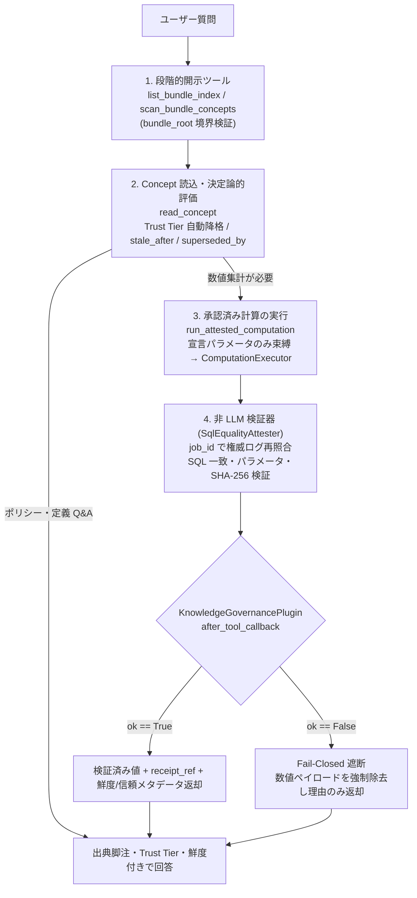

# PROD-07: Governed Knowledge & Attested Computation パターン

## 概念

**Governed Knowledge & Attested Computation (ガバナンス付き知識参照と検証済み計算)** は、[Open Knowledge Format (OKF) v0.3](https://github.com/open-knowledge-format/open-knowledge-format/blob/main/SPEC.md) に準拠した Markdown と YAML フロントマターの知識バンドルを対象に、**1. 段階的開示 (Progressive Disclosure) による安全な探索**、**2. 信頼ティア・鮮度・廃止転送・競合解決の決定論的評価**、**3. 非 LLM 検証器 (Attester) による `Attested Computation` の Fail-Closed 実行**を本番ランタイムで強制するデザインパターンです。

一般的な RAG は検索スコア上位のテキスト断片をそのまま LLM へ渡すため、「人間がレビューした後にエージェントが書き換えた未確認ドキュメント」「すでに廃止された旧基準」「期限切れのメトリクス定義」「LLM が勝手に書き換えた集計 SQL」を検出できず、もっともらしい誤答を返してしまいます。本パターンは、それらの判定をプロンプト任せにせず、決定論的コードと ADK `BasePlugin` で実行時に保証します。



## いつ使うか

✅ **適している場合:**
- 財務指標 (売上・粗利)、社内規定、運用プレイブック、データカタログなど、**定義の鮮度・レビュー状態・出典・集計ロジックの厳密さ**が求められるエンタープライズ業務エージェント
- 人間と複数のエージェントが Git リポジトリ上の知識コーパスを継続的に共同編集しており、エージェント改訂後の未確認ドキュメントを自動で `unverified` へ降格させたい場合
- LLM に SQL や計算式をアドホック生成させず、承認済み SQL にパラメータのみ渡して実行し、改ざんや逸脱を非 LLM コードで確実に遮断したい場合

❌ **不向きな場合・できないこと:**
- **数万件の非構造化文書 (PDF・問い合わせログ・議事録) を横断検索する用途には単体で不向き**: ディレクトリとフロントマターを辿る段階的探索は大量文書の全文意味検索を置き換えません。大規模探索は [`CLI-04: Grounded RAG`](../../agents_cli_patterns/cli04_grounded_rag_deploy/) (Agent Search / ベクトル検索) を使い、確定的な業務定義や計算ルールを OKF バンドルで管理する併用設計が適しています
- **OKF の Trust Tier はアクセス制御 (ACL) ではない (OKF §5.3)**: Trust Tier (`human-reviewed` / `machine-confirmed` / `unverified`) は読み手への助言シグナルであり、閲覧認可を強制する機能はありません。マルチテナントや機密区分ごとのアクセス制御には [`PROD-03: Guardrails & Context Isolation`](../prod03_guardrails_context_isolation/) のセッション束縛認可を併用してください
- **OKF v0.3 は 1.0 未満であり、Attestation のワイヤプロトコルと Attester ABI は先送り仕様 (§12.2)**: 現時点でレシート形式や Attester 実行サンドボックスは標準化途上です。本パターンでは `ComputationExecutor` / `ComputationAttester` Protocol として疎結合に抽象化しており、将来仕様が確定した際もアダプタ層の差し替えで追従できます

## CLI-04 (`Grounded RAG`) との違い

| 観点 | Grounded RAG (`agents_cli_patterns/cli04`) | Governed Knowledge & Attested Computation (`prod07`) |
|---|---|---|
| 知識の形式と探索 | フラットなチャンク集合に対するトップ k 検索 | `index.md` と相対リンクによる段階的開示 (必要 Concept のみ読込) |
| 信頼性・改訂管理 | 静的な出典 ID 付与のみ | `verified[].at >= generated.at` による Trust Tier 自動算出・自動降格 |
| 鮮度・廃止の扱い | 検索バックエンド側の再インデックス依存 | `stale_after` による期限警告、`status: deprecated` → `superseded_by` 自動転送 |
| 数値計算の保証 | テキスト検索のみで集計実行は対象外 | 宣言パラメータ束縛 + 非 LLM `Attester` による権威ジョブ照合と Fail-Closed 遮断 |

## このデモのユースケース

**小売・EC 事業向けの財務指標・社内ポリシー参照エージェント (`bundle/`)**

同梱の OKF v0.3 サンプルバンドル ([`bundle/`](bundle/)) には、意図的に異なるガバナンス状態の Concept を配置しています。

| Concept ID | `type` | 算出される Trust Tier | `status` | 鮮度・挙動 |
|---|---|---|---|---|
| `metrics/income_statement` | `Metric` | `human-reviewed` | `stable` | 鮮度内。2つの承認済み計算へリンク |
| `computations/recognized_revenue` | `Attested Computation` | `human-reviewed` | `stable` | 鮮度内。SQLite 実行 + 非 LLM 検証成功 |
| `computations/gross_profit` | `Attested Computation` | `machine-confirmed` | `stable` | `stale_after` 超過 (検証成功しつつ鮮度警告を出力) |
| `policies/revenue_recognition` | `Policy` | `human-reviewed` | `stable` | 現行ポリシー (廃止ドキュメントの転送先) |
| `policies/legacy_margin_policy` | `Policy` | `human-reviewed` | `deprecated` | `superseded_by` により `policies/revenue_recognition` へ自動転送 |
| `policies/discount_approval` | `Policy` | `unverified` | `stable` | 人間承認後にエージェントが更新したため v0.3 ルールで自動降格 |

また、バンドルルートには `type` フロントマターを持たない [`bundle/README.md`](bundle/README.md) を配置しており、OKF v0.3 §3.2 規約に従い安全にスキップされることも確認できます。

## アーキテクチャと実装のポイント

### 1. OKF v0.3 準拠パーサと境界防御 (`okf_bundle.py`)

- **現行検証のみを有効とする Trust Tier 算出 (§5.3)**: `compute_trust_tier` は `verified[].at >= generated.at` の検証イベントだけを集計し、`human:<id>` のみ `human-reviewed` を付与します (`team:` や `process:` は `machine-confirmed`)。古い検証履歴は消さずに保持し、`verified_before_last_change: true` として呼び出し元へ通知します。
- **厳格なパス境界チェック (§3.2, §6)**: `resolve_path` と `_assert_within_root` は URI スキーム・`/` 起点・ファイル相対パスを統一解決しつつ、パーセントデコードおよびシンボリックリンク解決後に `bundle_root` 外へ出る参照をすべて `PathTraversalError` で遮断します。
- **寛容な消費と決定論的競合解決 (§11.2)**: 未知キーや未知の `type`、単一値スカラーのリスト項目をエラーにせず正規化します。複数 Concept が競合した際は `resolve_concept_conflict` が「1. 現行ステータス → 2. 信頼ティア → 3. 鮮度 → 4. `generated.at` の新しさ」の 4段階で決定論的に勝者を決めます。

### 2. `ComputationExecutor` Protocol と非 LLM 検証器 (`attestation.py`)

- **パラメータのみの型付きインターフェース (§10.2, §10.3)**: `validate_and_bind_parameters` は未宣言キーの混入や型不一致 (Python で `bool` が `int` のサブクラスである落とし穴を含む) を拒否し、LLM が SQL を生成・改変できない構造を強制します。
- **権威ジョブログによる独立再照合 (§10.5)**: 既定の `SqliteComputationExecutor` はインメモリ SQLite で名前付きパラメータ SQL を実行して `job_id` と結果の SHA-256 ダイジェストを記録します。`SqlEqualityAttester` はエージェントの説明文ではなく `executor.get_job_record(job_id)` を直接再参照し、承認済み SQL・束縛パラメータ・結果ダイジェストの完全一致を確認します。本番環境では `ComputationExecutor` Protocol を BigQuery や dbt 実装に差し替えます。

### 3. `KnowledgeGovernancePlugin` による多層 Fail-Closed (`agent.py`)

仮にカスタム実行器にバグがあり、`attestation_ok: false` にもかかわらず数値フィールド (`rows`, `value`, `result` 等) を含めて返却した場合でも、`KnowledgeGovernancePlugin.after_tool_callback` が該当キーを確定的に除去し、`value_redacted_fail_closed: true` と監査ログを記録します。

### 4. 公式 Agent Skills (`okf-generate` / `okf-consume`) との役割分担

OKF v0.3 公式リポジトリで配布される `okf-generate` / `okf-consume` はコーディングエージェント向けの対話スキルです。一方、`PROD-07` は **本番アプリケーション内で稼働する ADK エージェントに対し、Python コードと `BasePlugin` で検証ルールと Fail-Closed 遮断を強制するランタイム実装パターン**として位置づけます。開発・知識整備フェーズで `okf-generate` により Git 上の OKF バンドルを更新し、本番サービスでは `PROD-07` 構成の ADK エージェントがそれを安全に消費する流れで補完し合います。

## トレードオフ

| 観点 | 評価 |
|---|---|
| コスト | 🟢 低 (`index.md` とフロントマターのスキャンで必要 Concept のみ読み込むため入力トークンを抑制) |
| レイテンシ | 🟡 中 (段階的探索と承認済み計算の 2〜3 ステップのツール呼び出しが発生) |
| 複雑性 | 🟡 中 (OKF バンドルの Git 運用・レビュー手順と Executor / Attester の整備が必要) |
| 監査性・正確性 | 🟢 高い (信頼ティア・鮮度・出典脚注・非 LLM 検証レシートがすべて構造化記録される) |

## 実行方法

```bash
# 1. 単体・インプロセス結合テスト (Trust Tier 自動降格・廃止転送・鮮度警告・パストラバーサル拒否・SQL 改ざん Fail-Closed)
.venv/bin/pytest tests/unit/test_production_patterns.py -k "Prod07" -v

# 2. デモ実行 (GOOGLE_CLOUD_PROJECT 設定時)
PYTHONPATH=. .venv/bin/python production_patterns/prod07_governed_knowledge_attestation/demo.py
```

## 学習ポイント

1. OKF v0.3 の段階的開示 (`index.md` + フロントマタースキャン) と `bundle_root` 境界保護の実装
2. エージェント編集に追従する Trust Tier 自動降格 (`verified[].at >= generated.at`)、`stale_after` 鮮度判定、`superseded_by` 転送の決定論的評価
3. LLM に SQL を書かせずパラメータ束縛 + 非 LLM Attester + `BasePlugin` で Fail-Closed を強制する `Attested Computation` の設計

## 次のステップ

→ **[PROD-08: AI Gateway Mediation パターン](../prod08_ai_gateway_mediation/)**: 複数エージェント・複数テナントを横断する資格情報隔離、トークン基準レート制限と優先度シェディング、サーキットブレーカー自動フェイルオーバーおよびプレフィックス親和性ルーティングを学ぶ
