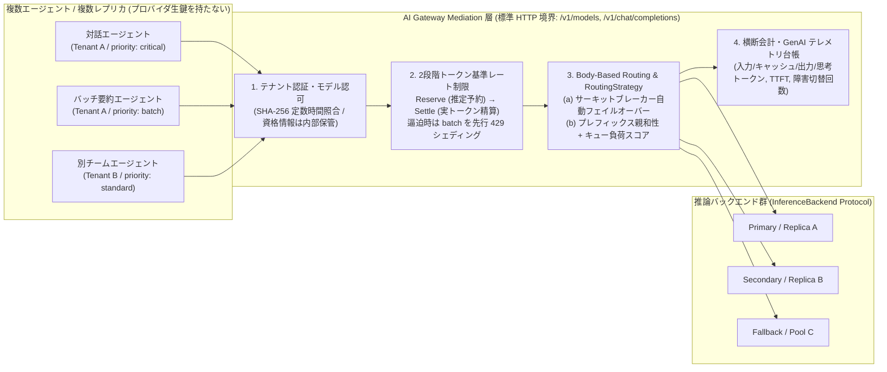

# PROD-08: AI Gateway Mediation パターン

## 概念

**AI Gateway Mediation (AI ゲートウェイ仲介・マルチテナント推論統制)** は、複数のエージェントアプリケーション・複数レプリカ・複数テナントから推論バックエンドへ向かうトラフィックを、**単一の標準 HTTP 仲介層 (AI Gateway)** で集約統制するデザインパターンです。

単一エージェントプロセス内のプラグイン (`PROD-03`, `PROD-06`) だけでは、複数レプリカや複数チームを跨ぐ共有クォータ管理、プロバイダ資格情報の隔離、バックエンド障害時の横断フェイルオーバー、複数テナント間の優先度制御を実現できません。本パターンでは、エージェント本体から推論インフラの詳細と生の資格情報を完全に切り離し、**1. テナント認証・モデル認可と資格情報隔離**、**2. モデル一覧公開とリクエスト本文ベースルーティング**、**3. 2段階トークン基準レート制限と優先度シェディング**、**4. 差し替え可能なバックエンド選出戦略**、**5. 横断的な OpenTelemetry GenAI 準拠の会計・可観測性**をプロセス外境界の契約として定義します。



## いつ使うか

✅ **適している場合:**
- 複数チーム・複数エージェントが共通の推論インフラや外部モデル枠を共有しており、1つのバッチジョブや特定テナントによるトークン枯渇・独占を防ぎたい場合
- 各エージェントコンテナへプロバイダ API キーや物理エンドポイント設定を直接配布せず、資格情報の保管・ローテーション・監査をプラットフォーム側へ集約したい場合
- 推論バックエンド側の一時障害 (`429` / `503`) 時にアプリケーションコードを書き換えずにセカンダリへ自動切替したい場合、または共有推論プール上でプロンプトキャッシュ親和性と負荷に応じた振り分けを行いたい場合

❌ **不向きな場合・できないこと:**
- **本リポジトリの FastAPI 実装は本番の高速 L7 データプレーンそのものではない**: 本パターンの Python / FastAPI 実装は、ゲートウェイ境界の契約・状態機械・責務分離を検証するための実行可能リファレンスです。数千 RPS や大規模ストリーミングを低オーバーヘッドで処理する本番環境では、専用の L7 リバースプロキシやマネージド API ゲートウェイへ同等の契約を委譲してください
- **単一プロセスのインメモリ台帳では複数ゲートウェイインスタンス間のレート制限は共有できない**: ゲートウェイ自体を水平スケールする本番構成では、`TokenRateLimiter` の状態バックエンドを共有インメモリデータストア等へ外出ししてアトミック更新する必要があります
- **推論サーバー内部のライブキャッシュ索引・キュー状態の収集は外部連携が前提**: プレフィックス親和性・負荷認識ルーティングをセルフホスト推論クラスタで実運用するには、推論サーバー側から公開される待機キュー長やキャッシュメトリクスをゲートウェイのエンドポイント選出器へ継続連携する仕組みが必要です
- **セッション内部の業務文脈に依存する制御はアプリ層に残すべき**: ツール引数の業務検証 (`PROD-01`)、ツール出力のセッション内検疫 (`PROD-03`)、回答品質の意味的判定 (`PROD-04`)、会話履歴の要約圧縮 (`PROD-06`) はエージェント内部状態を知る必要があるため、ゲートウェイ層へ無理に移さず併用してください

## アプリケーション層 (`PROD-03` / `04` / `06`) との責務比較

| 観点 | アプリケーション層 (インプロセス: `PROD-03` / `04` / `06`) | AI Gateway 層 (プロセス外共有境界: `PROD-08`) |
|---|---|---|
| 制御単位 | 1エージェント・1セッション・1プロセス内 | 複数エージェント・複数レプリカ・複数テナント横断 |
| 予算・レート制御 | 1セッションの暴走停止 (`PROD-06`) | テナント・共有プール横断の重み付きトークン制限 + 優先度シェディング |
| モデル選択の根拠 | タスク難易度・回答品質の意味的判定 (`PROD-04`) | Body-Based Routing、障害サーキットブレーカー、キャッシュ親和性・負荷スコア |
| 資格情報・セキュリティ | ツール引数と外部送信の検疫 (`PROD-03`) | プロバイダ資格情報の隔離、テナント認証・モデル認可、統一監査ログ |
| 可観測性 | アプリ固有の実行ログ | 全エージェント横断の GenAI 標準メトリクスとチャージバック会計 |

## このデモのユースケース

**マルチテナント推論仲介ゲートウェイ (`demo.py`)**

1. **Part 1 (オフライン HTTP 実証)**: インプロセス HTTP (`httpx.ASGITransport`) 上で、`GET /v1/models` によるテナント認可済みモデル探索、`503` 障害からの自動フェイルオーバー、プレフィックスキャッシュ親和性とキュー長によるバックエンド選出、共有枠逼迫時の `batch` 先行 `429` シェディングと `critical` 対話保護を一括検証します。
2. **Part 2 (実モデル結合実証)**: ADK エージェントはプロバイダ生鍵を持たずに `GatewayClientLlm` 経由で論理モデル `tier:standard` を呼び出し、AI Gateway 背後の実モデルバックエンド (`GeminiInferenceBackend`) が推論とトークン会計を完了します。

## アーキテクチャと実装のポイント

### 1. 2段階トークン基準レート制限 (`Reserve -> Settle`, `gateway.py`)

推論 API では 1リクエストあたりの計算量がプロンプト長・出力長・思考トークン数によって数百倍異なるため、従来のリクエスト回数 (RPM) 制限ではバックエンドを守れません。さらに、事前チェックだけでは同時到着した複数リクエストが枠をすり抜ける競合 (TOCTOU) が起きます。

本パターンの `TokenRateLimiter` は `asyncio.Lock` 下で次を実行します。

1. **Reserve (呼出前予約)**: 入力テキスト長から推定トークン量をアトミック予約します。テナント枠または共有プール枠の利用率が `shedding_utilization_threshold` を超えた状態では、`priority == "batch"` を先行して `HTTP 429` (`X-RateLimit-*`, `Retry-After`) で遮断し、`critical` 対話用の余力を確保します。
2. **Settle (応答後精算)**: レスポンス確定後に、入力・キャッシュ読込・出力・思考トークンへ重み係数 (`TokenCostWeights`) を掛けた実効トークン消費量で予約分を精算します (バックエンド障害時は予約分を 0 として解放)。

### 2. 差し替え可能な 2つのルーティング戦略 (`routing.py`)

`RoutingStrategy` Protocol の背後に、クラウド API 向けとセルフホスト推論プール向けの 2戦略を実装しています。

- **`FailoverRoutingStrategy`**: 一時障害 (`429`, `502`, `503`, `504`) が閾値回連続すると対象バックエンドのサーキットを開放し、自動で次優先バックエンドへ切替えます。クライアント起因の `400` 等はサーキットを開放せず即返却し、一定時間経過後は回復確認 (ハーフオープン) を行います。
- **`PrefixLoadAwareRoutingStrategy`**: 共有推論プール上の各レプリカについて、プロンプト先頭プレフィックス一致率と正規化キュー長から次式のスコアを算出し、キュー飽和レプリカを除外したうえで最高スコアのレプリカを選出します。

$$
S(b) = w_{\text{prefix}} \cdot \operatorname{prefix\_hit}(b) - w_{\text{load}} \cdot \frac{q_b}{q_{\max}}
$$

### 3. エージェント側からの資格情報隔離 (`agent.py`)

`GatewayClientLlm` はゲートウェイ発行のテナントトークンと論理モデル名 (`tier:standard` 等) だけを保持し、物理モデル名やプロバイダ資格情報はゲートウェイ内部の `BackendEndpoint` / `InferenceBackend` に閉じ込めています。これにより、エージェントコンテナ側が侵害されてもプロバイダ生鍵が露出せず、モデル移行や障害切替もゲートウェイ側の設定変更だけで完結します。

## トレードオフ

| 観点 | 評価 |
|---|---|
| 統制・ガバナンス | 🟢 高い (全エージェントの認証・クォータ・会計・障害切替を単一通過点で強制可能) |
| 運用・レイテンシ | 🟡 ゲートウェイ経由の 1ホップと JSON 本文解析のオーバーヘッドが増える |
| 可用性設計 | 🟡 ゲートウェイ自体が単一障害点 (SPOF) にならないよう冗長化と共有状態ストア設計が必須 |
| 移植性 | 🟢 高い (エージェント側は標準 HTTP と論理モデル名にのみ依存し、バックエンド差し替えが容易) |

## 実行方法

```bash
# 1. 単体・インプロセス HTTP 結合テスト (認証/認可・フェイルオーバー・プレフィックス選出・並列レート制限・優先度シェディング・ADK Runner E2E)
.venv/bin/pytest tests/unit/test_production_patterns.py -k "Prod08" -v

# 2. デモ実行 (Part 1 オフライン検証 + Part 2 実モデル経由実行)
PYTHONPATH=. .venv/bin/python production_patterns/prod08_ai_gateway_mediation/demo.py
```

## 学習ポイント

1. インプロセス制御 (`BasePlugin`) とプロセス外共有仲介層 (AI Gateway) の責務境界
2. 同時実行に強い 2段階トークン基準レート制限 (`Reserve -> Settle`) と優先度シェディングの実装
3. サーキットブレーカー自動フェイルオーバーと、プレフィックス親和性・キュー長スコアリングの `RoutingStrategy` 抽象化

## 次のステップ

→ **[Production Patterns 一覧に戻る](../README.md)**: 全 8つの本番運用デザインパターンの全体像と組み合わせ方を確認する
